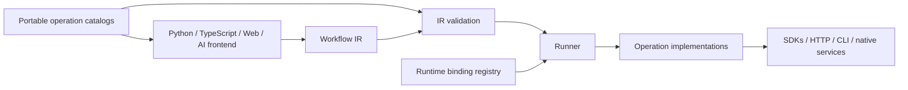

# Aixand IR v0.1 design proposal

# 1. Executive summary

**Recommend that `aixand-ir` v0.1 describe an ordered sequence of generic, versioned operation invocations.** Operations exchange immutable data and opaque runtime values through named inputs and outputs.

The core should contain:

- `Workflow`
- `Sequence`
- `Operation`
- `Literal`
- `Reference`, including an optional property/index path
- `Object` and `Array` construction expressions

Workflow inputs and outputs are declarations, not executable nodes.

The two additions to the suggested minimum—object and array construction—are necessary for payloads that combine literals and references. Separate `InputReference`, `OperationOutputReference`, and `PropertyAccess` nodes are unnecessary; one reference construct can cover them.

The operation catalog should define operation identities, exact versions, input/output contracts, and documentation. A separate runtime registry should associate those definitions with executable bindings. Neither workflows nor portable operation definitions should contain Python imports, callable names, CLI commands, HTTP endpoints, credentials, or SDK clients.

For typing, recommend a small structural type model plus a generic **opaque nominal type**. An opaque value can represent an agent handle, mailbox capability, message capability, or receipt without making any of them a core IR concept.

Three distinctions are essential:

1. **Operation completion is not necessarily application completion.**
2. **Opaque values are not necessarily owned resources.**
3. **Portable workflow definitions do not imply portable, serializable execution state.**

No source code was changed. This proposal is based on inspection of the current SDK implementations, documentation, examples, and relevant tests; no live agent workflows were executed.

# 2. Proposed architecture

## Findings from the current APIs

| Current API or value | Observed behavior | Design consequence |
|---|---|---|
| Agent Manager `Agent` | A frozen record containing managed identity and a runtime session reference. Runtime control lives elsewhere. | Do not infer “resource handle” merely from a Python class name. |
| Aixand `Agent` | A stateful composition handle containing its connection, input lock, delivery history, and optional Carrier binding. | Preserve handle identity across operations; do not serialize its implementation fields. |
| `Agent.send()` | Returns an Undercurrent `InputReceipt` after terminal delivery. It does not wait for task completion. | Give the operation a receipt output, not an answer output. |
| `Agent.wait()` | Observes stable runtime readiness. Omitted `after`, explicit `None`, and an explicit receipt have different meanings. | Preserve argument omission and package-defined handle state. |
| Aixand mailbox | Returns a native Carrier client associated with an authenticated identity. | Model the application mailbox capability; keep credentials and client management outside the workflow. |
| Carrier `Message` | Combines ordinary message fields with a client used for reply and acknowledgment methods. Acknowledgment mutates its local acknowledgment field. | Separate immutable snapshots from capabilities that perform effects. |
| Undercurrent `Session` | Explicitly a snapshot, not the owner of a process. | Represent observations as ordinary data where practical. |
| Undercurrent receipt | Immutable delivery evidence with session affinity and a possibly absent observation revision. | A receipt is not a process resource; affinity and validity remain package responsibilities. |
| Carrier JSON messages | JSON is explicitly encoded into or decoded from an ordinary text body. | Do not automatically interpret message text as typed structured data. |
| Connection cleanup | Detaches by default. Optional stopping applies to agents spawned by the scope, not attached agents. | Resource policy belongs to execution scopes and bindings. |

These conclusions follow from the [Agent Manager value definition](agent-manager/agent_manager/sdk.py#L19), [Aixand agent implementation](aixand-python/src/aixand/_agent.py#L13), [mailbox API](aixand-python/src/aixand/messaging.py#L5), [Carrier message implementation](carrier/carrier/models.py#L10), and [Undercurrent models](undercurrent/python/src/undercurrent/models.py#L5).

The examples establish two different application patterns:

- The [research example](aixand-python/examples/research.py#L9) sends two direct turns and inspects terminal output.
- The [team example](aixand-python/examples/team.py#L10) waits for an explicit correlated Carrier answer, acknowledges it, and returns its content.

The IR must represent both without conflating readiness, delivery, acknowledgment, and substantive results.

## Architecture boundary



Recommend four separate responsibilities:

| Component | Owns |
|---|---|
| `aixand-ir` | Document model, value expressions, type rules, structural and semantic validation, serialization |
| Operation catalogs | Published operation contracts and descriptive metadata |
| Runtime bindings | Implementations, SDK adaptation, resource access, credentials, implementation-specific configuration |
| Runner | Resolving bindings, invoking operations in order, retaining results, cancellation, execution-scope cleanup |

**Why:** the same document can be produced by several frontends and executed through different implementations.

**Rejected:** making the IR a serialization of Aixand Python calls. That would expose method dispatch, SDK classes, connection objects, and Python-specific lifetime behavior as permanent workflow concepts.

## Application semantics versus plumbing

Application-visible operation inputs can include:

- Provider, profile, working directory, instructions, and public messaging address.
- Task content, recipients, reply correlation, and acknowledgment.
- Explicit receipt boundaries.
- Operation-specific readiness or timeout options.

Binding configuration should contain:

- SDK clients and connection reuse.
- Carrier credentials and private receipt mailboxes.
- Inbox consumers and delivery journals.
- Undercurrent bridge configuration and revision translation.
- Input locks and background worker tasks.

An explicit application acknowledgment is a workflow operation. The private acceptance protocol used to deliver a message into an agent is integration plumbing.

# 3. IR constructs

The following are the proposed normative v0.1 constructs. Unknown fields are rejected unless explicitly allowed.

## Workflow

**Purpose:** declare a parameterized computation with an ordered body and named results.

| Required field | Meaning |
|---|---|
| `ir_version` | Exact IR format version; `"0.1"` |
| `inputs` | Map of workflow input names to input declarations |
| `body` | A `Sequence` |
| `outputs` | Map of workflow output names to output declarations |

Optional fields: `name`, `description`.

A workflow input declaration contains:

| Field | Required? | Meaning |
|---|---|---|
| `type` | Yes | Expected value type |
| `default` | No | Ordinary JSON value used when the input is absent |
| `description` | No | Documentation |

A workflow output declaration contains:

| Field | Required? | Meaning |
|---|---|---|
| `type` | Yes | Promised result type |
| `value` | Yes | Expression evaluated after the body succeeds |
| `description` | No | Documentation |

Validation and execution rules:

- An input without a default must be supplied.
- Defaults must satisfy their declared types.
- Unknown supplied workflow inputs are rejected.
- Defaults cannot contain references or opaque values.
- Outputs are evaluated only after the entire body succeeds.
- Every declared output must evaluate and satisfy its type.
- Empty input and output maps are valid.
- An empty output map means no returned application value.
- A workflow has no early-return construct in v0.1.

Workflow input omission is resolved at entry. There is no workflow-level `undefined` value.

**Why:** inputs and outputs define a stable interface suitable for any frontend. An executable `Return` node would add unnecessary control flow to a sequential first version.

## Sequence

```json
{
  "kind": "sequence",
  "steps": []
}
```

Required fields: `kind`, `steps`. No optional fields.

Rules:

- `kind` must be `"sequence"`.
- `steps` is an ordered array of `Operation` nodes.
- An empty sequence is valid.
- v0.1 permits one root sequence; nested sequences are unnecessary.

Execution:

1. Execute each step in array order.
2. Wait for that invocation to complete successfully.
3. Validate and publish its outputs.
4. Continue to the next step.

A failure stops the sequence. Later steps and workflow outputs are not evaluated.

**Why:** sequence order preserves effects even when operations have no explicit data dependency.

**Rejected:** inferring execution order from references or introducing a DAG scheduler.

## Operation

```json
{
  "kind": "operation",
  "id": "send_1",
  "operation": {
    "id": "aixand.agent.send",
    "version": "1.0.0"
  },
  "inputs": {}
}
```

Required fields: `kind`, `id`, `operation`, `inputs`. No optional fields in v0.1.

Rules:

- `id` identifies this invocation within the workflow.
- `operation.id` identifies a published operation contract.
- `operation.version` selects an exact contract version.
- `inputs` maps declared input names to expressions.
- Invocation IDs must be unique.
- Inputs must satisfy the resolved operation definition.
- An invocation does **not** redeclare its outputs.

Execution:

1. Evaluate input expressions.
2. Apply declared operation-input defaults.
3. Validate the resulting arguments.
4. Invoke the resolved binding.
5. Await completion.
6. Validate the complete named output record.
7. Publish that record under the invocation ID.

There is no implicit argument conversion, automatic retry, or implicit acknowledgment.

**Why:** output ports belong to the operation contract. Repeating them on each invocation permits inconsistencies and lets a workflow appear to invent outputs an implementation does not produce.

## Literal

```json
{
  "kind": "literal",
  "value": "Research this project"
}
```

Required fields: `kind`, `value`. No optional fields.

- `value` can contain any permitted ordinary JSON value.
- Its entire contents are data.
- An object resembling an IR expression inside a literal remains an ordinary object.
- A literal cannot construct an opaque runtime value.

## Reference

References select a workflow input or an earlier operation output.

```json
{
  "kind": "ref",
  "source": "input",
  "name": "task"
}
```

```json
{
  "kind": "ref",
  "source": "step",
  "step": "spawn_1",
  "output": "agent"
}
```

Required fields:

- Always: `kind`, `source`.
- Input source: `name`.
- Step source: `step`, `output`.

Optional field: `path`, defaulting to an empty array.

A reference reads an existing value. It does not invoke an operation, perform remote access, or wait for a future producer.

## Object construction

```json
{
  "kind": "object",
  "fields": {
    "task": {
      "kind": "ref",
      "source": "input",
      "name": "task"
    },
    "mode": {
      "kind": "literal",
      "value": "research"
    }
  }
}
```

Required fields: `kind`, `fields`. No optional fields.

Each field value is an expression. Evaluation constructs a new immutable string-keyed object. Empty objects are valid.

## Array construction

```json
{
  "kind": "array",
  "items": [
    {"kind": "literal", "value": "research"},
    {"kind": "ref", "source": "input", "name": "label"}
  ]
}
```

Required fields: `kind`, `items`. No optional fields.

Evaluation constructs an immutable array in the specified order. Empty arrays are valid.

**Why add these two constructs:** a third-party operation needs to accept payloads such as `{"title": input_title, "labels": ["research", input_label]}`. A literal plus whole-value references cannot express that.

They are construction expressions, not a general expression language.

# 4. Value/reference model

## Ordinary values

| Value | Representation and semantics |
|---|---|
| Null | JSON `null`; a present value |
| Boolean | JSON `true` or `false`; distinct from numbers |
| Integer | An exact integer within the portable safe range |
| Floating-point number | A finite binary64 number |
| String | Unicode string |
| Array | Ordered sequence of values |
| Object/map | Unordered mapping from strings to values |

Recommend the exact integer range:

```text
−9,007,199,254,740,991 through +9,007,199,254,740,991
```

Larger exact integers and exact decimal quantities require a package-defined string representation. Frontends must reject integer literals that would lose precision.

Do not preserve a distinction between JSON spellings such as `1` and `1.0`. Reject NaN and infinities. This follows a conservative interoperability profile informed by JSON’s documented numeric interoperability limits. [RFC 8259](https://www.rfc-editor.org/rfc/rfc8259)

Bytes, timestamps, decimals, sets, tuples, and language-specific objects are not additional core value kinds:

- A timestamp can use a documented string representation.
- Bytes can use an explicitly documented encoding or an opaque value.
- Reading terminal bytes as text requires a package operation with specified decoding behavior.
- A Python `Path` must be lowered to an operation-defined string representation.

## Runtime value domain

Runtime values additionally include **opaque atoms**.

Arrays and objects may contain opaque atoms when their declared types permit them. However, such a value is no longer ordinary JSON data and cannot be serialized as a JSON workflow input or result without an explicit adapter.

Ordinary data is immutable once published. Copying a reference to an opaque atom preserves its identity; it does not clone the underlying resource.

## Unified references and paths

Recommend one reference representation with a static path:

```json
{
  "kind": "ref",
  "source": "step",
  "step": "verify_1",
  "output": "result",
  "path": ["issues", 0, "message"]
}
```

Path semantics:

- A string segment selects an object key.
- A nonnegative integer segment selects an array element.
- `"0"` is an object key; `0` is an array index.
- Keys containing dots or slashes need no special expression syntax.
- Missing properties, out-of-range indexes, and traversal through null fail evaluation.
- Traversal through an opaque atom is invalid.
- No wildcard, computed index, optional chaining, interpolation, or method call exists.

The validator checks schema-known paths. Potentially absent optional properties and array indexes require runtime presence checks and should produce a diagnostic when absence cannot be excluded.

**Why:** this covers the actual access patterns without separate reference and property-access trees.

**Rejected:** strings such as `"$spawn_1.agent.address"` or `"${workflow.task}"`. They require an expression parser and escaping rules, and they obscure the distinction between ordinary strings and references.

## Missing versus null

These must remain different:

```json
"inputs": {}
```

```json
"inputs": {
  "after": {"kind": "literal", "value": null}
}
```

An omitted operation argument remains absent unless its contract supplies a default.

For the proposed Aixand wait operation:

| Argument form | Meaning |
|---|---|
| `after` omitted | Use the handle’s latest eligible direct-send receipt |
| `after: null` | Observe current readiness without a receipt boundary |
| `after: receipt reference` | Use that particular receipt |

This distinction exists in the [current implementation](aixand-python/src/aixand/_agent.py#L105) and is covered by the [composition tests](aixand-python/tests/test_composition.py#L77).

## Immutable data versus mutable resources

A message snapshot might contain:

```text
content, sender, recipient, created_at, acknowledged_at
```

Acknowledging the corresponding message must not retroactively mutate that previously published snapshot.

A later acknowledgment operation can return an acknowledgment record. A later inspection operation can return a fresh message snapshot.

**Why:** immutable operation results make references stable and understandable. Mutable resources remain reachable through their opaque handles.

# 5. Operation contract

## Identity and versioning

The operation identity is the pair:

```text
(operation ID, exact contract version)
```

Examples:

```text
aixand.agents.spawn @ 1.0.0
github.create_issue @ 1.0.0
postgres.query @ 2.0.0
browser.navigate @ 1.0.0
verifier.verify @ 1.0.0
```

These are logical identifiers, not import paths.

Recommend qualified, case-sensitive operation names consisting of lowercase dotted segments. For example:

```text
^[a-z][a-z0-9_-]*(\.[a-z][a-z0-9_-]*)+$
```

A version is an exact, immutable contract identifier. Semantic versioning is a reasonable publishing convention, but the core performs exact matching and no version-range resolution.

The operation version is independent of:

- IR format version.
- Package distribution version.
- SDK version.
- Workflow revision.
- Executable artifact version.

Changing an implementation while preserving its contract need not change the operation identity. Changing the published contract requires a new version.

## Definition shape

Each operation definition contains:

| Required field | Meaning |
|---|---|
| `id` | Qualified operation identifier |
| `version` | Exact contract version |
| `inputs` | Named input declarations |
| `outputs` | Named output declarations |

Optional fields: `title`, `description`.

Operation input declarations contain:

- Required `type`.
- Required `required` boolean.
- Optional `default`.
- Optional `description`.

Rules:

- A default is permitted only for a non-required input.
- Defaults are ordinary JSON values and must satisfy the input type.
- A non-required input without a default remains absent when omitted.
- Unknown input names are rejected.

Operation output declarations contain:

- Required `type`.
- Optional `description`.

Every declared output is present on success. A potentially unavailable result should use a nullable type. An operation with no result returns an empty output record.

An illustrative definition:

```json
{
  "id": "aixand.agent.send",
  "version": "1.0.0",
  "title": "Send input to an agent",
  "description": "Wait for input readiness and submit text. Completion confirms terminal delivery, not completion of the requested task.",
  "inputs": {
    "agent": {
      "type": {
        "kind": "opaque",
        "id": "aixand.agent",
        "version": "1"
      },
      "required": true
    },
    "text": {
      "type": {"kind": "string"},
      "required": true
    },
    "timeout": {
      "type": {"kind": "number", "nullable": true},
      "required": false,
      "description": "Seconds; omission or null uses the execution scope's configured timeout."
    }
  },
  "outputs": {
    "receipt": {
      "type": {
        "kind": "opaque",
        "id": "aixand.input_receipt",
        "version": "1"
      }
    }
  }
}
```

All operation identifiers and versions in this proposal are proposed catalog entries, not claims that such a catalog already exists.

## Behavioral contract

Signatures alone are insufficient. Each published operation must document:

- What successful completion establishes.
- Its observable side effects.
- Meaning of omitted arguments and null.
- Relevant resource-affinity requirements.
- Failure and cancellation behavior.
- Any effects that can remain uncertain.

These are contract semantics; they do not require a complex machine-readable effect system in v0.1.

For example, the send contract includes nonempty-text requirements and the fact that it updates the agent handle’s direct-send boundary. A primitive string type alone cannot capture those rules.

## Async behavior

Every invocation has one completion boundary.

A binding may be synchronous, asynchronous, local, or remote. The runner waits for its completion before advancing.

No `async` flag or `Await` node is necessary.

A completed `spawn` invocation can leave an agent process running. A completed mailbox-opening invocation can leave a live client available. A sequential workflow can therefore interact with several concurrently running external agents without containing a `Parallel` node.

## Minimum package contract

A package exposes a portable catalog:

```text
contract_version
package:
    id
    version
operations:
    [OperationDefinition, ...]
```

Optional package metadata: `title`, `description`.

The minimum participation requirement is:

1. Publish these operation definitions.
2. Provide compatible runtime bindings for at least one runner environment.

There is no mandated package manager, programming language, directory layout, entry-point mechanism, or network discovery protocol.

A package may separately provide frontend mappings, such as the mapping from a Python method to an operation identifier.

## Runtime binding metadata

Keep the following outside the portable catalog:

- Python entry points or Rust symbols.
- CLI commands and argument encoders.
- HTTP routes and transport configuration.
- Credentials and service selection.
- Resource factories, registries, and cleanup hooks.
- Opaque-value adapters.

The runtime registry associates an exact operation identity with its definition and executable binding. Missing or conflicting bindings fail preparation; the runner does not interpret the identifier as code to import.

**Why:** operation contracts should remain stable when implementation technology changes.

# 6. Type model

## Recommendation: a small structural type schema

Use a compact, explicit type descriptor rather than arbitrary JSON Schema as the connection type system.

JSON Schema should validate the *documents containing these descriptors*. The descriptors themselves form a smaller type language.

| Kind | Additional required fields | Meaning |
|---|---|---|
| `null` | None | Null |
| `boolean` | None | Boolean |
| `integer` | None | Portable exact integer |
| `number` | None | Finite binary64 number, including integers |
| `string` | None | String |
| `array` | `items` | Homogeneous array |
| `object` | `properties`, `required` | Structured object or map |
| `json` | None | Arbitrary ordinary JSON, recursively excluding opaque values |
| `opaque` | `id`, `version` | Nominal runtime value |

For non-`null`, non-`json` types, optional `nullable: true` additionally permits null.

For objects:

- `properties` maps property names to types.
- `required` lists properties guaranteed to be present.
- Optional `additional` defaults to `false`.
- `additional` can instead contain the type of additional property values.

A string-to-JSON map is:

```json
{
  "kind": "object",
  "properties": {},
  "required": [],
  "additional": {"kind": "json"}
}
```

A structured verification result is:

```json
{
  "kind": "object",
  "properties": {
    "passed": {"kind": "boolean"},
    "summary": {"kind": "string"},
    "issues": {
      "kind": "array",
      "items": {"kind": "string"}
    }
  },
  "required": ["passed", "summary", "issues"]
}
```

No inheritance, generics, arbitrary unions, recursive types, dependent types, or refinement language is needed in v0.1.

## Compatibility rules

At minimum:

- Identical scalar types are compatible.
- `integer` can flow into `number`.
- `number` cannot generally flow into `integer`.
- Boolean is never an integer.
- Nullable values cannot flow directly into non-nullable inputs.
- Arrays are checked through their element types.
- Object compatibility checks required properties, property types, and extra-property rules.
- Opaque types require exact nominal ID and version equality.
- JSON-only types can flow into `json`.
- `json` cannot automatically flow into a more specific type.
- No string-to-number or data-to-handle coercion occurs.

Literal and construction expressions can be checked directly against their target type.

A dynamic result needing a narrower contract must pass through a package operation that validates and publishes that narrower result. A workflow cannot override an operation’s declared output schema to pretend the result is more specific.

For example, generic `postgres.query` can return broadly typed rows. A schema-specific query operation can publish a more precise row type. The core does not infer SQL result schemas.

## Opaque values

Recommend:

```json
{
  "kind": "opaque",
  "id": "aixand.agent",
  "version": "1"
}
```

The core knows only:

- Nominal type identity.
- Runtime value identity.
- Whether a binding accepts the value.
- That property traversal and literal fabrication are forbidden.

It does not know whether the value represents:

- A process-related capability.
- An authenticated mailbox.
- A message bound to an identity.
- Immutable delivery evidence.
- A browser tab.
- A database transaction.

**Why choose `opaque` over `resource<T>`:** receipts are opaque domain values but are not owned resources. Resource ownership is a runtime property, not an automatic consequence of nominal typing.

## Mapping current domain values

| Current value | Recommended portable operation representation |
|---|---|
| Aixand `Agent` | Opaque handle; expose needed public facts as separate data outputs or inspection results |
| Agent Manager identity record | Selected ordinary identity data; optionally an opaque attachment capability |
| Carrier mailbox/client | Opaque mailbox capability |
| Carrier `Message` | Opaque capability for reply/ack plus an immutable data snapshot |
| Input receipt | Opaque immutable receipt token |
| Undercurrent `Session` | Ordinary observation snapshot where the package publishes a stable schema |
| Session/run ID | Ordinary string locator, interpreted within configured service context |
| Terminal bytes | Explicit encoding or opaque value; no implicit text conversion |

A package may publish a structured receipt schema if users need its fields. The recommended high-level Aixand contract keeps revision numbers private and permits passing the receipt back to `wait`.

Nominal equality does not prove that a receipt belongs to a particular agent. The binding must enforce session affinity at runtime.

Similarly, agreement on an opaque type ID does not create a universal binary ABI. Participating bindings must agree on access through the runtime’s opaque-value registry or adapters.

## Why not unrestricted JSON Schema?

Arbitrary JSON Schema is useful for data validation, but it does not directly solve:

- Opaque non-JSON values.
- Predictable static compatibility between ports.
- Capability identity and scope.
- Cross-operation resource affinity.

Starting with the small algebra makes connection checking explicit. A later version can add a bounded schema profile if real packages need richer validation.

# 7. JSON schema/serialization proposal

## Structural schemas

Publish Draft 2020-12 JSON Schemas for:

1. Workflow documents.
2. Operation catalogs.
3. Shared expression, declaration, and type-descriptor structures.

Use tagged unions for node and expression kinds, and closed objects for structural records. JSON Schema’s document-validation facilities fit this role; reference resolution and type compatibility remain semantic validation. [JSON Schema Core](https://json-schema.org/draft/2020-12/json-schema-core)

Recommended structural conventions:

- Workflow input, output, and invocation names use a restricted identifier syntax such as `^[A-Za-z_][A-Za-z0-9_-]*$`.
- Ordinary data-object keys remain arbitrary strings.
- Object key order has no semantic meaning.
- Array order is preserved.
- Duplicate JSON keys are rejected during parsing.
- Unsupported IR versions, expression kinds, and structural fields are rejected.
- References have exactly one source form.
- `path` may be omitted for an empty path.

For byte-level canonicalization, use JSON Canonicalization Scheme rather than inventing another sorting and number-serialization algorithm. Pretty-printed JSON remains valid for debugging. Canonicalization identifies a document representation; it does not make semantically equivalent programs identical. [RFC 8785](https://www.rfc-editor.org/rfc/rfc8785)

## Complete sequential example

This example uses **explicit receipt boundaries** and returns a managed run identifier. It does not claim to return research findings.

Assume the catalog declares:

- `spawn` outputs `agent`, `run_id`, and nullable `address`.
- `send` outputs `receipt`.
- `wait` outputs an observation snapshot.

```json
{
  "ir_version": "0.1",
  "name": "research_two_turns",
  "inputs": {
    "task": {
      "type": {
        "kind": "string"
      }
    }
  },
  "body": {
    "kind": "sequence",
    "steps": [
      {
        "kind": "operation",
        "id": "spawn_1",
        "operation": {
          "id": "aixand.agents.spawn",
          "version": "1.0.0"
        },
        "inputs": {
          "provider": {
            "kind": "literal",
            "value": "codex"
          },
          "profile": {
            "kind": "literal",
            "value": "research"
          }
        }
      },
      {
        "kind": "operation",
        "id": "send_1",
        "operation": {
          "id": "aixand.agent.send",
          "version": "1.0.0"
        },
        "inputs": {
          "agent": {
            "kind": "ref",
            "source": "step",
            "step": "spawn_1",
            "output": "agent"
          },
          "text": {
            "kind": "ref",
            "source": "input",
            "name": "task"
          }
        }
      },
      {
        "kind": "operation",
        "id": "wait_1",
        "operation": {
          "id": "aixand.agent.wait",
          "version": "1.0.0"
        },
        "inputs": {
          "agent": {
            "kind": "ref",
            "source": "step",
            "step": "spawn_1",
            "output": "agent"
          },
          "after": {
            "kind": "ref",
            "source": "step",
            "step": "send_1",
            "output": "receipt"
          }
        }
      },
      {
        "kind": "operation",
        "id": "send_2",
        "operation": {
          "id": "aixand.agent.send",
          "version": "1.0.0"
        },
        "inputs": {
          "agent": {
            "kind": "ref",
            "source": "step",
            "step": "spawn_1",
            "output": "agent"
          },
          "text": {
            "kind": "literal",
            "value": "Summarize your findings"
          }
        }
      },
      {
        "kind": "operation",
        "id": "wait_2",
        "operation": {
          "id": "aixand.agent.wait",
          "version": "1.0.0"
        },
        "inputs": {
          "agent": {
            "kind": "ref",
            "source": "step",
            "step": "spawn_1",
            "output": "agent"
          },
          "after": {
            "kind": "ref",
            "source": "step",
            "step": "send_2",
            "output": "receipt"
          }
        }
      }
    ]
  },
  "outputs": {
    "run_id": {
      "type": {
        "kind": "string"
      },
      "value": {
        "kind": "ref",
        "source": "step",
        "step": "spawn_1",
        "output": "run_id"
      }
    }
  }
}
```

The returned run ID is ordinary data. It identifies a run within the configured manager environment; it does not guarantee that the process remains alive or that a Carrier binding can be reconstructed.

To return a textual research result, add an operation that obtains that result explicitly—for example a correlated Carrier reply—and reference its content.

# 8. Validation rules

Validation should have three clearly distinguished stages.

## A. Structural/schema validation

Requires only the document.

Checks include:

- Supported format version.
- Required and forbidden fields.
- Valid node and expression variants.
- Correct container shapes.
- Identifier syntax.
- Path segment syntax.
- Valid type-descriptor structure.
- Duplicate JSON keys.
- Portable numeric representation.

This does not establish that an operation exists.

## B. Semantic validation

Requires the workflow and the relevant operation catalogs.

| Check | Rule |
|---|---|
| Duplicate invocation IDs | Reject |
| Unknown operation/version | Reject |
| Unknown input name | Reject |
| Missing required operation input | Reject unless a contract default applies |
| Unknown workflow input reference | Reject |
| Unknown producer invocation | Reject |
| Unknown output port | Reject using the producer’s definition |
| Self-reference or forward reference | Reject |
| Invalid property path | Reject when structurally impossible |
| Incompatible source/target types | Reject |
| Opaque property traversal | Reject |
| Invalid defaults | Reject |
| Invalid workflow output expression/type | Reject |
| Optional-member or array-index uncertainty | Diagnose and require runtime presence checking |

For step position `i`, all step references inside its input expressions must target a position strictly less than `i`.

That single rule excludes forward references and cycles in v0.1. A graph scheduler is unnecessary.

Unused outputs are valid. An unused operation result does not make the operation removable because the operation may have effects.

## C. Execution preparation and runtime checks

Preparation additionally checks:

- Every required binding is available and compatible.
- Supplied workflow inputs satisfy the interface.
- Any supplied opaque values belong to an accepted live scope.
- The chosen execution mode supports the workflow’s output types.

Runtime checks include:

- Operation input values after expression evaluation.
- Every operation’s complete output record.
- Property/index presence.
- Opaque value validity and resource affinity.
- Package-specific conditions such as an agent being stopped.
- Workflow output values.

A binding returning an invalid output is an execution failure. Its external effects may already have occurred.

Diagnostics should identify the document location, invocation ID, expected contract, and actual problem. For example:

```text
/body/steps/2/inputs/after:
expected opaque<aixand.input_receipt@1>,
received opaque<carrier.message@1>
```

# 9. Runner contract

## What the IR specification owns

The specification defines observable execution semantics:

- Sequence order.
- Expression evaluation.
- Argument omission and defaults.
- Reference resolution.
- Output publication.
- Type requirements.
- Failure stopping subsequent work.

These rules allow different runners to execute the same workflow consistently.

## What the runner owns

The runner performs execution:

1. Validate the workflow and resolve the catalog.
2. Resolve compatible bindings before beginning workflow effects.
3. Validate and initialize workflow inputs.
4. Execute one workflow operation at a time.
5. Await, validate, and retain each result.
6. Evaluate workflow outputs.
7. Apply the execution scope’s cleanup policy.

The runner also owns runtime cancellation, diagnostics, and observation. Those concerns do not become nodes or mutable fields in the workflow document.

## Execution scope and lifecycle

Each invocation runs within an execution scope that provides bindings with access to:

- Configuration and credentials.
- Shared clients.
- Opaque-value storage.
- Owned-resource cleanup.
- Background-service failure reporting.

For the Aixand binding, this can encapsulate an Aixand connection. Other packages can use unrelated implementations.

Important rules:

- Retaining a handle does not automatically mean owning its resource.
- Dropping an unused output does not automatically close its resource.
- Bindings must register resources early enough to handle partial setup failures.
- Cleanup policy distinguishes detaching from stopping.
- Attached resources must not be treated as newly owned resources.
- Background binding failures must interrupt affected pending execution rather than leave it waiting indefinitely.

This follows the current SDK’s [scope cleanup behavior](aixand-python/src/aixand/_connection.py#L176) and [managed-failure-aware waiting](aixand-python/src/aixand/_connection.py#L123).

No `Connection`, credential, worker, consumer, or delivery-journal node is required.

## Returning opaque values

Opaque values can cross a workflow boundary only through a compatible live runtime scope.

Recommend:

- An embedded runner may accept and return opaque values when the caller owns the enclosing scope.
- A standalone JSON execution interface accepts and returns ordinary JSON values.
- If an execution mode closes its scope on return, it must reject escaping opaque outputs during preparation unless it provides an explicit lifetime-transfer mechanism.
- v0.1 should not define that lifetime-transfer mechanism.

A workflow needing a portable result should return data or use an explicit package export operation.

**Why:** otherwise a workflow could successfully return a handle whose connection and consumers were already closed.

## Errors and cancellation

The logical operation outcome is either:

- A validated output record.
- A failure.

Recommend a minimal runner-facing failure representation containing:

```text
code
message
optional structured details
```

The runner adds invocation and operation identity. Bindings preserve relevant domain information in details, including uncertain effects, run identifiers, or diagnostic references.

Rules:

- Failure stops the sequence.
- Cancellation does not imply rollback.
- A timeout does not establish that a mutation had no effect.
- No failed mutation is automatically replayed.
- No partial successful output record is published.
- Cleanup errors must not erase the primary failure.

A domain operation may return a timeout as ordinary data if that is its contract. Carrier already distinguishes `wait()`, which returns timeout status, from `wait_for_reply()`, which raises on timeout. The binding must preserve that distinction. [Carrier implementation](carrier/carrier/sdk.py#L196)

“One invocation per step” is a logical execution rule, not an exactly-once side-effect guarantee.

## Keeping this out of orchestration-engine territory

`aixand-ir` should not implement:

- Service scheduling.
- Worker queues.
- Distributed leases.
- Checkpoint storage.
- Replay.
- Recovery journals.
- Retry engines.
- Process supervision.
- Trigger delivery.
- Agent readiness detection.

Those responsibilities already belong to packages, infrastructure, or future execution products.

# 10. Python → IR mapping example

Consider the requested future frontend:

```python
@aixand.workflow
async def research(task: str):
    agent = await aixand.agents.spawn(
        provider="codex",
        profile="research",
    )

    await agent.send(task)
    await agent.wait()

    await agent.send("Summarize your findings")
    await agent.wait()
```

The frontend needs a separate mapping from recognized Python callables and methods to operation contracts.

| Python construct | IR mapping |
|---|---|
| Function parameter `task: str` | Workflow input `task`, type `string` |
| `aixand.agents.spawn(...)` | `aixand.agents.spawn` operation |
| Assignment to `agent` | Frontend symbol referring to `spawn_1.agent`; no assignment node |
| `agent.send(task)` | `aixand.agent.send`, with receiver supplied as input `agent` |
| Positional argument `task` | Named input `text` containing an input reference |
| `await` | Invocation completion already required by sequence semantics |
| `agent.wait()` | `aixand.agent.wait`, with `after` omitted |
| No return statement | Empty workflow output map |

The exact operation sequence is:

```text
spawn_1:
    spawn(provider="codex", profile="research")

send_1:
    send(agent=spawn_1.agent, text=input.task)

wait_1:
    wait(agent=spawn_1.agent)
    # after is absent

send_2:
    send(agent=spawn_1.agent, text="Summarize your findings")

wait_2:
    wait(agent=spawn_1.agent)
    # after is absent

outputs: {}
```

Relative to the JSON example in section 7:

- Remove both `after` inputs.
- Replace the workflow output map with `{}`.

That is the faithful lowering of this particular Python function.

## Why omission must survive compilation

The current handle updates its default receipt only when a direct-send receipt includes an observation revision. An explicit receipt without a revision is rejected by `wait(after=receipt)`.

Consequently, this rewrite is not universally valid:

```python
await agent.send(task)
await agent.wait()
```

into:

```python
receipt = await agent.send(task)
await agent.wait(after=receipt)
```

The distinction is visible in the [receipt update logic](aixand-python/src/aixand/_agent.py#L59).

The operation contract should preserve the existing default behavior. A frontend optimization may make the receipt explicit only when it can prove equivalence.

## Explicit receipt dependencies

For source code that already says:

```python
receipt = await agent.send(task)
await agent.wait(after=receipt)
```

the wait input is:

```json
{
  "kind": "ref",
  "source": "step",
  "step": "send_1",
  "output": "receipt"
}
```

References establish value dependencies:

```text
spawn_1.agent → send_1.agent
send_1.receipt → wait_1.after
```

Sequence establishes execution ordering, including the ordering of effects on the same handle.

For an implicit wait, there is no receipt reference, but sequence still places the wait after the send. The operation’s documented handle semantics supply the default boundary.

## Properties and methods

Do not interpret `agent.address` as property traversal into an opaque atom.

A frontend can lower that property to:

- A separately published stable `address` output from `spawn`, or
- An explicit package inspection operation.

Likewise:

- `message.reply(...)` becomes a generic operation receiving the message capability.
- `message.ack()` becomes an explicit acknowledgment operation.
- `message.content` can reference a published immutable snapshot.
- A mutable property such as `acknowledged_at` needs a fresh observation when read after mutation.

These are frontend/package mappings, not Python concepts in the core IR.

## Workflow return values

For:

```python
async def research(task: str) -> str:
    ...
    return answer.content
```

use a workflow output named `result`, type `string`, referencing the explicit answer content.

The frontend must not infer that a wait observation or terminal screen is that answer.

Arbitrary Python, multiple nested connection scopes, callbacks, and unsupported control flow should be rejected by the initial frontend. Cleanup semantics must not be silently discarded during lowering.

# 11. Forward-compatibility analysis

| Future feature | How this design accommodates it |
|---|---|
| Expressions | Add expression variants in a later IR version |
| If/else | Add a structured control node containing sequences and explicit block results |
| Loops/ForEach | Add scoped iteration inputs and results; retain immutable value references |
| Parallel execution | Add an explicit parallel construct; do not infer concurrency from absent references |
| Joins | Define results of structured parallel blocks rather than introducing arbitrary graph edges now |
| Triggers | An external trigger invokes a workflow with inputs |
| Subworkflows | Initially expose a workflow through a compatible operation binding; add a dedicated construct only when needed |
| Error handling | Add a construct that handles invocation failures; errors are not already mixed into ordinary outputs |
| Retries | Add explicit policy only after defining uncertain-effect and idempotency requirements |
| Durable execution | Define separate execution-state, codec, and recovery contracts |
| Visual editing | Use stable invocation IDs, named ports, type information, and explicit reference paths |

The important structural commitments are:

- Tagged node and expression kinds.
- A body container.
- Stable invocation identities.
- Immutable published values.
- Explicit operation contracts.
- Separate definition and execution state.

No `retry`, `depends_on`, `checkpoint`, `trigger`, or speculative control-flow fields are needed now.

Older validators should reject newer unsupported constructs. Forward compatibility means that the model can evolve cleanly, not that old runners silently ignore new semantics.

# 12. Alternatives considered and rejected

| Alternative | Reason for rejection |
|---|---|
| Serialize Python calls and objects | Couples the IR to one frontend and SDK implementation |
| Hard-code spawn/send/wait/message nodes | Prevents third-party operations from participating uniformly |
| Put handler locations in operation definitions | Couples portable contracts to deployment and implementation technology |
| Declare outputs on every invocation | Duplicates the contract and permits nonexistent output declarations |
| Use one untyped `result` for every operation | Loses useful port validation and makes visual composition less informative |
| Use dotted reference strings | Introduces parsing and escaping ambiguity |
| Separate property-access nodes immediately | Static reference paths cover v0.1 requirements |
| Support literals and references only | Cannot build mixed dynamic object/array payloads |
| Make all domain objects JSON records | Leaks capabilities or loses their identity and behavior |
| Treat every opaque value as a resource | Incorrectly assigns ownership/lifecycle semantics to receipts and other tokens |
| Expose properties directly on opaque handles | Makes apparently pure expressions depend on mutable state or remote calls |
| Use unrestricted JSON Schema for connection typing | Adds complexity without solving opaque-value semantics |
| Rewrite every implicit wait into a receipt reference | Can change current SDK behavior |
| Infer a DAG from data references | Ignores effect ordering and shared-handle state |
| Persist opaque handles as IDs automatically | Confuses a locator with recoverable runtime state |
| Add retry and durability “hooks” now | Suggests guarantees that v0.1 cannot define or provide |

# 13. Open questions requiring a design decision

These are choices to ratify before implementation, with recommended defaults.

| Decision | Recommendation |
|---|---|
| Small type algebra or bounded JSON Schema dialect? | Start with the small algebra above. Adopt a richer dialect only against demonstrated package requirements. |
| May workflow interfaces contain opaque values? | Yes for embedded execution with a caller-owned scope; require ordinary data for standalone JSON interfaces. |
| Default Aixand cleanup policy? | Preserve detach semantics for compatibility; make stop-owned-agents an explicit execution option. |
| Should high-level receipts expose their fields? | Keep them opaque initially. Add explicit inspection only when applications need it. |
| Operation namespace ownership? | Require unique qualified IDs in the selected catalog; defer a global registry or namespace service. |
| Public snapshot shape for Agent and Message? | Publish deliberately selected data fields separately from capabilities. Avoid mirroring every SDK attribute. |
| Numeric portability policy? | Safe exact integers plus finite binary64; use explicit strings for larger exact quantities. |
| Initial operation catalog breadth? | Cover the researched sequential examples and one independent third-party-style package. Do not export every SDK method automatically. |

A particularly important package-level decision is whether `spawn` should expose stable public fields such as `run_id` and `address` as separate outputs. I recommend that it should, because this supports frontend property lowering without introspecting an opaque handle.

# 14. Recommended v0.1 scope

Include:

- One root sequence of operations.
- Generic exact-version operation identities.
- Named operation inputs and outputs.
- Workflow parameter and result declarations.
- Literal, reference, object, and array expressions.
- Static property/index paths.
- Small structural types and opaque nominal values.
- Explicit omission, default, and null semantics.
- Portable operation catalogs.
- Structural validation, semantic validation, and runtime value requirements.
- Stable JSON serialization and canonicalization.
- A minimal runner conformance contract.

Exclude:

- General expressions and arbitrary source execution.
- Branches, loops, parallel blocks, and joins.
- Streaming operation outputs.
- Workflow-level consumers and callbacks.
- Catch/retry policies.
- Persistence, replay, recovery, and distributed execution.
- Resource serialization and automatic reattachment.
- A Python compiler implementation.
- Provider-specific behavior in the IR library.

This scope can express the current sequential research flow and the finite coordinator request/reply flow. Long-running application consumer definitions remain outside v0.1.

# 15. Proposed implementation sequence

1. **Ratify the semantic decisions.**  
   Resolve the type representation, opaque boundary, omission rules, and lifecycle policy before coding.

2. **Write the normative specification and examples.**  
   Include valid and invalid documents, exact defaults, failure semantics, and the two forms of agent waiting.

3. **Create the `aixand-ir` schema and validation library.**  
   Keep it independent of Aixand, Agent Manager, Carrier, and Undercurrent SDK dependencies.

4. **Define a small operation catalog.**  
   Cover spawn, direct send, wait, explicit stop, mailbox creation, message send, correlated reply waiting, acknowledgment, and selected data extraction.

5. **Build a separate minimal runner with fake bindings.**  
   Verify ordering, result publication, failure propagation, cancellation, and opaque-value scope handling.

6. **Add real bindings using the existing SDKs.**  
   Preserve shared handle state, receipt affinity, consumer-failure propagation, partial-launch diagnostics, and detach-versus-stop behavior.

7. **Validate with one independent package.**  
   For example, a verifier returning a typed record or a database operation accepting a constructed parameter object. This tests extensibility without privileged Aixand handling.

8. **Only then prototype frontend lowering.**  
   Start with a restricted Python AST frontend and compare its output with hand-authored and visual-editor-generated IR.

Conformance cases should specifically include omitted versus null `after`, receipts without revisions, foreign-session receipts, Carrier deliveries between direct sends, explicit acknowledgment, invalid binding outputs, and failures with uncertain effects.
