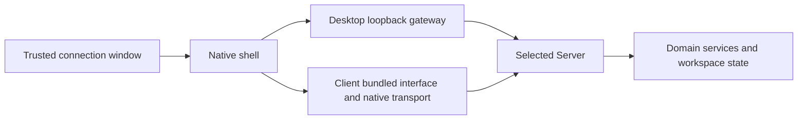
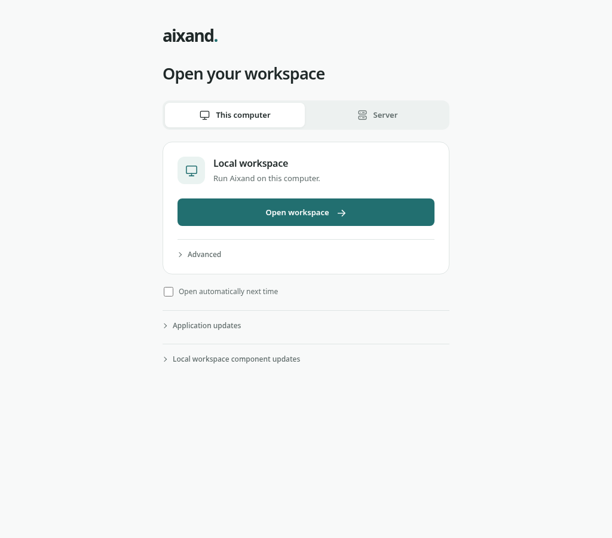

# Desktop architecture

Desktop is the native boundary around a Suite workspace. It owns the trusted connection window, saved host selection, opening and monitoring workspace windows, and local maintenance handoffs. Web owns the workspace interface; Server and its domain services own workspace operations and persistent work. Closing a window does not cancel that work.

## Reading paths

| Change | Read in order |
| --- | --- |
| Understand the shell | [Composition](architecture/composition.md), [trust and storage](architecture/trust.md), [connection lifecycle](lifecycles/connections.md) |
| Change Client networking | [Client](client.md), [native transport](integrations/native-transport.md), [verification](development/verification.md) |
| Change local startup | [Local workspace lifecycle](lifecycles/local-workspace.md), [maintenance](lifecycles/maintenance.md) |
| Build or release | [Development](development/README.md), [packaging](development/packaging.md), [implementation status](reference/implementation-status.md) |

## Component boundary

The implementation starts in [main.rs](../src-tauri/src/main.rs). Read [existing Desktop README](../README.md) for retained installation entry points and [Web native boundaries](../../web/docs/desktop.md) for related interface documentation. These pages describe source contracts, not platform qualification or public update availability.

## Interface snapshot

Real launcher HTML, CSS and JavaScript with mocked native responses; 1024 × 900, light theme. This fixture shows interface structure and role differences. It does not run native services, connect to a Server or qualify an installer. [Capture inputs and method](development/verification.md#launcher-screenshot-fixtures).
