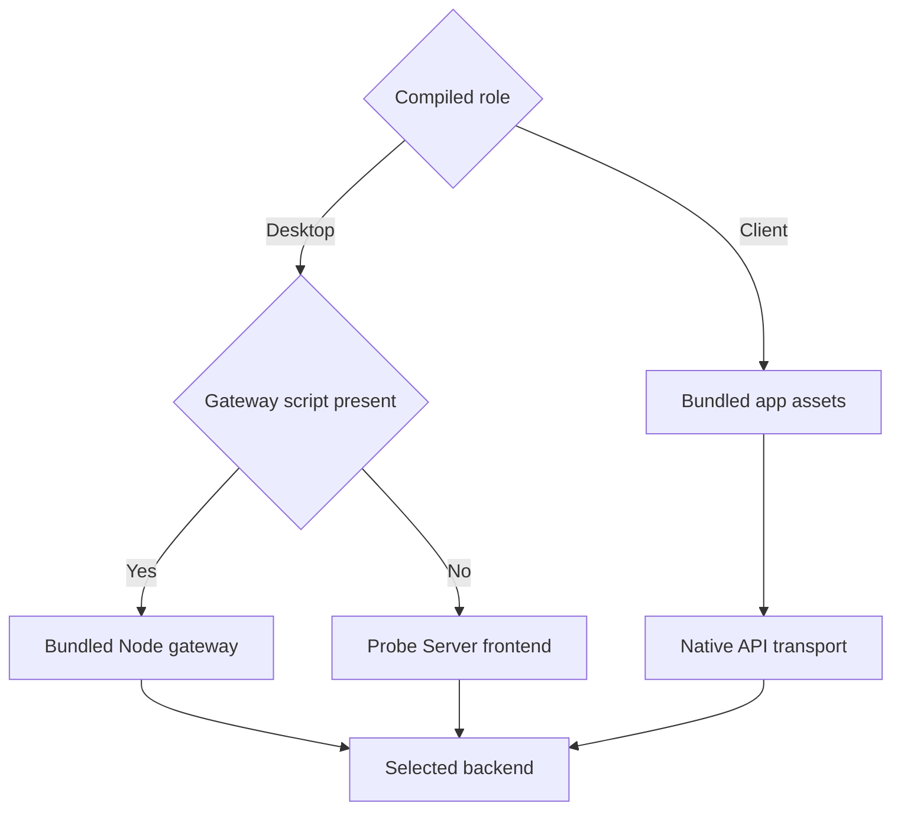

# Native composition and payloads

One Rust binary source implements Desktop and Client. The Cargo `client` feature changes local-runtime availability, workspace loading, transport permissions and update ownership. Packaging must select both the feature and the appropriate Tauri configuration; a product name alone does not establish the role.

| Layer | Responsibility | Source |
| --- | --- | --- |
| Rust shell | Registers command handlers and state; creates workspace windows and probes health | [main.rs](../../src-tauri/src/main.rs) |
| Trusted launcher | Profile editing, startup selection, reviewed maintenance and update controls | [launcher.js](../../src-tauri/launcher/launcher.js), [launcher HTML](../../src-tauri/launcher/index.html) |
| Local runtime adapter | Runs installed Node/runtime commands and decodes JSON output | [local_runtime.rs](../../src-tauri/src/local_runtime.rs) |
| Desktop interface gateway | Child lifecycle in Rust; asset/API gateway implemented in Node | [desktop_client.rs](../../src-tauri/src/desktop_client.rs), [gateway](../../../../scripts/runtime/desktop-client.mjs) |
| Client adapter | Generation-scoped IPC and sockets | [client_transport.rs](../../src-tauri/src/client_transport.rs) |
| Client libraries | Outbound session transport and signed native package updater | [transport](../../src-tauri/transport/src/lib.rs), [updater](../../src-tauri/native-updater/src/lib.rs) |

## Three interface paths

| Payload | Workspace choices | Native identity / input |
| --- | --- | --- |
| Desktop | Local runtime or remote Server | `org.aixand.suite`; [base config](../../src-tauri/tauri.conf.json) plus [full resources](../../src-tauri/tauri.full.conf.json) |
| Client | Remote Server only | `org.aixand.suite.client`; [Client config generator](../../../../scripts/runtime/client_package.py) and Cargo `client` feature |
| Historical connected shell | Remote Server serving HTML | Fallback when installed `runtime/desktop-client.mjs` is absent |

Client carries no local backend, Node/Python runtime kit or first-party product installation kit. Native WebView/TLS dependencies remain. Desktop's gateway is a local listener and child process; this is intentionally different from Client's outbound-only Rust transport. See [packaging](../development/packaging.md) before interpreting a successful shell build as a complete installer.
