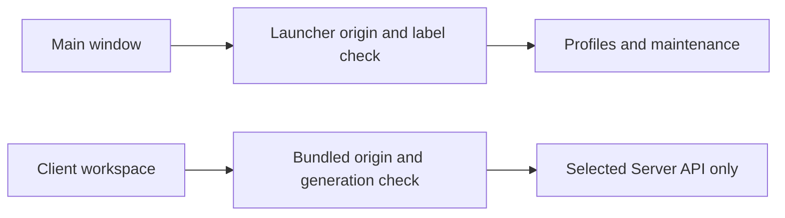

# Trust, sessions and storage

Native authority belongs to the bundled `main` connection window. Tauri capabilities and explicit command checks both enforce the boundary. Remote workspace content receives no launcher, cleanup, setup or process-execution authority.

| Caller | Accepted identity | Authority |
| --- | --- | --- |
| Launcher | Label `main`; `tauri://localhost` or HTTP(S) `tauri.localhost`, no port or URL credentials | [Main capability](../../src-tauri/capabilities/main.json) command allowlist |
| Development launcher | Exact configured loopback development origin, including scheme, host and port | Same checks; arbitrary localhost ports are not trusted |
| Client workspace | Compiled Client, label `workspace`, strict bundled origin | Only request/socket commands in [workspace capability](../../src-tauri/capabilities/client-workspace.json) |
| Desktop workspace | External gateway or Server document | No native workspace capability |
| New-window link | HTTP(S), host present, no credentials | Open with system browser; deny embedded new window |

See [launcher authorization and tests](../../src-tauri/src/launcher.rs), [browser policy and tests](../../src-tauri/src/browser.rs), and [command checks](../../src-tauri/src/main.rs). Client navigation is confined to the bundled origin. Authentication still belongs to Server: native transport supplies the selected backend Origin and cookies; it does not bypass password, Origin or CSRF validation. Configure remote origin policy using [Server authentication](../../../server/docs/operations/authentication.md).

## Persistence ownership

Paths below are relative to Tauri's per-user application configuration directory, not the workspace directory.

| State | Owner / partition | Lifetime and failure behavior |
| --- | --- | --- |
| `connections.json` | Shell profiles, selected ID, automatic opening preference | Validated on read/write; temporary-file rename on save; no passwords |
| `sessions/PROFILE-HASH.json` | Client native cookie store; SHA-256 of backend URL plus profile prefix | Original cookie expiry persists; Unix temporary session file mode 0600; failed saves warn and may require sign-in after restart |
| `browser/PROFILE-HASH` | Client WebView storage | Ordinary Windows/Linux launches use separate directories; Unix directory mode 0700 |
| macOS Client WebView | Ephemeral/incognito workspace | Native sessions and profiles persist; browser drafts/preferences/cache do not survive closure |
| `clients/PROFILE.json` | Desktop gateway ID and preferred loopback port | Preserves origin when possible; gateway rejects links/junctions in state path |
| `updates` | Desktop application updater preferences/recovery | Runtime update engine owns semantics |
| `native-updates` | Client release envelope, sequence floor, download identity, preferences | Rust updater uses private files and operation locking |

The automation environment `TAURI_WEBVIEW_AUTOMATION=true` deliberately shares WebKit context for tests. It is an explicit test exception, not evidence of ordinary browser isolation. Desktop gateway cookies use a profile/backend-derived namespace; do not describe Desktop as using Client's native cookie jar. [Transport](../integrations/native-transport.md) and [gateway](../integrations/desktop-gateway.md) explain the two session models.
