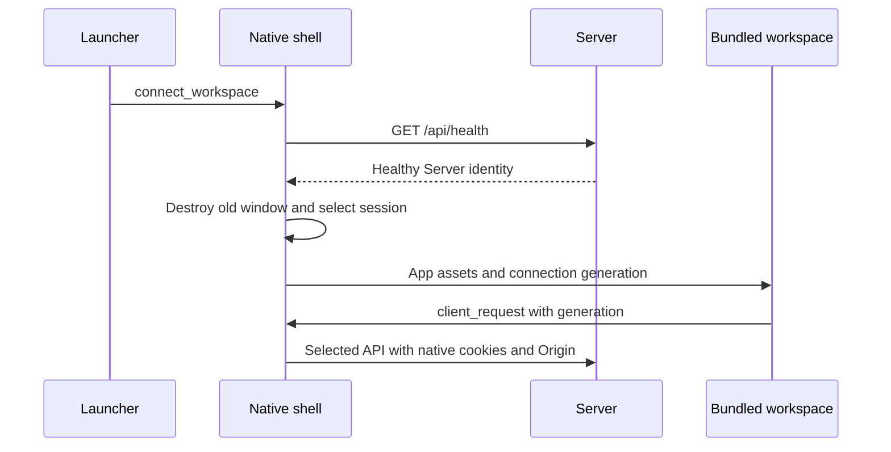
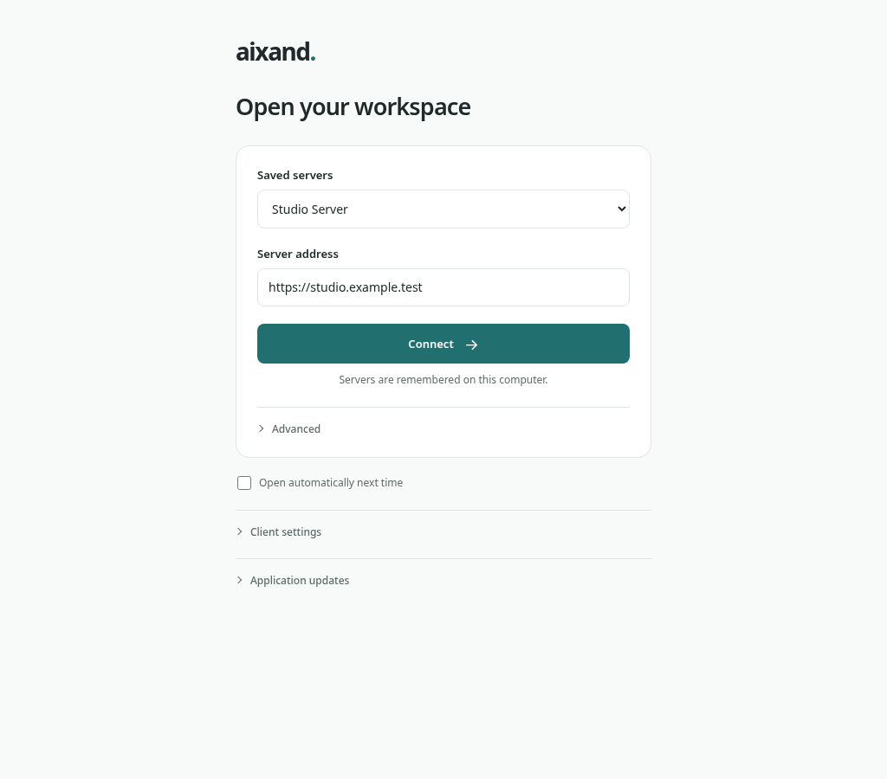

# Client contract

Client is a remote-only application built from the Desktop shell. It owns its interface assets and native session transport, so a selected Server need not serve a frontend. Server owns the workspace and all backend products; Client never creates an SSH tunnel, starts a remote service or updates the connected Server.

| Concern | Implemented contract |
| --- | --- |
| Local selection | Settings validation rejects local profiles; setup/start/component maintenance commands reject Client |
| Assets | `resources/client-assets` via Client Tauri overlay; workspace app URL is `index.html` |
| Bootstrap | Native initialization defines `__AIXAND_CLIENT__` and immutable `__AIXAND_CONNECTION__` generation |
| Network | Restricted outbound Rust HTTP/WebSocket; bundled CSP allows IPC rather than arbitrary remote fetch |
| Session | Native cookie persistence partitioned by profile and normalized backend URL |
| Switching | Destroy previous document before selecting a new session; increment generation and cancel old requests/sockets |
| Reset | Explicit confirmed local reset clears connections, sessions and browser data, not Server state |
| Update | Signed full Client package through native OS installer; no backend product inventory |

Read [composition](architecture/composition.md), [trust/storage](architecture/trust.md), [transport contract](integrations/native-transport.md), and [updates/reset](lifecycles/maintenance.md). The related [Web Client reference](../../web/docs/client.md) retains frontend integration and packaged probe context.

The [packaged Linux probe](../../../scripts/runtime/verify-client.py) covers a disposable authentication/socket scenario. That evidence does not qualify every workspace feature, every native platform, or a public update channel. See [verification](development/verification.md).

## Interface snapshot

Real launcher HTML, CSS and JavaScript with mocked native responses; 1024 × 900, light theme. This fixture shows interface structure and role differences. It does not run native services, connect to a Server or qualify an installer. [Capture inputs and method](development/verification.md#launcher-screenshot-fixtures).
