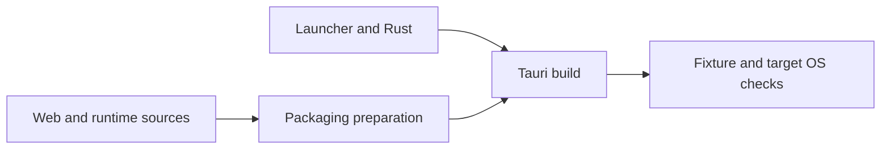

# Develop the native shell

Desktop development exercises the connection shell and prepared inputs. A running Tauri window does not demonstrate a complete local runtime, target installer qualification or public release availability. [Packaging](packaging.md) and [verification](verification.md) cover those separate obligations.

Use Node 24, Rust and the target OS Tauri prerequisites. The native crate declares Rust 1.95; Windows needs Microsoft C++ Build Tools. From `apps/desktop`:

```sh
npm ci
npm run desktop:dev
npm run desktop:build
npm run desktop:export
```

| Input | Owner / change path |
| --- | --- |
| Native CLI scripts | [package.json](../../package.json), pinned Tauri CLI and npm lockfile |
| Launcher assets | [HTML](../../src-tauri/launcher/index.html), [JS](../../src-tauri/launcher/launcher.js), [CSS](../../src-tauri/launcher/launcher.css) |
| Native command registration | [main.rs](../../src-tauri/src/main.rs), [build.rs](../../src-tauri/build.rs), capability allowlists |
| Desktop assets/runtime | Root packaging prepares runtime; [base config](../../src-tauri/tauri.conf.json) alone selects launcher assets |
| Client assets/role | Root Client packaging stages Web assets and selects Client config/feature |
| Web behavior | [Web development](../../../web/docs/desktop.md); interface changes belong to Web |



`desktop:dev:ssh` is currently the same `tauri dev` command; it creates no tunnel. Existing remote HTTPS or loopback tunnel endpoints must already be available. Preserve exact development-origin matching in launcher authorization; do not trust all loopback services for convenience.

For an unfamiliar change, start at [composition](../architecture/composition.md), trace the relevant command from registration through origin/label checks to its owning engine, then identify tests in [verification](verification.md). Preserve consent, operation IDs, profile/backend partitioning and failed-operation evidence. See [implementation gaps](../reference/implementation-status.md) before relying on source export or build success.
