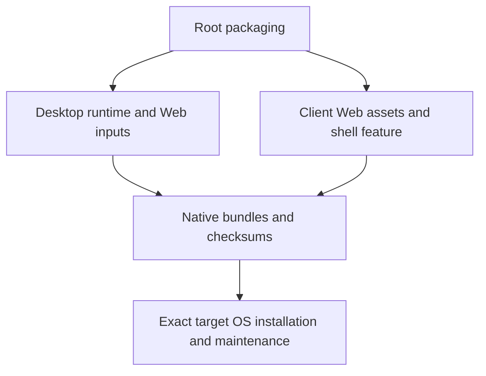

# Packaging, export and OS qualification

Root packaging assembles complete application roles. The component's Tauri commands build the native shell; they do not independently assemble backend/product runtime inputs or publish installers. Build on the target platform and qualify the exact resulting package.

From the Suite root:

```sh
python3 scripts/package-linux.py --package desktop --output /fresh/desktop-build
python3 scripts/package-macos.py --package desktop --output /fresh/desktop-build
```

```powershell
.\build-windows.ps1 -Package desktop -OutputDirectory C:\fresh\desktop-build
```

Use `client` for remote-only packages; `all` builds Desktop, Server and Client. `both` retains Desktop/Server meaning. Client-only assembly skips backend compilation and product/runtime assembly; build-time Node does not imply shipped Node. `--runtime-only` belongs to runtime-bearing roles. Read [Server build and qualification prerequisites](../../../server/docs/operations/installation.md#build-and-qualification).



| Input / artifact | Contract / source |
| --- | --- |
| Linux/macOS entry | [Linux wrapper](../../../../scripts/package-linux.py), [macOS packager](../../../../scripts/package-macos.py) |
| Windows entry | [PowerShell wrapper](../../../../build-windows.ps1), [Windows packager](../../../../scripts/package-windows.py) |
| Client assembly | [client_package.py](../../../../scripts/runtime/client_package.py); role-specific installer directory and installers.json |
| Desktop resources | [Full config](../../src-tauri/tauri.full.conf.json), [Windows full config](../../src-tauri/tauri.windows.full.conf.json) |
| Client native identity | [build.rs](../../src-tauri/build.rs) and [metadata validation](../../src-tauri/native-updater/src/build_metadata.rs) bake public trust and application version; enabled trust requires a safe positive sequence (disabled development trust permits zero) |
| Build environment | `AIXAND_CLIENT_UPDATE_CONFIG`, `AIXAND_CLIENT_SEQUENCE`, optional matching `AIXAND_CLIENT_VERSION`; optional metadata output path |
| Windows template | [Installer](../../src-tauri/windows/installer.nsi), [runtime hooks](../../src-tauri/windows/runtime-hooks.nsh), [maintenance preparation](../../src-tauri/windows/maintenance-update.py) |

## Source export boundary

From `apps/desktop`, `npm run desktop:export` invokes [export-desktop.py](../../scripts/export-desktop.py), defaulting to `artifacts/desktop/aixand-desktop-source.zip`. An explicit output path is supported by the Python helper. The allowlist includes native source, lockfiles, launcher, capabilities, icons, Windows helpers, transport and updater sources. It excludes environments, runtime state, node_modules, frontend artifacts and native target directories. The generated README is copied from Web's existing Desktop development page.

The current allowlist omits `vendor/glib` despite Cargo's local GLib patch. Consequently, do not describe the export as a proven self-contained full Desktop or Client build input. See [status](../reference/implementation-status.md). No source changes were made to repair that gap here.

## Qualification boundary

| Target | Evidence needed beyond source/fixture tests |
| --- | --- |
| Windows | Native build/installation, WebView2 acquisition, connection flow, maintenance cancellation, `/UPDATE`, uninstall checklist and private-file behavior |
| macOS | Native WebView ephemeral Client behavior, native trust, install/replace workflow, signing/notarization as release policy requires |
| Linux | Package ownership/authorization, actual DEB/RPM upgrade/removal, WebKit networking and isolation, installed runtime dependencies |

A cross-build or export is not OS qualification. Signing, notarization, feed promotion and distribution are separate release operations. The [retained Windows maintenance guide](../../src-tauri/windows/README.md) requires interactive fixture-based checks; Linux source inspection cannot replace them.
