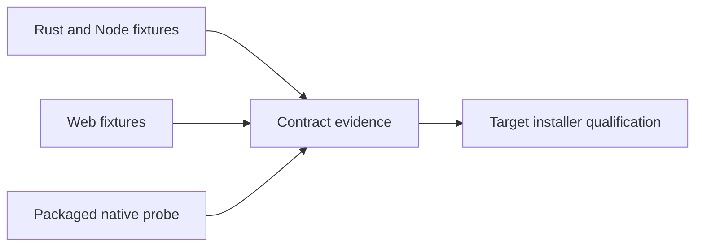

# Verification and evidence boundaries

Tests are split between pure Rust policy/session libraries, Node runtime/gateway fixtures, Web interface fixtures and packaged native probes. Use the layer that owns the contract; no one layer establishes end-to-end installer qualification.

From the Suite root, established focused commands include:

```sh
npm --prefix apps/web run test:desktop
npm --prefix apps/web run test:client
cargo test --manifest-path apps/desktop/src-tauri/transport/Cargo.toml
cargo test --manifest-path apps/desktop/src-tauri/native-updater/Cargo.toml
node --test scripts/runtime/desktop-client.test.mjs
python3 -m unittest discover -s scripts/runtime -p test_client_package.py
```

| Layer | Test/source entry | What to assess |
| --- | --- | --- |
| Launcher policy | [launcher.rs](../../src-tauri/src/launcher.rs), included in native-updater tests | Packaged origins, exact development origin, wrong label/credentials refusal |
| Connection policy | [connections.rs](../../src-tauri/src/connections.rs) | URL/settings validation, health identity/body limit, redirects/frontend failures |
| Client transport | [Transport tests](../../src-tauri/transport/src/lib.rs) | Cookie persistence, Unix mode, exact Origin, socket auth, path/header refusal |
| Client updater | [Engine tests](../../src-tauri/native-updater/src/engine.rs), [signature tests](../../src-tauri/native-updater/src/lib.rs), [metadata tests](../../src-tauri/native-updater/src/build_metadata.rs) | Stale review/consent, malformed trust, immutable identity, download bounds, fixed handoff |
| Web refresh | [component_refresh.rs](../../src-tauri/src/component_refresh.rs), included in native-updater tests | Matching successful operation refreshes exactly once |
| Desktop gateway | [desktop-client.test.mjs](../../../../scripts/runtime/desktop-client.test.mjs) | Access-token gate, cookies, forwarding and isolation policy |
| Local setup | [setup.test.mjs](../../../../scripts/runtime/setup.test.mjs) | Persisted setup and ownership choices |
| Cleanup | [cleanup.test.mjs](../../../../scripts/runtime/cleanup.test.mjs), [Windows preparation tests](../../src-tauri/windows/test_maintenance_update.py) | Reviewed scope, blockers, preservation and transactional preparation |
| Native Client probe | [verify-client.py](../../../../scripts/runtime/verify-client.py) | Linux packaged app under WebKitWebDriver/Xvfb, actual auth/socket/reset/isolation/listener checks |
| GLib backport | [security test manifest](../../src-tauri/security-tests/Cargo.toml), [regression](../../src-tauri/vendor/glib/tests/variant_str_iter_security.rs) | Vendored upstream security fix, not general desktop qualification |



Browser fixtures require Web dependencies and Playwright runtime. Native probes require prepared fixture packages and platform tools. Do not run maintenance against a developer's live installation as a substitute for a disposable fixture. These commands are reading-path guidance; execution results for this documentation task are recorded in its staged report, not implied by this page.

## Launcher screenshot fixtures

[Capture helper](capture-launcher.mjs) loads the actual launcher assets in Chromium, substitutes fixed read-only Tauri responses and blocks HTTP(S). Desktop shows a configured isolated workspace; Client shows the reserved example.test Server. Native mutation commands fail explicitly.

From the Suite root, with Web development dependencies installed:

```sh
node apps/desktop/docs/development/capture-launcher.mjs
```

[Capture manifest](../assets/screenshots/capture.json) records the source hashes, fixture mode, viewport and artifact names. These browser captures illustrate the bundled interface; native permissions, services, WebView behavior and installer outcomes need the separate checks above.

## Native session qualification recipe

Use the [Client session fixture and native handoff](../../../../scripts/qualification/client-session-recipe.md)
for isolated production-auth/transport checks, cookie persistence across restart,
and actual WebView/IPC evidence. Browser captures and transport probes cover
different boundaries; retain the scope recorded by each recipe.
