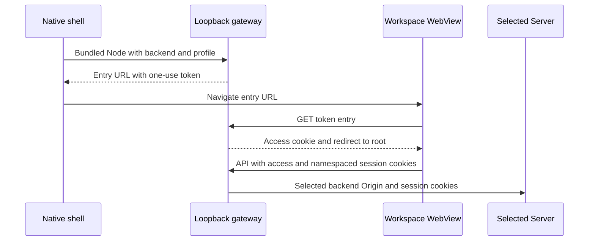

# Desktop interface gateway

Full Desktop carries Web assets and starts a bundled Node gateway even when the selected backend is remote. This gives assets and API traffic one browser origin while keeping Server selection in trusted native code. Historical packages without the gateway script retain the Server-hosted frontend fallback.

| Boundary | Implementation |
| --- | --- |
| Process | Rust retains child, backend/profile and gateway URL; same live selection reuses it; replacement kills/waits old child |
| TLS/environment | Node `--use-system-ca`; strips NODE_OPTIONS, NODE_TLS_REJECT_UNAUTHORIZED and NODE_USE_ENV_PROXY |
| Startup response | First JSON line bounded to 4096 bytes; returned address must be HTTP `127.0.0.1` |
| Entry | Random one-use token exchanges for random HttpOnly SameSite=Strict access cookie |
| Browser requests | Exact Host, absent or exact Origin, no cross-site fetch metadata, access-cookie match |
| API | `/api` or `/api/` paths; gateway rewrites Host/Origin and strips forwarding/hop headers; forwards only recognized namespaced session cookies |
| WebSockets | Authorized `/api/` upgrade; pipes selected backend socket; not Client's six-path Rust allowlist |
| Assets | GET/HEAD only; realpath stays within selected Web directory; dot paths, traversal and non-files refused |
| Response | Removes backend CORS/CSP/Clear-Site-Data and remaps recognized session cookies; same-backend Location rewritten to loopback |
| Failure | Backend request timeout five minutes; unavailable backend yields 502 or closes socket |
| Teardown | Native drop kills/waits child; parent's stdin closure closes gateway sockets; remote services remain owned by Server |

The cookie prefix hashes profile plus backend origin. State stores ID and preferred port, not backend passwords. If a saved port is occupied or denied, the gateway chooses another OS-assigned port and updates state; browser origin continuity is therefore best effort. Startup requires both `index.html` and `recovery.html`. Selected Web component assets resolve through runtime component selection before serving.

Source: [native gateway owner](../../src-tauri/src/desktop_client.rs), [Node gateway](../../../../scripts/runtime/desktop-client.mjs). Tests: [gateway fixtures](../../../../scripts/runtime/desktop-client.test.mjs). A successful reviewed Web component activation refreshes the gateway only for its matching completed operation; checks, downloads, other components and failed activations do not trigger refresh. See [maintenance](../lifecycles/maintenance.md).
