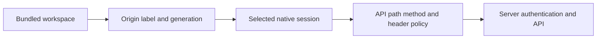

# Native HTTP and WebSocket transport

Client's Rust transport is outbound-only. The frontend supplies an API path and constrained request data; it cannot select a host, filesystem path, proxy headers, cookies or Origin. The [Tauri adapter](../../src-tauri/src/client_transport.rs) adds caller/generation checks around the [transport library](../../src-tauri/transport/src/lib.rs).

## HTTP contract

| Field / boundary | Contract |
| --- | --- |
| `Request` | camelCase, unknown fields denied; `path`, `method`, header pairs, optional byte body |
| Path | Starts `/api/`, at most 8192 bytes, no backslash/fragment; joined URL must retain backend origin and API prefix |
| Methods | GET, POST, PUT, PATCH, DELETE, HEAD |
| Headers | At most 16; only Content-Type, Accept, X-CSRF-Token |
| Native headers | Exact backend Origin; cookie jar supplies cookies |
| Size | Request body and response body each at most 16 MiB; response read incrementally |
| Timeouts | Ten-second connection; 120-second HTTP total; loopback bypasses proxies |
| Redirect | Not followed; HTTP status returned to caller |
| `Response` | Status, byte body, only Content-Type, Cache-Control, Retry-After response headers; Set-Cookie never exposed |
| Transport error | String error for invalid policy, network loss, interrupted response or size overflow; HTTP error status remains a response |

## Socket contract

Only `/api/agents/ws`, `/api/carrier/ws`, `/api/terminals/ws`, `/api/workflows/ws`, `/api/workflow-jobs/ws` and `/api/vox/ws` are allowed, with no query. HTTP(S) maps to WS(S); handshake supplies backend Origin and native cookies with a ten-second timeout. Native TLS trust remains enabled.

| Adapter element | Contract |
| --- | --- |
| Socket ID | Nonempty, at most 64 bytes; no duplicates; at most 32 live entries |
| Outbound queue | Capacity 32; `try_send` rejects busy/closed queue |
| Renderer payload | Text at most 1 MiB, or explicit close |
| Network frame/message | At most 16 MiB; incoming text forwarded, ping answered, other binary data ignored |
| IPC events | Tagged `open`, `message {data}`, `error`, `close {code,reason}` |
| Connection changed | Watch generation cancels HTTP/handshake/socket; socket close 1001 |
| Network failure | Error event then close 1006, generic connection-lost reason |

Selecting a session increments generation and clears socket senders. A stale renderer generation is rejected even if it still holds a socket ID. Cookie persistence retains original expiry instead of renewing Max-Age on restart. Corrupt/unreadable session data falls back to an empty jar; persistence failure warns without claiming durable sign-in.

Library tests exercise path confinement, insecure backend rejection, cookies/Origin, persistence permissions, socket echo and redirect/header injection refusal. They are colocated in [lib.rs](../../src-tauri/transport/src/lib.rs); [verification](../development/verification.md) distinguishes these from packaged isolation checks.
