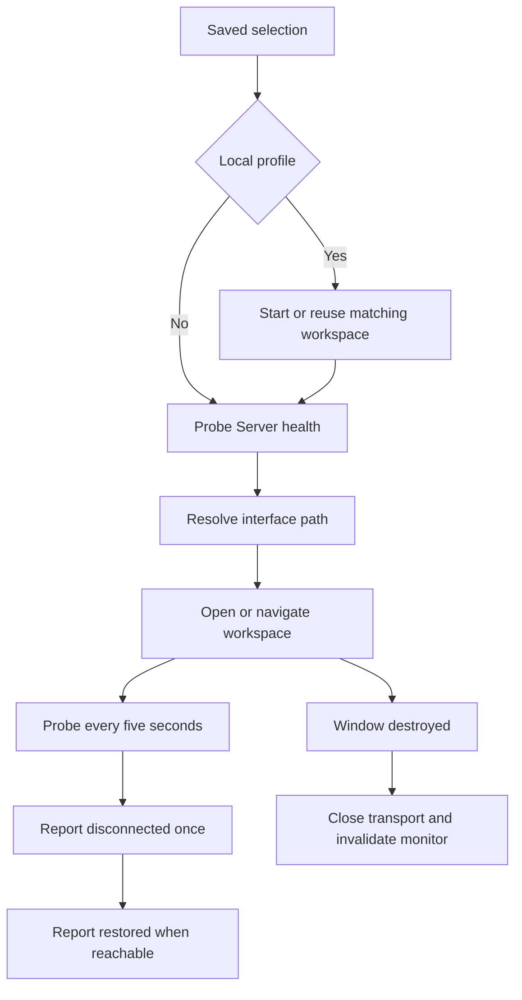

# Connection and window lifecycle

The launcher saves selection independently from opening the workspace. A connection attempt reads and validates current settings, serializes against other attempts with a try-lock, resolves local startup when selected, then probes Server before opening content.

## Input and health contracts

| Input / result | Constraint | Failure implication |
| --- | --- | --- |
| Server address | At most 2048 bytes; root HTTP(S), no credentials/path/query/fragment; network hosts require HTTPS | Refuse before navigation |
| Local profile | HTTP `127.0.0.1`; validated like other profiles | Cannot turn a remote host into local setup authority |
| Profiles | At most 20; unique nonempty ASCII alphanumeric/underscore/hyphen IDs up to 64 bytes; trimmed names 1–80 characters | Invalid settings are not silently accepted |
| Empty settings | Empty selected ID; automatic opening forced off | First run waits for selection |
| Health | Successful `/api/health`, JSON `service=aixand-server`, `status=ok`; maximum 64 KiB body | Refuse unrelated server/error HTML |
| Protocol | Present `x-aixand-protocol` must equal `1`; absent header accepted | Incompatible protocol asks for compatible releases |
| Workspace identity | Optional `x-aixand-workspace` used by local startup | Existing listener must match expected local workspace |
| Frontend fallback | Successful root response with `text/html` content type | Only required for historical shell without gateway |

[connections.rs](../../src-tauri/src/connections.rs) includes URL, settings, health-size, redirect and frontend tests. Probes use no redirects, three-second connect and eight-second total timeout; loopback bypasses proxies. The monitor uses a separate atomic connection generation so old loops stop after replacement/closure. UI events are `connecting`, `connected`, `disconnected`, `restored`, `closed` and error reports through `workspace-status`.

[main.rs](../../src-tauri/src/main.rs) reuses a Desktop workspace when possible, navigating on explicit reload, fresh interface or changed origin. Client destroys its previous workspace before swapping native sessions. Destruction closes the Desktop gateway and Client transport, reveals the launcher and reports that Server work remains available. Reachability recovery reports status; it does not silently restart work. Launcher automatic opening waits when local installation-mode selection is still required.
