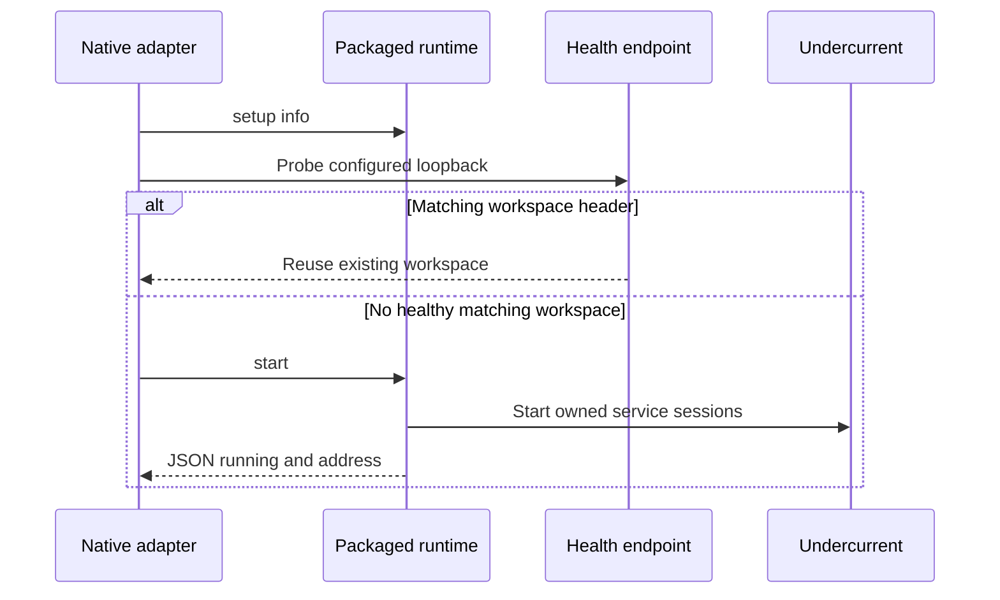

# Local workspace and service lifecycle

Desktop delegates service management to the packaged runtime rather than spawning backend services directly. The shell locates `runtime/manifest.json` and bundled Node in Tauri resources; Client reports local runtime unavailable. Web onboarding owns tool installation and license presentation after a workspace opens.

| Decision | Owner / behavior |
| --- | --- |
| Local port | Shell reads `AIXAND_LOCAL_PORT`, default `8753`; valid u16 at least 1024 |
| Existing healthy port | Shell compares `x-aixand-workspace` to setup `workspaceId`; mismatch refuses rather than stopping another workspace |
| Setup mode | Launcher chooses `isolated` with `settings=fresh` or `shared` with `settings=reuse`; runtime persists and validates plan |
| Isolated | Component data/tool context belongs to this Suite workspace |
| Shared | Reuses selected normal user stores and Undercurrent connection; does not transfer ownership of unrelated sessions |
| Runtime start | Requires selected setup, unchanged selected executables and compatible active runtime; checks ports and owned session readiness |
| Runtime stop | Shared connection stops only sessions carrying this instance's ownership label; stops daemon only when owned |
| Window close | Releases interface transport; it is not runtime stop |

Read [native adapter](../../src-tauri/src/local_runtime.rs), [launcher mode selection](../../src-tauri/launcher/launcher.js), [installation plan](../../../../scripts/runtime/installation-plan.mjs) and [runtime service ownership](../../../../scripts/runtime/runtime.mjs). Runtime dispatch supports setup actions; native setup exposes only `info`, `check`, `save`, `install`, `discover`, `choose` and the special `stop` action. Unsupported actions fail before a subprocess starts.

## Process contract

The adapter launches the installed Node executable with installed `runtime.mjs`, passes JSON options as an argument, and expects one JSON result on stdout. Nonzero exit returns at most 4096 stderr characters; invalid JSON and interrupted blocking tasks have explicit errors. Windows subprocesses use the no-console creation flag. These commands are installed runtime operations, not renderer-supplied executables.

Shell availability checks only establish manifest/Node presence. Full runtime integrity, software selection and dependency readiness remain runtime concerns; opening the launcher is not a successful installation check. [Setup tests](../../../../scripts/runtime/setup.test.mjs) and [runtime source](../../../../scripts/runtime/runtime.mjs) are the starting points for mode or ownership changes.
