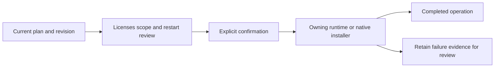

# Maintenance, updates and reset

The trusted launcher owns local maintenance entry points. Runtime engines own Desktop software plans and activation; Rust owns Client's full-package updater. Neither a daily check nor an automatic download authorizes installation or restart. Existing [Web update reference](../../../web/docs/updates.md) retains the broader application/component/product contracts.

## Update ownership

| Kind | Shell behavior | Engine / contract |
| --- | --- | --- |
| Desktop application | `application_updates`; injects native parent PID/application path for install, closes gateway and exits on handoff | [Runtime updates](../../../../scripts/runtime/updates.mjs), [worker](../../../../scripts/runtime/update-worker.mjs) |
| Desktop components | Launcher serializes against connection, cleanup and other component review; delegates JSON actions | [Component engine](../../../../scripts/runtime/component-updates.mjs) |
| Web component refresh | Ready plan must include Web; confirmed current revision and restart consent; bind started operation; refresh once only on matching `completed` status | [Review state and tests](../../src-tauri/src/component_refresh.rs) |
| Client application | Serialized Rust updater; successful native installer handoff exits app | [Native adapter](../../src-tauri/src/native_updates.rs), [engine](../../src-tauri/native-updater/src/engine.rs) |
| Client backend products | Rejected; Client has no local component maintenance | Connected Server owns them |

Client engine actions are `status`, `settings`, `check`, `due`, `download`, `plan`, `install`. Daily checks default on; automatic download defaults off. Due checks honor daily interval and attempted-check backoff. Automatic payloads are capped at 512 MiB and five minutes; explicit downloads allow 30 minutes. Failed checks retain last successful `checkedAt`.

Client verifies Ed25519 over exact envelope payload bytes, role/API protocol, target, expiry (at most 90 days), monotonic feed sequence and immutable identity. Artifact package sequence (`releaseSequence`, legacy fallback feed sequence) must exceed installed sequence to offer an update. Licenses bind text hashes; Client artifacts cannot contain backend products. Plan revision and explicit confirmation/restart/license acceptance are checked again before package size/hash verification and fixed OS handoff. Renderer paths, commands and installer arguments are not accepted. [Library contracts/tests](../../src-tauri/native-updater/src/lib.rs) cover refusal cases.

| Native Client target | Handoff |
| --- | --- |
| Windows NSIS | Verified downloaded executable; no caller-supplied arguments |
| Linux DEB/RPM | Owning executable package queried through dpkg/rpm; fixed pkexec package-manager install; portable builds refused |
| macOS DMG/PKG | System open with wait-apps; installer remains OS/user controlled |

Checked-in [Client trust](../../src-tauri/client-update-config.json) and [runtime trust](../../../../scripts/runtime/update-config.json) are disabled. These implementations do not establish an enabled public channel or a completed OS installation. Desktop activation backup/snapshots and interrupted reservations remain runtime-owned; inspect exact operation IDs before retrying and never infer database rollback safety from a software backup.

## Cleanup and reset

| Operation | Guard and effect |
| --- | --- |
| Cleanup plan | Runtime checklist plus shell-owned `desktop` item for connections/browser data |
| Apply / stop-processes / repair-permissions | Confirmed, unique nonempty selection; current runtime plan revision; available runtime IDs; connection/maintenance locks |
| Blocked/failed cleanup | Return report before clearing browser data or closing workspace windows |
| Successful apply | Close workspace windows; clear browser data when Desktop selected; runtime removes selected owned components |
| Provider restore | Separate confirmed runtime operation; retains provider-specific ownership rules |
| Client reset | Compiled Client plus `confirmed`; serialize against connection, invalidate generations, clear WebView data, remove sessions/browser directories, save empty settings |
| Windows uninstall | `--cleanup-uninstall` mode prevents uncontrolled close; finish returns 1223 for cancel, 10 when Desktop data removed, otherwise 0 |

[main.rs](../../src-tauri/src/main.rs) is the shell contract; [cleanup engine](../../../../scripts/runtime/cleanup.mjs) owns blockers, process review, permissions and product scope. Reset does not modify Server. OS removal normally preserves per-user data unless explicitly cleared. [Windows installer reference](../../src-tauri/windows/README.md) documents `/UPDATE`, cancellation and transactional helper preparation; preserve those contracts when changing the shell.
