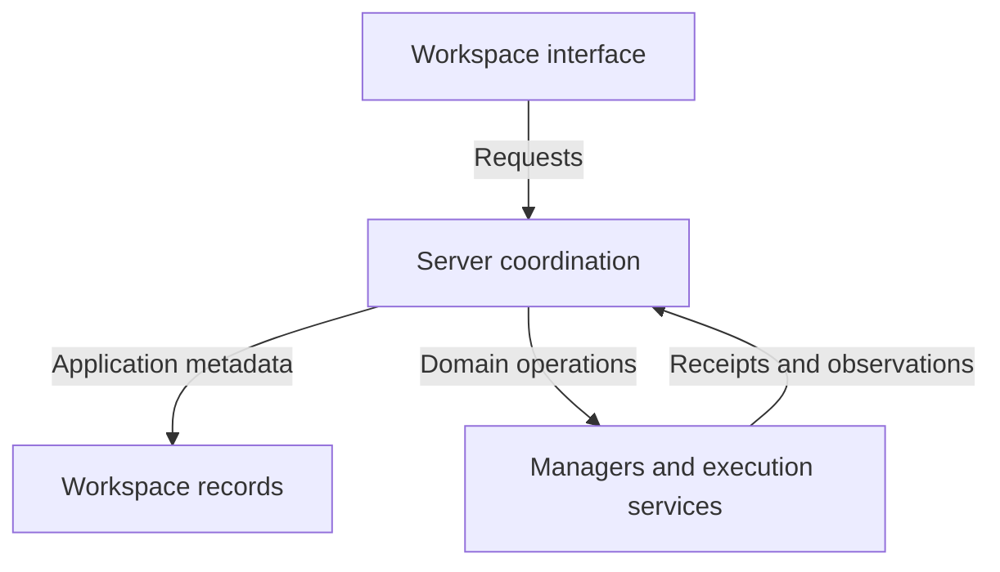

# Understand Aixand Server

Server coordinates a Suite workspace: authenticated requests, project/chat
associations, captured launch intent, and live updates. Work runs on the selected
backend's computer. These pages describe the current source checkout.

[Current implementation coverage](implementation-status.md): several retained integration contracts name handlers or tests absent from this checkout.

## Where Server fits

Server connects the workspace to its domain owners. It retains associations and
presentation state; managers, Runner, Carrier, and Undercurrent retain their own
authority. See [state ownership](architecture/ownership.md).

## Reading path

| Section | Understand | Start here |
| --- | --- | --- |
| Architecture | Processes, ownership, request flow, security | [Architecture index](architecture/README.md) |
| Lifecycles | Conversation recovery and workflow coordination | [Lifecycle index](lifecycles/README.md) |
| Integrations | Boundaries with managers, tools, messaging, devices, and voice | [Integration map](integrations/README.md) |
| Development | Implementation owners and focused checks | [Source map](development/README.md) |
| Operations | Installed-host setup and maintenance | [Installation](operations/installation.md) · [Authentication](operations/authentication.md) · [Source production](operations/production.md) |

**For an agent:** read architecture first, follow the affected lifecycle, then use
the source map to choose the implementation and tests.

## Keep these facts separate

| Observation | What it establishes |
| --- | --- |
| Operation accepted | The request was accepted under its contract |
| Provider turn completed | That turn reached its terminal state |
| Application result accepted | The result satisfied its task contract |
| Delivery confirmed | The destination received the addressed report |

One observation does not establish the others. Retain IDs and receipts; inspect
uncertain work before another mutation. Authentication grants the workspace OS
user's authority; scoped tools do not approve a child's pending requests.

[AppModule](../src/app.module.ts) ·
[Agents gateway](../src/agents/agents.gateway.ts) ·
[Application chats](../agent-bridge/application/chats.py) ·
[Installed Server setup](../../../docs/getting-started/install-server.md)
