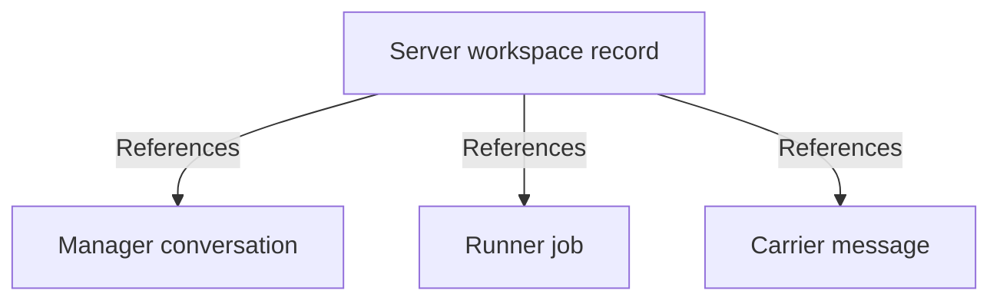

# Server state and ownership

Server owns workspace associations and application intent. References to domain
records do not transfer ownership of those records.

## Associations cross authority boundaries

This is an ownership sketch, not a database schema. Resolve recorded IDs through
their owning APIs; a UI label or profile alias cannot replace an identity.

## Authority map

| Owner | Authoritative state |
| --- | --- |
| Server | Project registrations, workspace preferences, UI/execution associations, application intent and presentation metadata |
| Conversation Manager | Transcripts, settings, approvals, queues, worker lifecycle |
| Agent Manager | Profiles, native environments, provider readiness and selection |
| Prompt, Skill, MCP Managers | Resource libraries, accepted revisions, preparation and publisher lifecycle |
| Orchestration MCP | Execution associations, scoped tools/broker contracts, delegated result acceptance |
| Runner | Jobs, scheduling, checkpoints, cancellation and outcomes |
| Carrier | Addressed messages, publication keys and acknowledgements |
| Undercurrent | Supervised processes, terminal I/O and runtime observations |
| Connect | Pairing, transfer receipts and receiving companion behavior |

## Persistence rules

| Record or action | Rule | Source |
| --- | --- | --- |
| Workspace database | Scope includes manager configuration and runtime identity; `AGENTS_STATE_DIR` selects the directory | [Chat state](../../shared/chat_state.py) |
| Pre-configuration state | Preserve populated state; reject ambiguous populated scopes | [Database selection](../../shared/chat_state.py) |
| Chat associations and search | Suite owns the association and rebuildable projection, not manager history | [SuiteChats](../../agent-bridge/application/chats.py) |
| Projects and discovery | Local service owns registry, discovery jobs, and import journals | [Projects](../../agent-bridge/application/services/projects.py) |
| Launch capture | Retain selected resources, access, host, and identities; later defaults do not retarget accepted work | [Conversation lifecycle](../lifecycles/conversations.md) |
| Removal | Unregistering, deleting presentation/history, stopping work, and uninstalling have separate effects | [Suite ownership](../../../../docs/architecture/ownership.md) |

Changing environment paths is not a state migration. Preserve the receipts needed
to inspect work after presentation records disappear.
