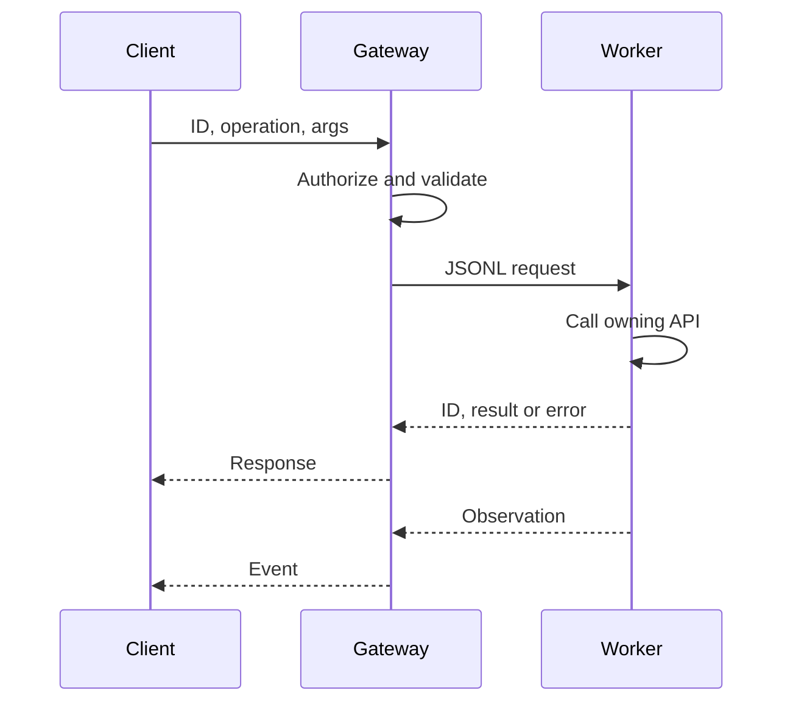

# Server request and event flow

The agents WebSocket path illustrates admission, dispatch, and observations.
Other gateways have their own schemas and lifecycles.

## Request and observation

Events may race with responses. Reconnect reads current state; it must not infer
state from message order. The called API defines what each response proves.

## Admission and identity

| Check | Behavior | Source |
| --- | --- | --- |
| Socket and request | Authorize; parse JSON; validate operation/arguments; enforce bounds | [Gateway](../../src/agents/agents.gateway.ts), [schema](../../src/agents/protocol.ts) |
| ID reused with changed arguments | Reject the conflict | [Gateway](../../src/agents/agents.gateway.ts) |
| Duplicate still pending | Report pending; do not dispatch again | [Gateway](../../src/agents/agents.gateway.ts) |
| Completed response cache | Scoped to that connection; not durable global exactly-once execution | [Gateway](../../src/agents/agents.gateway.ts) |
| Worker dispatch | Correlate responses and adapt domain results | [Service](../../src/agents/agents.service.ts), [entry](../../agent-bridge/main.py), [SuiteChats](../../agent-bridge/application/chats.py) |

A transport request ID and a durable operation key have different lifetimes.
Retain both when required. A new transport ID does not make an uncertain effect
safe to repeat.

## Events and interruption

| Observation | Required interpretation |
| --- | --- |
| Chat, project, resource, or workflow event | An update to inspect; not a second transcript or queue authority |
| Voice event | Retain its connection-specific ownership |
| Bridge lost | Pending calls receive errors; observers see unavailable connection state |
| Timeout or lost response | Inspect original receipts and identities; do not infer success, failure, or permission for replacement work |

[Conversation recovery](../lifecycles/conversations.md) ·
[Workflow recovery](../lifecycles/workflows.md)
