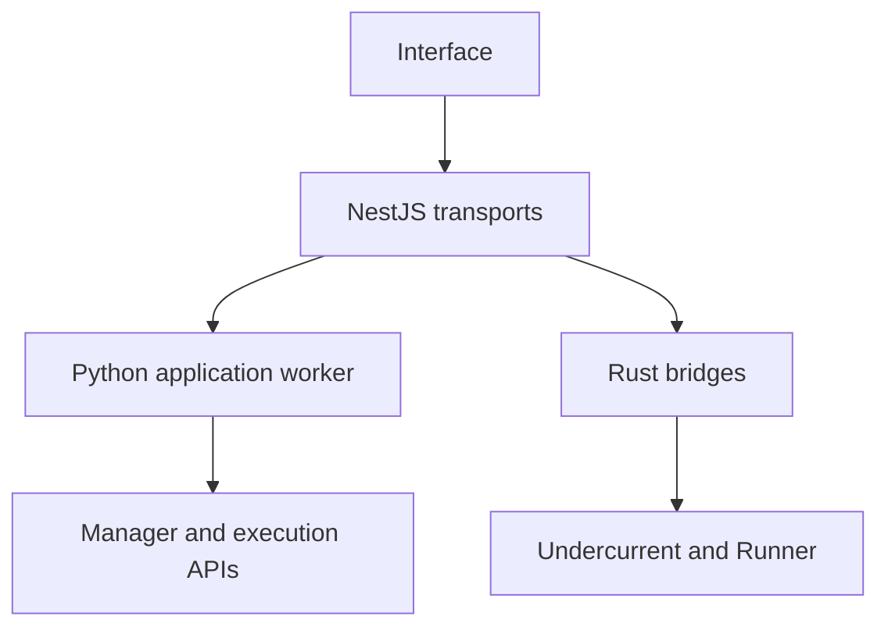

# Server runtime architecture

NestJS owns the public transports. Private workers and bridges adapt domain APIs.
This diagram shows the main request paths, not every runtime connection.

## Main paths

The application worker can also reach runtime and messaging APIs. The table lists
adapters omitted from the simplified diagram.

## Process responsibilities

| Boundary | Job | Source |
| --- | --- | --- |
| NestJS | Compose features; authorize and validate public requests | [AppModule](../../src/app.module.ts), [HTTP policy](../../src/configure-app.ts) |
| Application worker | Dispatch workspace operations and emit observations over JSON lines | [Agents service](../../src/agents/agents.service.ts), [Python entry](../../agent-bridge/main.py) |
| Recovery worker | Inspect and recover retained session identities over private local IPC | [Recovery service](../../src/recovery/recovery.service.ts), [worker](../../recovery-worker/main.py) |
| Carrier adapter | Adapt message operations and observations | [Carrier contract](../integrations/carrier.md) |
| Terminal bridge | Adapt bounded terminal commands and output to Undercurrent | [Rust terminal bridge](../../bridge/src/main.rs) |
| Workflow bridge | Adapt the Server workflow transport to Runner | [Runner adapter](../../src/workflows/runner-client.ts), [Rust bridge](../../workflow-bridge/src/main.rs) |

Worker stdout carries protocol data. Keep diagnostics off that channel. Request
IDs correlate responses; unsolicited messages carry application updates.

## Startup and failure

| Situation | Meaning |
| --- | --- |
| Development startup | [main.ts](../../src/main.ts) loads local environment configuration |
| Production startup | [production-main.ts](../../src/production-main.ts) loads production inputs and can attach configured assets |
| Worker ready | Its protocol is available; provider access and task success still need separate evidence |
| Worker lost | Pending requests fail visibly; reconnect and inspect retained effects before retrying |

The Server installer role is backend-only. Shared source support for serving
assets does not change that role. Continue with [request flow](request-flow.md)
and [conversation recovery](../lifecycles/conversations.md).
