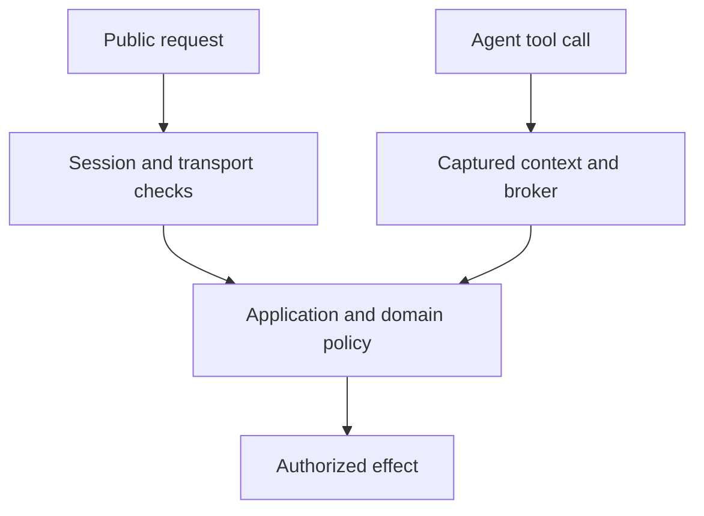

# Server security boundaries

Server is a single-owner workspace. Authentication grants the backend OS user's
workspace authority, including agent execution and terminal input.

## Enforcement layers

The paths have different admission rules. A public session does not bypass tool
scope; a captured tool context does not approve pending child requests.

## Checks to preserve

| Boundary | Enforcement | Source |
| --- | --- | --- |
| Ordinary HTTP API | Session; mutation authorization and CSRF for state changes | [configureApp](../../src/configure-app.ts) |
| Origins and proxy peers | Exact configured origin and trust policy | [Auth configuration](../../src/auth/config.ts) |
| WebSockets | Connection authorization, message/send gating, schemas, payload bounds, backpressure | [AuthService](../../src/auth/auth.service.ts), [agents gateway](../../src/agents/agents.gateway.ts) |
| Initial password setup | Verified local connection; forwarded setup remains denied | [Authentication contract](../operations/authentication.md) |
| Initialized auth state | Missing/invalid database fails closed; preserve the initialized marker | [Authentication contract](../operations/authentication.md) |
| Scoped tools | Captured role, conversation, project, and execution context | [Tool adapter](../../agent-bridge/application/tools.py) |
| Resources | Accepted definitions/artifacts and captured launch bindings | [Suite resources](../integrations/suite-resources.md) |

Health and authentication routes have dedicated handling. Their exceptions are
not exemptions for feature APIs.

## Private and captured data

- Process pipes and recovery endpoints stay private; browser requests enter through public validation and policy.
- Credentials and host-local context references stay off frontend assets and portable workflow/device paths.
- Reading a retained conversation does not grant mutation rights.
- Unsupported or out-of-scope calls fail visibly; do not switch to a broader profile or standalone workspace.
- A captured definition does not freeze external code or prove provider access.

[Workspace-scope tests](../../agent-bridge/tests/test_application_workspace_scope.py)
cover one boundary. Auth/gateway changes need their own checks; native/device
changes also need target-specific validation.
