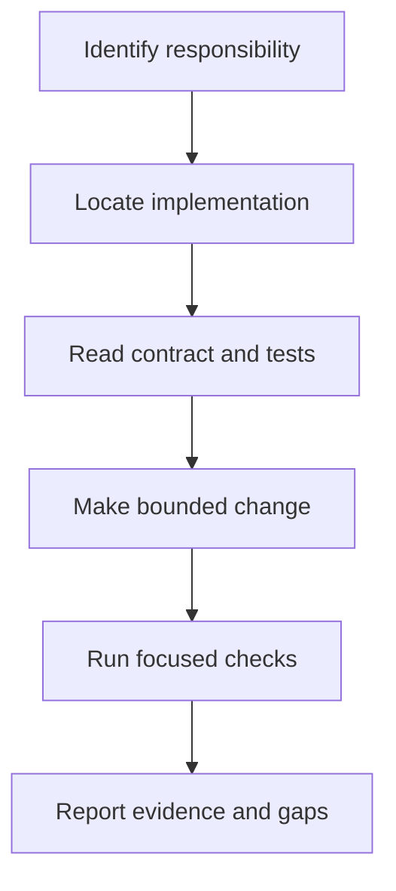

# Server source map and verification

Identify the owning layer, follow its contract, then run focused checks.
Use this map after the [component overview](../README.md).

[Current implementation coverage](../implementation-status.md): several retained integration contracts name handlers or tests absent from this checkout.

## Change path

## Source map

| Responsibility | Entry |
| --- | --- |
| Composition and HTTP policy | [AppModule](../../src/app.module.ts), [configureApp](../../src/configure-app.ts) |
| Agents schema, admission, correlation | [Protocol](../../src/agents/protocol.ts), [gateway](../../src/agents/agents.gateway.ts), [service](../../src/agents/agents.service.ts) |
| Application dispatch and chats | [Python entry](../../agent-bridge/main.py), [SuiteChats](../../agent-bridge/application/chats.py) |
| Workspace identity and projects | [Chat state](../../shared/chat_state.py), [projects](../../agent-bridge/application/services/projects.py) |
| Launch capture and scoped tools | [Resources](../../agent-bridge/application/resources.py), [tools](../../agent-bridge/application/tools.py) |
| Session recovery | [Service](../../src/recovery/recovery.service.ts), [worker](../../recovery-worker/main.py) |
| Native terminals | [Gateway](../../src/terminals/terminals.gateway.ts), [bridge](../../bridge/src/main.rs) |
| Workflows | [Job gateway](../../src/workflows/jobs.gateway.ts), [application adapter](../../agent-bridge/application/workflows.py) |

## Verification map

| Contract | Existing evidence |
| --- | --- |
| Manager authority | [Manager-boundary tests](../../agent-bridge/tests/test_chat_manager_boundary.py) |
| Reconnect without replay | [Restart tests](../../agent-bridge/tests/test_sdk_restart.py) |
| Workspace/tool scope | [Scope tests](../../agent-bridge/tests/test_application_workspace_scope.py), [tool tests](../../agent-bridge/tests/test_sdk_suite_tools.py) |
| Captured resources | [Resource tests](../../agent-bridge/tests/test_sdk_chat_resources.py) |
| Search projection | [Search tests](../../agent-bridge/tests/test_chat_search.py) |
| Workflow adaptation | [Route tests](../../agent-bridge/tests/test_public_workflow_routes.py), [Runner adapter tests](../../src/workflows/runner-client.spec.ts) |

Read fixture prerequisites before running integration checks. Test links identify
evidence; they do not establish a pass in the current checkout. Report fixture,
live-provider, remote-device, and installer qualification separately.

## Supporting guides

| Need | Guide |
| --- | --- |
| Prepare and run source | [Local development](local-development.md), [package scripts](../../package.json) |
| Measure memory | [Capacity](capacity.md) |
| Validate documentation | [Documentation checks](../../../../docs/development/documentation.md) |
| Publish source-owned pages | [Manifest](../publication.json), [publishing contract](../../../../docs/development/publication.md) |

Edit Suite sources, then import the selected revision. Generated website articles
are snapshots of these files.
