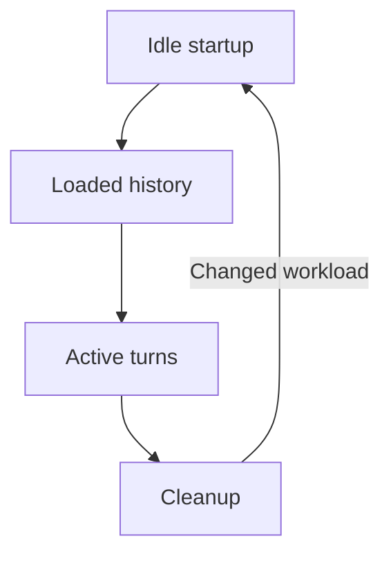

# Plan chat memory capacity

Measure an isolated workload. There is no qualified minimum-RAM guarantee for a
complete Suite installation.

## Measure the workload

| Measurement | Interpretation |
| --- | --- |
| Linux source | `/proc/<pid>/smaps_rollup` for each process |
| RSS | Resident pages; can double-count shared pages |
| PSS | Apportions shared pages; allow separately for swap |
| MiB | 1,048,576 bytes |
| Include | Server, Python workers, Undercurrent, providers, MCP/tools, browser tabs; measure Vox separately |
| Predictor limits | Saved-chat count does not establish live threads/peak memory; transcript transport bounds are not RAM budgets |

Use temporary homes without real credentials. Live model checks need deliberate
authorization and can consume quota. Stop only measurement-owned processes and
remove their temporary homes. Recheck after changing versions, models, resources,
or concurrent work.
