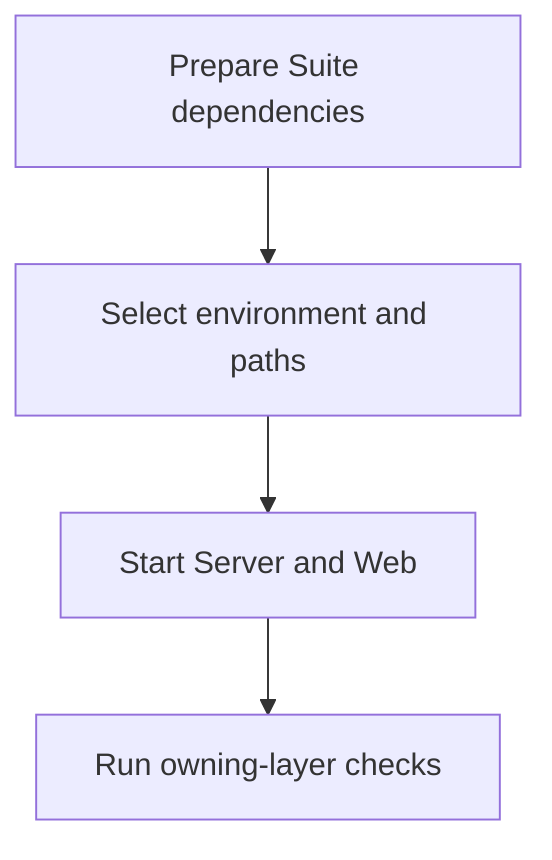

# Develop Suite Server

Prepare the source environment, then choose checks for the layer you changed.

## Bootstrap locally

This path runs source code rather than installing the published application.
From the Suite root, use `./dev.sh prepare` for pinned Python dependencies.
Then, from `apps/server`, with Node 24.15+ and Rust available:

```sh
npm ci
npm run bridge:build
cp -n .env.example .env
npm run start:dev
```

The development API defaults to loopback port 3000. Start
[Suite Web](../../../web/README.md#develop-locally) and complete local password setup.



## Configure the development server

| Setting / boundary | Contract |
| --- | --- |
| Listener | Loopback port 3000 |
| Environment | Process values override `.env`; inspect [.env.example](../../.env.example) for bind/origin/bridge/Python choices |
| Authentication | HTTP and sockets remain protected; one OS-user workspace, not per-user isolation |
| Recovery/security | [Authentication runbook](../operations/authentication.md); secrets stay out of frontend assets |

## Locate responsibilities

| Boundary | Owner |
| --- | --- |
| Transport validation | [App composition](../../src/app.module.ts), [agents schema](../../src/agents/protocol.ts) |
| Launch capture and onboarding | [Application services](../../agent-bridge/application/README.md) |
| Native terminal I/O | [Rust bridge](../../bridge/Cargo.toml), Undercurrent |
| Workflow adaptation | [Workflow bridge](../../workflow-bridge/Cargo.toml), [native contract](../integrations/native-workflows.md) |
| Message handoff | [Carrier](../integrations/carrier.md) |
| Devices and transfer | [Connect](../integrations/connect.md) |
| Manager state | [Managers](../integrations/managers.md) |

Orchestration MCP still has Server consumers. Migrate callers before removing an
exporter; use the [integration map](../integrations/README.md).

## Verify a change

From `apps/server`, select the relevant checks:

```sh
npm run build
npm test
npm run bridge:build
npm run workflow:build
```

| Check | Evidence |
| --- | --- |
| `build` | TypeScript compilation |
| `test` | Vitest fixtures |
| `bridge:build` / `workflow:build` | Native terminal / workflow bridge compilation |
| Protocol/pressure/live scripts | Read [package scripts](../../package.json) and prerequisites first; isolated environment |

Preserve captured identities and receipts. Missing reports, stopped workers, or
unconfirmed dispatch do not authorize replacement work. Build/fixture success
is separate from provider, installer, production, and delivered-result evidence.
