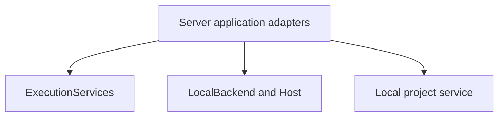

# Server integration boundaries

Choose the owning contract before changing an integration. Optional components
retain their own installation, capability, and target-platform prerequisites.

[Current implementation coverage](../implementation-status.md): several retained integration contracts name handlers or tests absent from this checkout.

## Application coupling

`SuiteChats` imports execution services; scoped tools use the backend and broker.
Projects also have a local Server implementation. Inspect these consumers before
removing an exporter or claiming package independence.

## Find a contract

| Boundary | Authority / contract | Server entry |
| --- | --- | --- |
| Chats and profiles | [Independent managers](managers.md) | [SuiteChats](../../agent-bridge/application/chats.py) |
| Resource selection | [MCP](mcp.md), [Suite resources](suite-resources.md) | [Resource adapter](../../agent-bridge/application/resources.py) |
| Scoped tools and reads | [Conversation tools](conversation-tools.md), Orchestration MCP | [Tool context](../../agent-bridge/application/tools.py) |
| Native terminals | Undercurrent | [Terminal gateway](../../src/terminals/terminals.gateway.ts), [Rust bridge](../../bridge/src/main.rs) |
| Durable jobs | [Workflow coordination](../lifecycles/workflows.md), [native contracts](native-workflows.md) | [Application workflows](../../agent-bridge/application/workflows.py) |
| Messages | [Carrier](carrier.md) | Carrier integration adapter |
| Devices | [Connect](connect.md) | Workspace device integration |
| Voice | [Vox](../../../../services/vox/README.md) | [Vox service](../../src/vox/vox.service.ts) |
| Updates | [Activation contract](../../../web/docs/updates.md) | [Module composition](../../src/app.module.ts) |

## Keep failures scoped

| Observation | Required interpretation |
| --- | --- |
| Capability unavailable | Report unavailable; retain the selected host, route, and stores |
| Operation uncertain | Inspect its original identities and receipts |
| Tool registered | Its definition exists; live delivery still needs verification |
| Fixture passed | Only its exercised boundary is verified |

[Local projects implementation](../../agent-bridge/application/services/projects.py) ·
[Server documentation](../README.md)
