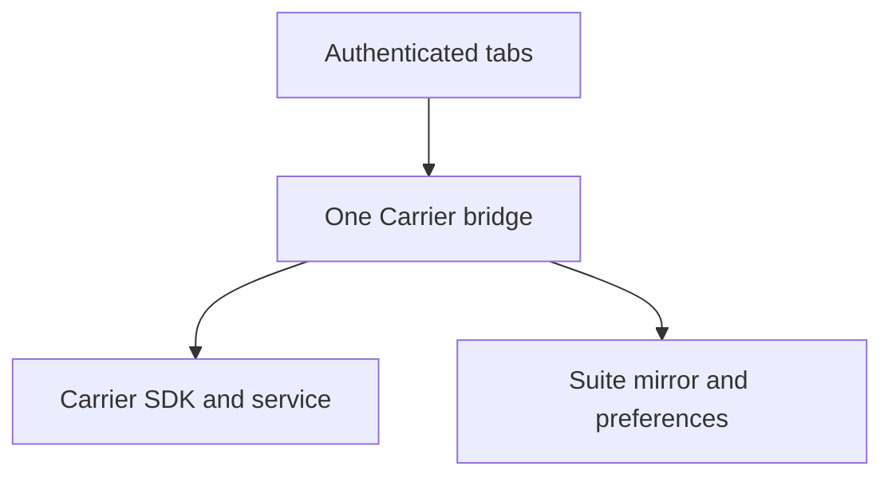
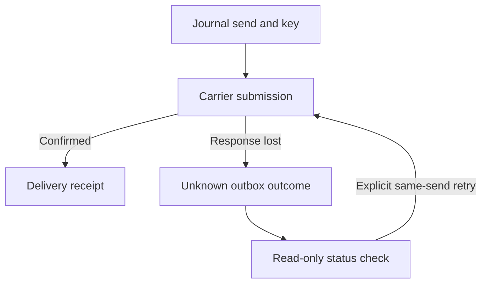

# Local Carrier integration

One backend-owned Python bridge serves `/api/carrier/ws` for every authenticated
tab. Carrier owns messages; Suite keeps a separate SQLite mirror and preferences.
Browser loss does not stop durable sends or agents.



## Start locally

| Preparation | Requirement |
| --- | --- |
| Carrier service | `carrier serve`; default `http://127.0.0.1:8765` |
| Provisioning | Set `CARRIER_DATABASE` to the exact running `--db` path; a URL alone cannot identify it |
| Source / older service data | `~/.aixand/carrier/carrier.db`; older installs may use `~/.local/share/carrier/carrier.db` |
| Source update | Carrier-checkout `./dev.sh reinstall`, then restart (`systemctl --user restart carrier.service` for the provided unit); editable installs need restart only |
| Python | `CARRIER_PYTHON` may select Python 3.11+ with `aixand-carrier-mcp`, optionally `aixand-suite-python`; otherwise configured agent Python/root `.venv` |
| Suite dependencies | Root `./dev.sh prepare`; local source dependencies are explicit opt-in |
| Application | Restart `apps/server` after bridge/SDK changes; run `apps/web`, sign in with the workspace session |

Check unit/override executable and database paths. Source owners:
[Python selection](../../src/agents/python.ts),
[Carrier service](../../src/carrier/carrier.service.ts),
[authentication](../operations/authentication.md).

## Configuration

| Setting | Default / purpose |
| --- | --- |
| `CARRIER_URL` | `http://127.0.0.1:8765` |
| `CARRIER_DATABASE` | Explicit running-service database path required for administrative provisioning |
| `CARRIER_PYTHON` | Explicit override; otherwise `AGENTS_PYTHON`, prepared root `.venv`, then `python3` |
| `CARRIER_BRIDGE_PATH` | `carrier-bridge/main.py`, relative to backend working directory |
| `CARRIER_STATE_DIR` | `~/.aixand/suite/carrier` |
| `CARRIER_STATE_DATABASE` | `<state directory>/suite.db` |
| `CARRIER_WORKSPACE_ID` | `local`; mailbox address namespace |
| `CARRIER_USER_ADDRESS` | `suite/<workspace-id>/user` |
| `CARRIER_USER_CREDENTIALS` | `<state directory>/user.json` |
| `CARRIER_AUTO_PROVISION` | `1`; provisions only the default user mailbox |
| `CARRIER_POLL_INTERVAL` | `2` seconds; allowed range 0.1–60 |
| `CARRIER_INSTANCE_ID` | Generated and persisted with the Suite dataset |
| `CARRIER_MAILBOXES_FILE` | Optional server-only JSON array of application mailboxes |
| `CARRIER_AGENT_CONFIG` | Optional runtime, provider, budget-source and context-link JSON |

| Invariant | Reason |
| --- | --- |
| Preserve service database + credentials | Required to restore the same dataset |
| Fresh `CARRIER_INSTANCE_ID` after dataset reset/replacement | Prevent collisions with reused numeric message IDs |
| No URL change under an existing instance | Reject silent retargeting |
| One adapter per Suite state database | Exclusive lock prevents duplicate owners |
| Browser selects registered mailbox ID | No credential path, URL, Python code, executable, or recovery manifest from browser input |

Optional server-only mailbox configuration:

```json
[
  {
    "id": "events",
    "address": "suite/local/events",
    "name": "Project events",
    "credentials": "/absolute/private/events.json"
  }
]
```

Each mailbox retains independent history, outbox, read/archive preferences.

## Messages and delivery



| Action | Effect |
| --- | --- |
| Inbox/Unread/Pending/Archived/Sent | Paginated bounded mirror queries; search body and sender/recipient; cached data survives upstream outage with explicit sync gaps |
| Read/archive | Suite preferences only; Home uses default mailbox attention independently of selected view |
| Acknowledge | Explicit Carrier acceptance, not task completion; history retained |
| Reply | Original numeric `reply_to`, addressed to original sender; branches/partial reply history remain visible |
| Retry same send | Exact key, content, recipient, reply reference; edits create a new operation; no automatic mutation replay |
| Sent sync | SDK `receive_sent()` / `/sent` include all authenticated sender history; older service reports Suite-recorded sends only |
| Cursors | Incremental new messages plus bounded refresh for older acknowledgement changes |

## Agents and recovery

Optional agent connection configuration:

```json
{
  "connection": {
    "runtime_home": "/absolute/path/to/undercurrent",
    "bridge": "/absolute/path/to/uc-python-bridge",
    "manager_home": "/absolute/path/to/agent-manager",
    "manager_config": "/absolute/path/to/providers.toml",
    "stable_for": 2,
    "timeout": 300
  },
  "cwd": "/absolute/path/to/project",
  "providers": { "codex": {} },
  "budget_sources": ["budget/local"]
}
```

| Boundary | Rule |
| --- | --- |
| SDK composition | `aixand-suite-python` enables default Codex profile discovery/MCP adapter; Agent Manager owns profiles/auth, Undercurrent owns processes |
| Provider config | Empty `providers` disables launches; other providers require `mcp_arguments` with `{url}` / `{credentials}` substitutions and local-manager support |
| Agent conversation | Fresh Carrier identity and initial durable outbox request |
| Task success | Authenticated correlated `task.completed` / `task.failed` for the registered run; never readiness, acknowledgement, or screen text |
| Shutdown / restart | Detach agents/close consumers; messages remain; inactive bindings require Restore delivery |
| `aixand.agents.restore()` | Validate original run/profile/auth/home/session/process-start/Carrier identity/journal; exclusive lock rejects another owner |
| Uncertain input | `submitting` or ambiguous entry blocks restore without replay; restore never launches, resumes, or forks |

Keep original manifests, journals, and credential files. Confirmed writes continue
from their accepted stage.

## Structured updates and budget alerts

```json
{
  "schema": "aixand.carrier",
  "version": 1,
  "kind": "agent.question",
  "title": "Which approach should I use?",
  "body": "Please choose an approach.",
  "project_id": "project-123",
  "run_id": "registered-run-id",
  "document_id": "document-456"
}
```

| Contract | Rule |
| --- | --- |
| Kinds | `agent.update`, `agent.question`, `task.request`, `task.completed`, `task.failed`, `project.update` |
| Unrecognized text/JSON | Remains plain text |
| Identity / navigation | Sender comes from authentication; only registered run and `context_links.projects` / `context_links.documents` mappings create actions |
| Budget alerts | Trusted `budget_sources`, `budget-source`, `/events/budget`; `budget.threshold_crossed` / `budget.test`; Carrier ingests/deduplicates |

## Chat inbox references

| Operation / stage | Contract |
| --- | --- |
| `message_search` | Read-only; `mailbox`, `search`, `limit` 1–100, `offset`; returns `instance`, summaries, `total`, `next_offset` |
| Summary | ID, title, sender, creation date, 180-character preview; incoming including archived; hyphen-separated words and `~ID` suffix; excludes outgoing |
| `message_get` | `mailbox`, numeric `id`, matching dataset `instance`; full presented message; rejects wrong dataset/mailbox |
| Read effect | No acknowledgement, preference change, or active-view switch; cache works offline |
| Composer | Resolve selected bodies before first submission; freeze context in create/send/queue/steering receipt |
| Failure / retry | Incomplete references or oversized context fail before chat/send; retries retain exact text/key |
| MCP authority | Agent identities keep their own inbox scope |

## Verification

From `apps/server`:

```sh
npm run build
npm run lint
npm test
npm run test:e2e
../../sdks/python/.venv/bin/python -m unittest discover -s carrier-bridge -p 'test_*.py' -v
```

From the Suite root after backend build, using disposable services:

```sh
node scripts/runtime/verify-carrier-bridge.mjs aixand-server /absolute/path/to/suite/python
```

The third argument is the bridge path; an optional fourth chooses the upstream
Carrier interpreter. `UC_TEST_BIN` overrides matching sibling runtime binaries.

| Evidence | Scope |
| --- | --- |
| Stdio tests | Unicode, exclusive owner, input bounds, clean shutdown |
| Installed-runtime verifiers | Authenticated socket, initial sync, SDK availability per target |
| Web `npm run test:carrier` | Real Carrier/Nest/Vite/browser/MCP delivery with deterministic PTY provider; isolated services/identities, no model account; mobile and both themes |

Stop only test-owned services/sessions. These are documented checks, not newly
claimed live test results.
