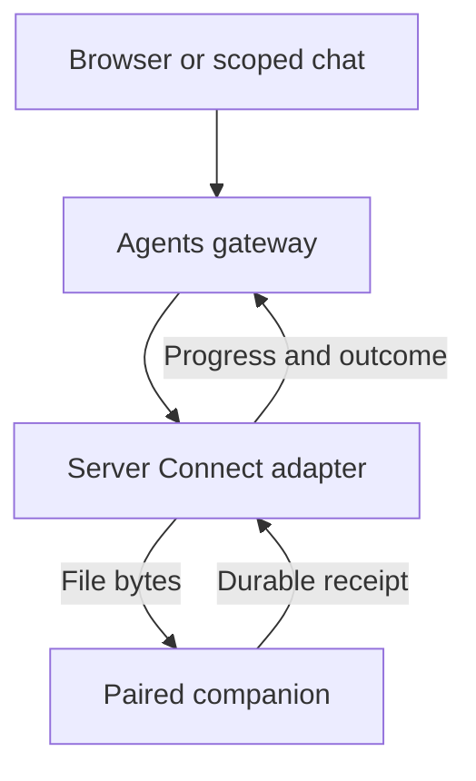
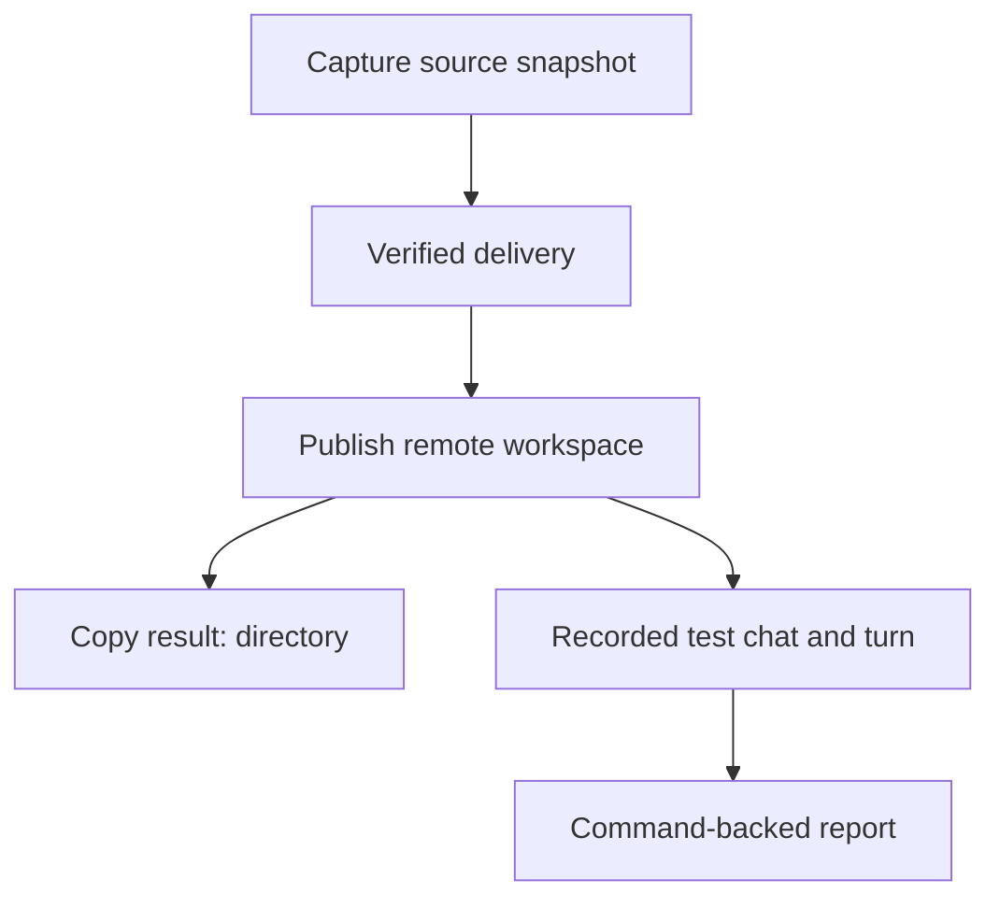

# Aixand Connect integration

Server coordinates paired-device work through the authenticated agents gateway.
Connect owns companion behavior and remote receipts. File bytes go directly from
the Suite host to the companion; the browser and model do not carry them.

## Control and transfer paths

## Implementation status

The companion source exists, but the Server adapters named below (`remote_chats.py`, `project_runs.py`, `project_matrix.py`, `connect_store`) are not present in the current application implementation. Gateway schemas alone do not establish end-to-end support. The tables retain the integration contract; remote orchestration and the historical validation recipes need requalification. See [source coverage](../implementation-status.md).



| Boundary | Contract |
| --- | --- |
| Public transport | `/api/agents/ws` validates `connect-*`; existing session, subscriptions, and backpressure apply |
| Worker/storage | `Chats.connect_store()` loads `services/connect`; private chat SQLite uses separate settings/device/receipt tables |
| Source setup | Suite-root `./dev.sh prepare`; `AIXAND_CONNECT_SOURCE` is an explicit development override |
| Concurrency | HTTP/hash/streaming on bounded worker threads; four concurrent transfers; at most four progress events per second per transfer |
| Chat authority | Profile/thread/active-turn/call ID derive the source; files stay inside the saved project; no arbitrary host, directory, chat, or credentials |
| Retry/control | Matching sends in one turn reuse the saved operation; status/cancel stay conversation-scoped; setup belongs to Settings |
| Events | `connect-transfer-updated`, `connect-project-updated`, and activity events use the authorized connection; browser loss does not stop work |

## Remote chats and project snapshots



| Path | Contract |
| --- | --- |
| Direct Codex | File transfer/direct chats need no Undercurrent. Companion `--project-root` advertises remote Codex support |
| Preflight | `connect-codex-inspect` verifies live NetBird identity, installation/login, and remote directory |
| Routing | `chat-create` with `deviceId` uses `remote_chats.py`; pin device/directory; reject mixed remote target and local backend |
| Native execution | One stdio `codex app-server` per live chat; four-process cap; bounded buffers; allowlisted requests and durable mutation receipts |
| Reconnect | Reload retained thread history/approvals; a buffer gap requires reopening; never replay uncertain input or fall back to the Suite host |
| Project copy | `copy_project_to_device`; `connect-project-copy/start/check/cancel`; needs `projectSnapshots`, no Codex or execution arguments |
| Project test | `test_project_on_device`; `project_runs.py` journals delivery/publication and linked chat; default access is Workspace write |
| Snapshot | `snapshot.py` builds a bounded ZIP with checksums, exclusions, portable-path validation; `project_workspace.py` publishes under a new UUID in the first project root |
| Repeated preparation | Return the existing workspace, preserving remote edits; a lost response never creates another test turn |
| Result/control | `get_project_run` exposes the confirmed `cwd`; `cancel_project_run` handles copies/tests, scoped to origin |
| Passing report | Requires actual native command evidence from the assigned turn; missing/malformed reports remain unconfirmed |

### Multi-machine comparison

| Property | Rule |
| --- | --- |
| Entry | `test_project_across_devices`, `list_project_test_targets`; gateway `connect-project-compare` / `connect-project-targets` |
| Targets | Two to four target records in one parent journal/card; one packaged snapshot, matching manifest/archive identities |
| Scheduling | Two active target jobs; others queue; target updates advance the parent revision |
| Suite host | Private `project-workspaces/<database>/<target>` extraction; journal-checked internal snapshot override, never browser-supplied |
| Isolation | No tests run in the original source directory; neither copies nor remote edits sync back |
| Control | Check, Stop, approval, failure, and report are per target; `targetId` must belong to the comparison |
| Restart | Unfinished targets become uncertain; Check reuses snapshot/chats without repeating unconfirmed submissions |

## Optional device managers

| Selection or capability | Behavior |
| --- | --- |
| Discovery | `managerDiscovery`; `/v1/managers`; gateway `connect-managers-inspect`; tool `inspect_device_managers`; package/profile/preflight report, no launch or secret contents |
| Auto | `chat-create` with `deviceId`, `profile: null`; quota routing happens on that machine |
| Specific | `profileSelection: {mode: "specific", profile: "personal"}`; legacy `remoteProfile` remains an exact-profile alias |
| Direct | `{mode: "direct"}` explicitly uses device-native Codex; Direct on the Suite host retains the controller profile |
| Managed transport | `remote_managed.py`; `/v1/managers/sessions/<chat UUID>` uses a fixed allowlist; interpreter, stores, runtime addresses, and connections stay device-owned |
| Helper | Discovered/configured `--manager-python`; downloadable base companion remains dependency-free |
| Authority | Agent Manager prepares launches/resources; Server Manager owns normalized sessions, receipts, event replay, approvals; Undercurrent owns retained processes |
| Pinning | Save interpreter, manager/runtime binding, create/launch IDs, account/profile/session before delivery; helper exit only disconnects |
| Quota | Rank remaining weekly allowance; reject exhausted short-term or unknown/stale observations; no fallback for unavailable managers/quota |
| Per-target policy | Project start accepts `profileSelection`; comparisons also accept `targetProfiles: [{deviceId, profileSelection}]`; omitted selection is independent Auto |
| Readiness | Check before target upload; quota choice at launch; file-only copies need neither agents nor profile selection |

Retries keep the original account, route, runtime, and session. Read-only recovery
does not launch a worker. Linked tasks resolve the assigned native turn through
its retained send receipt. Credentials remain on the device.

## Checks

Run from `apps/server` in the existing compatible SDK environment:

```sh
npm run build
npm run lint
npm test -- src/agents/connect-protocol.spec.ts src/agents/protocol.spec.ts
PYTHONPATH=../../../manager-suites/agent-manager:../../../undercurrent/python/src:../../../manager-suites/prompt-manager/src:../../../carrier:../../../manager-suites/mcp-manager/src:../../../manager-suites/server-manager/src \
  python3 -m unittest discover -s agent-bridge/tests -p 'test_remote_chats.py' -v
PYTHONPATH=../../services/connect:../../../manager-suites/agent-manager:../../../undercurrent/python/src:../../../manager-suites/prompt-manager/src:../../../carrier:../../../manager-suites/mcp-manager/src:../../../manager-suites/server-manager/src \
  python3 -m unittest discover -s agent-bridge/tests -p 'test_project_runs.py' -v
PYTHONPATH=../../services/connect:../../../manager-suites/agent-manager:../../../undercurrent/python/src:../../../manager-suites/prompt-manager/src:../../../carrier:../../../manager-suites/mcp-manager/src:../../../manager-suites/server-manager/src \
  python3 -m unittest discover -s agent-bridge/tests -p 'test_project_matrix.py' -v
```

From `apps/web`:

```sh
npm run build
npm run lint
npm run test:connect
```

| Evidence | Scope |
| --- | --- |
| Remote chat / snapshot / matrix tests | Pairing, real dispatcher/receiver/journals, exclusions, extraction, loss/restart recovery, independent control, native-command report rules |
| Browser fixtures | Mock WebSockets; pairing, progress, stale events, reloads, remote chats, scoped comparisons, mobile/accessibility |
| `test_remote_managers_live.py` | Isolated real Undercurrent/Codex with local model fixture; set `UC_TEST_BIN`, `CODEX_TEST_BIN`; Manager SDKs and native Server Manager dependencies required |
| `services/connect/tests/test_managers.py` | Authentication, fixed arguments, unavailable runtime, interpreter/route pinning, ambiguity, bundled helper |
| Recorded Linux/Mac checks | Live NetBird chat/file/Stop/reconnect, four-test snapshot report, copy of 645 files without a new Codex session, matching three-test comparison |
| Privacy / limits | Recorded live checks used isolated Suite state and retained original files; Windows native remote execution remains unverified |

## Conversation deletion and retained work

| Operation | Effect |
| --- | --- |
| Delete history | Local and available offline; retain frozen `chat_deletion_details`, project/workflow records, and explicit terminal-control release |
| Parent/subtree delete | Atomic, idempotent; deleted chats reject user input, disappear from search/broadcasts, and lose visible links |
| `connect-activity-list/check/stop` | Inspect/control unresolved work independently of chat visibility |
| `workflow-run-action` | Control an accessible run by its retained identity after origin deletion |
| `chat-delete-stop` | Validate captured family/work, cancel, verify outcome, then ordinary deletion; cancellation acknowledgement alone is insufficient |
| `GET /v1/codex/sessions/<id>` | Read-only inspection without `ensure`; optional `turnId` / `operationId` recover `codex_turns` evidence and receipts |
| Pending workflow report | Persist terminal evidence/report before Carrier; retry the existing `native_messages` identity without a live provider |
| Deleted worker | Retain only assigned workflow-report read capability until execution ends; Runner owns dependency advancement |

Update companions for read-only inspection support. Regression evidence includes
`test_history_activity.py`, `test_suite_resources.py`, `test_sdk_workflows.py`,
companion `test_codex.py`, and browser `chat-delete.spec.ts` / `background-work.spec.ts`.

[Companion setup, limits, storage, platform scope](../../../../services/connect/README.md)
