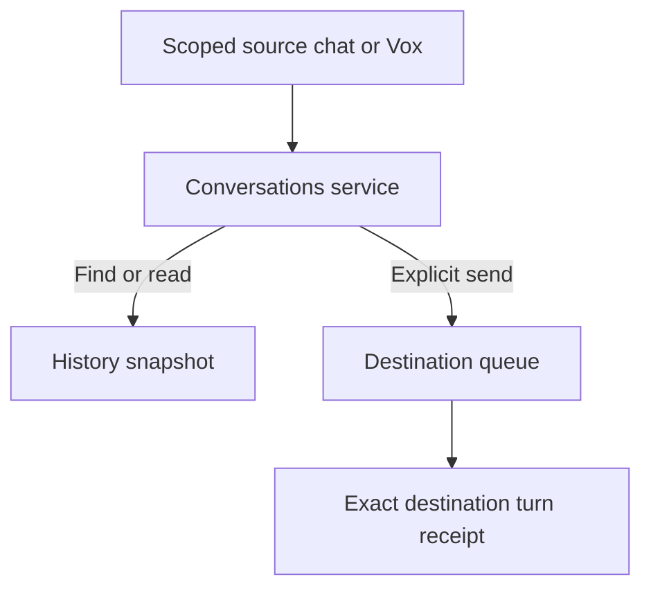
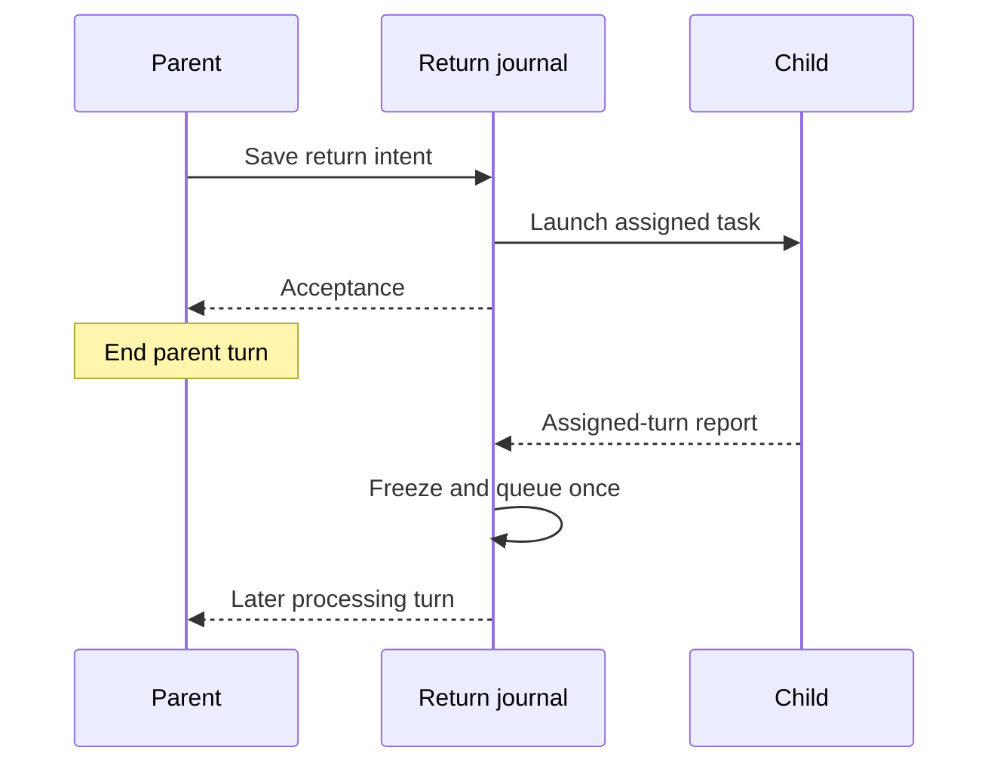

# Shared conversation tools

Vox and ordinary Suite Codex chats share `aixand_conversations`. Reading observes
existing conversations; sending uses the destination's durable follow-up queue.

## Read and send paths

## Implementation status

The retained `aixand_conversations` JSON contract exists, but the older `Conversations` service and `conversations_mcp.py` implementation described here are absent. Current Orchestration MCP exposes normalized Conversation Manager tools. Treat the legacy search/follow-up/automatic-return flow as an unqualified contract, not proof of current delivery behavior. See [source coverage](../implementation-status.md).



| Tool | Result |
| --- | --- |
| `search_chats` | Paginated titles/project names and user/assistant history; project/activity filters; recency ordering |
| `read_chat` | Snapshot of available/streaming messages, backward pages, long-message chunks, and family provenance |
| `send_chat_message` | Durable follow-up receipt and destination link; retains target history/profile/model/project/access |
| `get_chat_message_status` | Queue/delivery state and the exact destination turn's outcome/reply |
| `read_delegation_result` | Immutable originating-chat report, pages up to 16,000 characters |

## Search and read contracts

| Boundary | Rule |
| --- | --- |
| Coverage | Saved native conversations beyond UI's 100-chat list / 300-item snapshot; provider transcripts remain authoritative |
| Search cache | Refresh after changes; expires after 15 seconds; report unavailable history/coverage |
| Content | User/assistant messages only; no reasoning/tool output; Carrier-only conversations and standalone terminals excluded |
| Running/waiting read | Locally retained streaming messages; no provider call or shared history queue |
| Idle read | Reuse recent complete history or attempt refresh; login, queue, setup, rotated reads share a one-second budget |
| Incomplete refresh | Return available messages with `historyComplete: false` and `historyError`; withhold messages if saved login cannot be verified |
| Family | Current attachment differs from origin; detached child keeps provenance; totals/next offsets and cycle detection bound traversal |
| Deletion | Exclude deleted chats from search, family links, reads, and sends |

Reads never interrupt, resume, or submit a turn. Exact-delivery and supervisor
reconciliation use their separate provider-refresh path.

## Follow-up queue

| Case | Behavior |
| --- | --- |
| Clear send instruction | Send without another confirmation; clarify ambiguous target/content |
| Busy target | Queue in order without interruption; retain voice/launch/Runner ownership |
| Paused target | Keep paused and report it; UI can edit/remove/resume queued messages |
| Terminal client | Shares the thread; does not block queued messages |
| Retry | Same source turn + destination + text reuse one receipt even with another tool-call ID |
| Later source turn | May intentionally send the same text again |
| Unknown delivery | Inspect; never automatically replay; retain exact acknowledged target turn |
| Provenance | Show Sent via Vox or originating-chat link |

## Automatic returns from spawned chats



| Boundary | Contract |
| --- | --- |
| Launch | Attached `start_project_chat` / `start_remote_chat` persist intent before child creation and retain the confirmed initial thread/turn receipt |
| Waiting | Parent acknowledges dispatch and ends; child runs independently; no polling, browser, or Carrier required |
| Later dependent work | Save complete mandate in a persistent monitor; report/receipt events wake evaluations; ordinary one-off sends add no automatic watches |
| Scope | Only the assigned turn supplies the return; later child follow-ups do not replace it; legacy launches are not backfilled |
| Supervisor follow-up | Queue admission atomically registers an exact-receipt watch; retain full immutable report evidence, including results arriving before checkpoint |
| Adoption | A monitor may read reports belonging to its originating conversation, not unrelated chats |

Required child report:

```json
{"outcome":"completed","report":"The complete Markdown report"}
```

| Report / delivery | Rule |
| --- | --- |
| Outcome | `failed` when blocked; invalid/empty/oversized report, provider failure, or interruption produces explicit failure |
| Limit | 100,000 bytes in JSON string representation; original provider response stays inspectable |
| Storage | Freeze report in journal; small report inline, larger by reference; read every referenced page |
| Deduplication | Deterministic message identity; atomic queue admission/receipt; recovery reconciles rather than republishes |
| Unknown submission | Remain uncertain; never replay automatically |
| Processing | Delivery acceptance differs from parent-turn completion; retain exact receiving turn |
| Holds | Busy parent queues; Stop/paused queue, terminal/voice/Runner ownership, or full queue can hold admission |
| Detach/delete | Detached launches have no return; detach/delete cancels undelivered and unsent queue entries; submitting/accepted input cannot be recalled |
| Removed return | Never send it again; immutable result text; separate user instructions remain possible |
| Meaning | Application-assigned child/task/turn evidence under the existing request, not new user instructions or an automatic reply to the child |

UI states include waiting, pending, queued, paused, accepted, processing, processed,
cancelled, removed, and uncertain. Carrier Main-inbox delivery is a separate path.

## Transports and lifecycle

| Boundary | Contract |
| --- | --- |
| Schemas | `orchestration_mcp/services/conversation_tools.json`; standalone contracts in `orchestration_mcp/contracts`; bridge compatibility entries call one service |
| Native/stdio | Existing native app-server bridge or `agent-bridge/conversations_mcp.py` over private Unix socket; same database owner/queue, no public listener |
| Capability | `Conversations.toolset(origin)` returns host-only `mcpConfig` for an active controller or bound Vox; no tokens in browser snapshots |
| Refresh | Idle old chat gets updated tools at attachment; running turns retain tools; restart backend/new Vox call as needed; worker scope stays limited |
| Events | Indexed thread/profile/run lookup; healthy children use subscriptions; completion/loss reconciliation can refresh full history |
| Failure | Drop is not proof of stopped worker; retain reason, isolate notification-handler failures, preserve confirmed terminal outcomes against replay/races |
| Stop | Pause queue and reconcile exact turn before interrupt; completed turn must not interrupt a successor |
| Watchdog | Active metadata at most once per 30 seconds; history only when idle/reattaching; no model turn kept running |

## Validation

| Evidence | Scope |
| --- | --- |
| `test_conversations.py` | Scoped service and real stdio broker subprocess |
| `test_workspace_codex.py` | Opt-in installed Codex/local Responses fixture; search/read/send without external model calls |
| `test_delegations.py` | Exact turns, large results, holds, Stop, detach/delete, crash/uncertainty |
| `conversation.spec.ts`, `vox-conversations.spec.ts` | Chat Playwright configuration |
| Web `npm run test:chat-delegations` | Isolated browser/backend/SDK/offline provider; return across two restarts without open chat or Carrier |

Run Python checks in the existing SDK environment. Validation scopes above do not
claim a live paid-provider check. See [supervision](../lifecycles/supervision.md).
