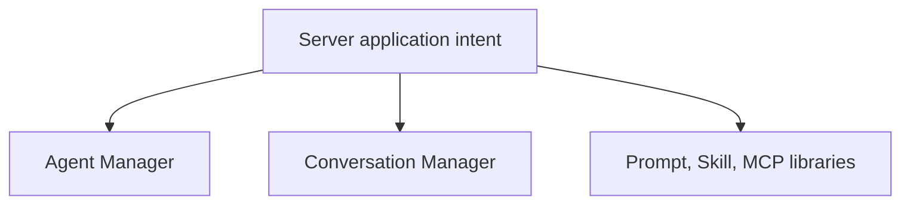

# Integrate independent managers

Server owns workspace associations and captured intent. Each manager retains its
domain's state and lifecycle.

## Prepare dependencies

| Mode | Preparation |
| --- | --- |
| Published dependencies | Suite-root `./dev.sh prepare` |
| Deliberate sibling development | `./dev.sh prepare --local-sources` |
| Packaged workers | Installed distributions; source overrides ignored |
| Orchestration MCP | Built from `mcps/orchestration`; separate from the managers |

[Dependency preparation](../../../../docs/development/dependencies.md)

## Keep state with its owner

| Owner | State / rule |
| --- | --- |
| Agent Manager | Native environments, profiles, provider operations and readiness |
| Conversation Manager | Transcripts, queues, settings, approvals, worker lifecycle |
| Resource managers | Independent profile-free libraries selected by `PROMPT_MANAGER_HOME`, `SKILL_MANAGER_HOME`, `MCP_MANAGER_HOME` |
| Suite launch | Capture resources before startup; library edits do not retarget running chats |
| Capability report | Inventory is not account access, a successful model turn, or qualified native skill delivery |

Check current provider/backend capabilities rather than inferring support from a
profile name. See [agent integration](../../../../docs/development/agent-integration.md),
[application composition](../../agent-bridge/application/README.md), and
[onboarding](../../../../docs/development/onboarding.md).

## Recover uncertain work

Retain environment, profile, conversation, and operation IDs. Inspect the original
receipt/journal before retrying. Missing dependencies or unsupported capabilities
return unavailable; never fall back into another manager's store.
