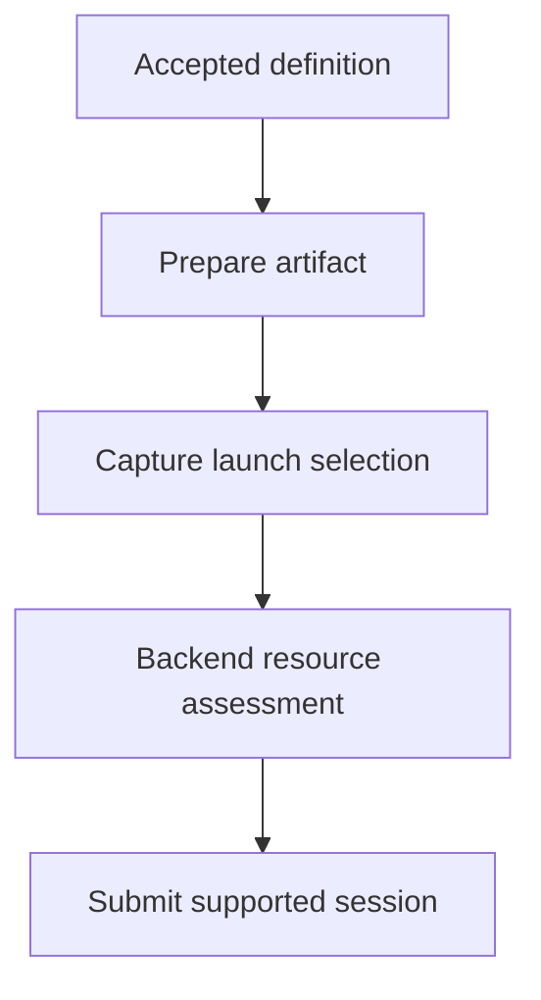

# MCP integration

MCP Manager owns definitions and prepared artifacts. Suite captures the accepted
selection; Agent Manager owns native environment and launch capability.

## Prepare a managed chat

| Step | Rule |
| --- | --- |
| Prepare Suite | Run `./dev.sh prepare` at the Suite root |
| Inspect selection | Use the resource library and accepted definition/preparation state |
| Capture | [Resource adapter](../../agent-bridge/application/resources.py) retains selections before launch |
| Required failure | Block launch; omit optional resources only under the accepted contract |
| Later library edit | Existing captured configuration stays unchanged |

Definitions neither freeze an external executable nor prove account access.
Profiles do not own the resource library. See
[agent integration](../../../../docs/development/agent-integration.md).

## Keep Suite tools scoped

| Boundary | Required behavior |
| --- | --- |
| Controller / worker resources | Apply [registered Suite tools](suite-resources.md) |
| Tool context | Capture originating role and allowed operations in [tools.py](../../agent-bridge/application/tools.py) |
| Child reporter | Private report endpoint; no inheritance of unrestricted parent orchestration authority |
| Result | Distinguish execution completion, Carrier publication, and [host acceptance](../../../../mcps/orchestration/docs/delegation-workflows.md) |
| Retry | Same operation ID and private context; inspect uncertain outcomes |
| Failure | No recovery by switching profile or standalone workspace |

Native terminal and managed-conversation tools have separate capability/lifecycle
contracts. Advanced delivery paths need their own qualification.
