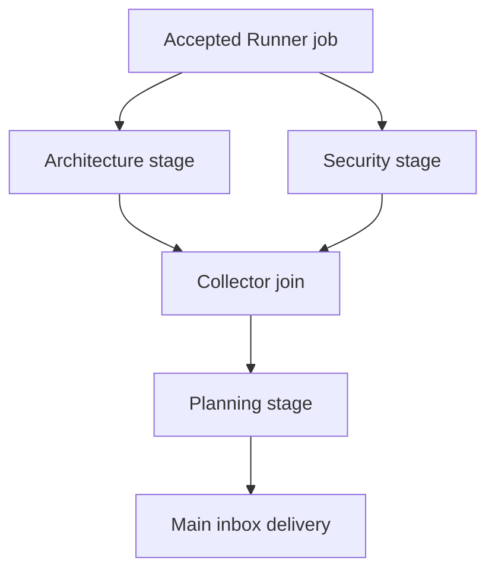
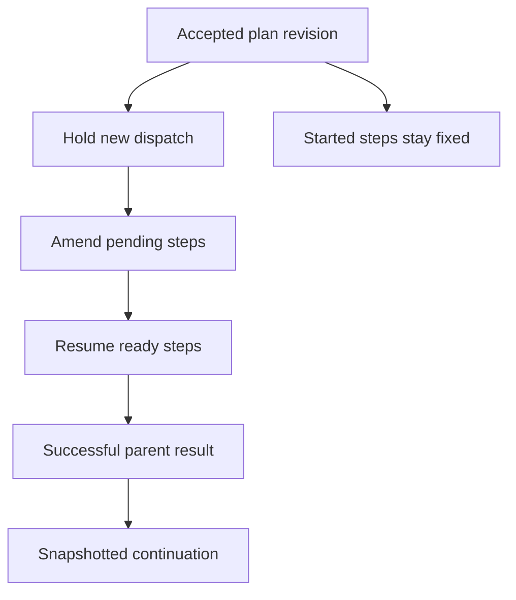

# Native chat workflows

Runner schedules and checkpoints. Suite supplies captured chat effects and
correlated reports. Carrier owns stage messages and final human delivery.

## Implementation status

Runner transport and the workspace workflow adapter exist. The historical Server native-workflow handler/test cited in the validation recipe is absent from this checkout. The detailed native chat/Carrier behavior below is a retained contract requiring boundary-specific qualification, not an established result of the current source tests. See [source coverage](../implementation-status.md).



| Entry / observation | Contract |
| --- | --- |
| Builder | Workflows → New workflow → Project audit → main inbox; editable graph uses the common node library/Run panel |
| Graph | `aixand.workflow-graph` version 2 via `/api/workflow-jobs/ws` when advertised; version 1 fallback for older hosts |
| Nodes | Project chats, managed agents/advisers, Spawn/Send/Wait, Collector, Carrier, Result, Done, Main inbox, Previous workflow result |
| Adviser links | Optional messaging; no required reply to finish a task |
| Native checkpoints | Reconcile retained outputs/identities after restart; live SDK handles preserve IR's non-replayable uncertainty policy |
| Legacy attempts | Preserve accepted submissions; audit-form migration backs up originals; opening an attempt never resubmits |
| Chat launch | `start_project_audit_workflow` / `start_project_workflow`; accepted run ID/link; controller ends its reply unless monitoring requested |
| Status/control | `get_workflow_status`, `cancel_workflow`; controller/browser closure does not cancel stages |
| Stage plan | Up to 16 named stages, `dependsOn`, `deliveryStep`; project/model and default profile inherited; stages cannot spawn more chats through workspace tools |
| UI discovery | Runs appear with saved library; open existing run/read-only progress; layout edits do not recompile accepted work |
| Results | Collector needs successful correlated reports and Carrier acknowledgement; Main inbox shows confirmed message ID |
| Public progress | Paginated, restored by backend events/reload; excludes credentials/full reports; history survives origin deletion |

Claude SDK and Antigravity SDK controllers also use this pipeline. Retain their
provider/backend and inherited or explicit profile; capture
`sdkApprovalPolicy: ask | deny`, with no quota Auto. Exact-turn SDK artifacts and
the scoped broker provide reports. Require `sdk_chat_workflows: [1]` and updated
workers. The native sandbox presets below apply to Codex.

## Spawn access and profile selection

| Field / policy | Rule |
| --- | --- |
| Default access | Four runtime presets or Manual; saved YOLO applies to audits/reviews; task wording does not change runtime authority |
| `permissionMode` | Run-wide or stage override, frozen into `permission_mode`; `full-access` means no sandbox or approval prompts |
| Manual | Explicit mode for every stage (or run default); report missing IDs before creation; never pass Manual as a provider mode |
| Existing work | Retain accepted access across settings changes, retries, restart, append/amend; new Manual stages require explicit access |
| `profileSelection` | `{"mode":"controller"}`, `{"mode":"auto"}` with optional `eligibleProfiles: ["work", "backup"]`, or `{"mode":"specific","profile":"backup"}`; omitted stage inherits |
| Auto timing | Choose when a stage becomes ready; rank weekly allowance, reject short-term exhaustion/unknown/stale quota, tie-break account load/stable names |
| Account identity | Codex auth aliases for the same account share allowance; model/resource compatibility required; no candidate is an error |
| Scope | Local Codex quota adapter only; remote machine uses its own adapter |
| Pinning | Persist profile, auth/account, requirements, quota decision before worker creation; changed saved auth/resources rejects launch |
| Resume | Server Manager forwards captured sandbox and approval settings |
| Preparation | `chat-workflow-prepare` with stable `key` and graph before Runner submission; retain prepared graph for retries/continuations |
| Prerequisites | `chat_permission_modes`, `chat_spawn_policy: [1]`; rebuild/restart older processes; legacy payloads retain their concrete policy |

A failed run that already created read-only chats needs a new launch to change
access; reconciliation must not silently upgrade existing identities.

## Upcoming work and follow-up workflows



| Action | Semantics |
| --- | --- |
| Apply changes to run | Pending instructions/dependencies only; add/insert/remove pending work; compare accepted revision, refresh after a race |
| Save definition | Future launches; combined action explicitly applies both |
| Started work | Fixed instructions/access/prerequisites; retain live resources and chats |
| Pause/Resume upcoming steps | Hold dispatch while active work finishes; allow append; state/revisions survive restart |
| Final delivery | Close editing before sending human message |
| Enable editing | Adopt supported resumable native/graph run into version 2, retain original submission/effects, pause; started legacy SDK scopes cannot be adopted |
| Continuation | Save selected workflow snapshot during or after run; start only after parent success; failed/cancelled parent skips waiting links |
| Inputs | Previous workflow result; default `previous_result` → `/result` before human delivery; named exports/literal JSON allowed, no previews/live handles |
| Control | Cancel pending links; submitted children retain parent link and ordinary cancellation |
| Tools | `amend_workflow`, `append_workflow_step`, `pause_workflow_steps`, `resume_workflow_steps`, `enable_workflow_edits`, `continue_with_workflow` |
| Idempotency | Require owned controller context; journal exact request before Runner; retry recovers same edit/child; loops remain future work |

## Configuration

Build Runner with `cargo build --locked`. Use actual private installation paths:

```dotenv
WORKFLOW_RUNNER_HOME=/absolute/private/runner-home
AGENTS_STATE_DIR=/absolute/private/chat-state
SUITE_WORKFLOW_SOCKET=/absolute/private/chat-state/native-workflows.sock
CARRIER_URL=http://127.0.0.1:8765
CARRIER_DATABASE=/absolute/path/to/the/database-served-by-carrier.db
CARRIER_STATE_DIR=/absolute/private/suite-carrier
CARRIER_WORKSPACE_ID=local
CARRIER_USER_ADDRESS=suite/local/user
```

Start the matching Carrier database and Runner socket:

```sh
carrier serve --db /absolute/path/to/the/database-served-by-carrier.db
runner --home /absolute/private/runner-home serve \
  --suite-socket /absolute/private/chat-state/native-workflows.sock
```

| Setting / capability | Requirement |
| --- | --- |
| Adapter startup | `CARRIER_DATABASE` or `SUITE_WORKFLOW_SOCKET` starts adapter at backend startup; crash reconnect is independent of browser |
| Python dependencies | Carrier in both environments; `CARRIER_SOURCE` selects explicit sibling sources |
| SDK workflows | Preserve existing `--sdk-config` and `--features sdk`; native chat path does not need the flag |
| Running executable | Rebuild alone is insufficient; restart through process manager |
| Runner health | `capabilities.native_chat_workflows: [1, 2]`, `workflow_graphs: [1, 2]`, `workflow_amendments: [2]`, `workflow_continuations: [1]`, `workflow_edits_adoption: [1]` |
| Unsupported host | Fail before chats start; explicit Reconcile progress retries saved key after upgrade; lost acceptance is recovered by key lookup |
| Runner home | `WORKFLOW_RUNNER_HOME` selection; Runner defaults `RUNNER_HOME`, then `$XDG_STATE_HOME/runner`, then `~/.local/state/runner` |
| Native socket | `AGENTS_STATE_DIR`, otherwise `$XDG_STATE_HOME/aixand/chats` or `~/.local/state/aixand/chats` |
| Main inbox | `CARRIER_USER_CREDENTIALS` or `CARRIER_STATE_DIR/user.json`; provisioning needs exact database; `CARRIER_AUTO_PROVISION=0` requires existing inbox |

Preserve existing credentials. Read-only lookup never submits unaccepted work.

## Handoffs and recovery

Required worker final report:

```json
{"outcome":"completed","report":"Complete Markdown report"}
```

| Boundary | Rule |
| --- | --- |
| Reports | `outcome: "failed"` when blocked; 100,000-byte JSON string limit; oversized/invalid response fails explicitly |
| Inputs | `aixand_workflow.read_input` pages up to 16,000 characters; consume full assigned reports, never UI previews |
| Correlation | Per-job collector and per-stage senders; reply to exact request; unrelated messages cannot unlock stages |
| Receipt order | Runner checkpoints result before acknowledgement; restart retries acknowledgement |
| Collector | Internal inspectable inbox; no manual send/ack/state mutation |
| Main inbox | Role `human`, default Home/Carrier destination; Runner never auto-consumes; final addressed message links stage chats |
| Restart / closure | Keep job/stage/message/chat/turn IDs; inspect with Reconcile progress or `runner resume JOB-ID` |
| Unknown effect | Stay `uncertain`; no replay or replacement thread |
| Cancel | Interrupt owned recorded turns; failed prerequisites block dependents, interrupt active siblings, and notify Main inbox |
| Cancel unconfirmed submit | Reserve its Runner key against late acceptance/retry |
| Approvals | Remain in the stage chat for user response |

Native plans provide successful joins/failure gating. Arbitrary branching belongs
to IR. Stable Carrier send keys deduplicate messages, not arbitrary external effects.

## Verification

Build Runner first; run from `apps/server` with the documented source SDK environment:

```sh
PYTHONDONTWRITEBYTECODE=1 \
PYTHONPATH=../../../manager-suites/agent-manager:../../../manager-suites/mcp-manager/src:../../../manager-suites/prompt-manager/src:../../../manager-suites/skill-manager/src:../../../manager-suites/server-manager/src:../../../undercurrent/python/src:../../../carrier \
../../workflow/ir/.venv/bin/python -m unittest discover \
  -s agent-bridge/tests -p test_native_workflows.py -v
```

The check uses real Runner/Carrier with a simulated provider: ordering, restarts,
full reports, correlation, invalid results, ownership, cancel/uncertainty,
message deduplication, edits, held restart, adoption, continuations. No paid model
calls. From `apps/web`, `npm run test:workflow-builder -- tests/project-audit.spec.ts`
checks authoring, submission recovery, live progress, and accessibility.
