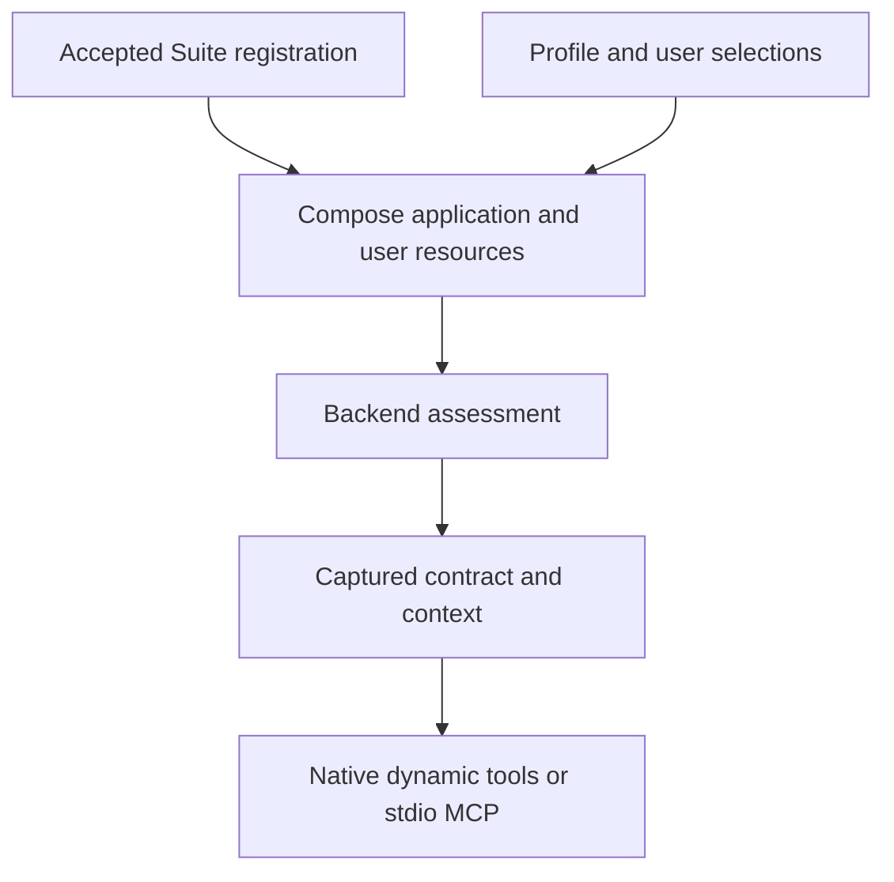

# Registered Suite default tools

Suite composes application resources with user/profile selections. Required
application resources retain their policy and captured versions.

## Implementation status

The bridge currently returns `unsupported` for `suite-resource-presets`. The legacy `orchestration_mcp.services` implementation described by this retained contract is absent except for diagnostics. Current launch-resource and scoped-broker adapters must be inspected separately; do not infer controller defaults or refresh support from these descriptions. See [source coverage](../implementation-status.md).

## Presets and capture

| Context | Resources |
| --- | --- |
| Normal local chat | `aixand-suite/controller`: workspace, conversations, agent administration |
| Basic chat | Explicitly disables application defaults |
| Project chat | Controller defaults plus selected project resources |
| Worker | Task resources without controller tools |
| Native workflow stage | Scoped workflow-input resource |
| Profile inheritance disabled | Does not disable application defaults |

| Owner / artifact | Contract |
| --- | --- |
| Suite startup | Registers `workspace`, `conversations`, `agents`, `workflow` under `aixand-suite` |
| Orchestration package | `orchestration-mcp` command and deterministic Python zip adapters from `mcps/orchestration` |
| MCP Manager | `capture_artifact` creates immutable digest-named copies; registration runs no installers/package scripts |
| Publisher lifecycle | Three-way reconciliation; customizations/rollback holds keep accepted definitions |
| `SuiteResources` | Application policy; Agent Manager provides generic layers/bindings without a Suite dependency |
| Composition | Deduplicate matching identities; conflicting exclusion cannot weaken a required resource—choose another preset |

One session receives one transport per application resource: native Codex dynamic
tools or managed stdio MCP. Shared handlers and receipts live in
`orchestration_mcp.services`; Suite entry points remain compatibility adapters.
Standalone hosts can use those handlers without Server. Backend assessment occurs
before submission.

## Context and version boundaries

| Item | Rule |
| --- | --- |
| Context files | Owner-only broker credentials; outside snapshots/history; runtime descriptors carry file references and definition/contract digests |
| Scope | Chat, profile, provider, project, origin, workflow identity; require active originating turn and captured group/contract |
| Receipts | Durable; never automatically replay unconfirmed calls |
| Delete / restart | Delete revokes contexts; restart restores existing broker/bindings without new accepted versions or bearer credentials |
| Snapshot | `agent-manager/resource-snapshot-4`; older request/snapshot versions remain readable |
| Broker | `aixand-suite/broker-1`; adapter verifies immutable artifact and contract |
| External behavior | Capturing an adapter does not freeze the deployed service/database; breaking protocol must remain compatible or reject context |

## Authenticated bridge operations

| Operation | Result / constraint |
| --- | --- |
| `suite-resource-presets` | Presets and readiness |
| `launch-preview` + `applicationPreset` | Same composition as creation; required failures precede native submission |
| `suite-mcp-context` + chat ID / durable key | Host-only private references and application/binding descriptors, never bearer credentials; active-turn scope still applies |
| `suite-tools-refresh` | Explicit idle-native upgrade, same Suite ID/history/user resources; retain creation receipt; uncertain result requires inspection |

Registered chats retain captured contracts on reopen/send; fresh chats use accepted
current registrations. Managed sessions need a new chat for new defaults. Legacy
native refresh remains supported; no migration rewrites account/profile defaults.

Paired-device contexts keep their own resource behavior. Do not forward host files
or Unix sockets as device paths. Remote `suiteTools=true` creation returns
`unsupported` until an authenticated relay is implemented and verified; ordinary
remote chats continue without Suite tools.
