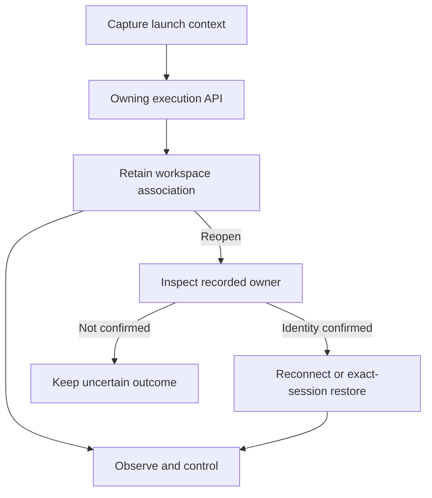

# Server conversation lifecycle

Server associates a workspace chat with managed execution. Conversation Manager
owns transcripts, settings, approvals, queues, and worker lifecycle.

## Launch and observe

This is a conceptual flow, not a persisted state enum. Reopen uses retained
identities; restoration does not resend previous messages or commands.

## Capture once, retain identity

| Input | Rule | Source |
| --- | --- | --- |
| Backend, environment, profile, project | Retain resolved identities; aliases must not retarget work | [SuiteChats](../../agent-bridge/application/chats.py) |
| Resources and effective access | Capture before execution; later defaults do not rewrite accepted work | [Resources](../../agent-bridge/application/resources.py) |
| Readiness | Check through the selected manager; unsupported required resources fail visibly | [Onboarding](../../agent-bridge/application/onboarding.py) |
| Approvals and questions | Preserve the owning request and scope | [Conversation tools](../integrations/conversation-tools.md) |

## Saved defaults and automatic approval

[Spawn access](../../agent-bridge/application/services/spawn_access.py) captures saved access defaults;
[behavior.py](../../agent-bridge/application/behavior.py) applies automatic approval through the public SDK.
The settings retain their existing workspace database tables and revisions.
New Codex chats and Suite worker contexts capture the saved default access.
An explicit launch value takes precedence. Existing chats keep their access.
The Manual default requires an explicit value before a new launch.

Automatic approval acts on known permission requests in retained SDK chats.
It uses a stable operation ID for each request. It leaves questions and unknown
requests for the user. Failed delivery stays visible for a manual response.
The saved switch also applies to pending requests and restored background chats.
Legacy chat records remain read-only.

## Recover or remove

Opening a saved chat calls `ExecutionServices.reconnect_conversation` before
reading live state. Reconnect checks the recorded process owner; exact-session
restore retains history and confirmed settings without resending messages or commands.

| Situation | Action |
| --- | --- |
| Reopen saved chat | Reconnect through execution services; inspect recorded process ownership |
| Supported stopped session | Restore that exact session; update the worker reference, retain the Suite ID |
| Background observer sees stopped worker | Report it; do not restore every saved chat at startup |
| Acceptance lost | Inspect the original operation, conversation, worker, session, and turn IDs |
| Detach, cancel, stop, or delete | Apply the specific contract; these actions have different effects |

A completed turn, a successful task, and delivered report remain separate facts.

## Unread completion state

Unread completion state belongs to Suite presentation metadata. Successful results
persist `latestCompletedTurnId`; `chat-mark-read` records `lastReadTurnId` only when
the acknowledged turn is still the latest completion. The workspace account shares
this state across devices through the existing chat update broadcast. The web
reader acknowledges a completion only while visible, focused, and at the latest
loaded response. Failed and cancelled results do not create unread success markers.

[Application notes](../../agent-bridge/application/README.md) ·
[Ownership](../architecture/ownership.md) ·
[Manager-boundary tests](../../agent-bridge/tests/test_chat_manager_boundary.py) ·
[Restart tests](../../agent-bridge/tests/test_sdk_restart.py)
