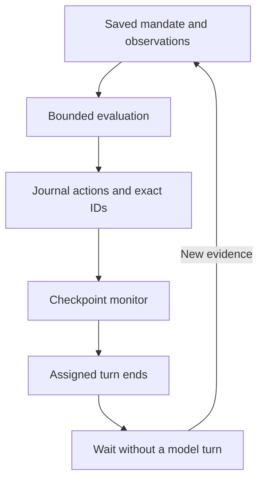

# Chat supervision

A monitor is a durable responsibility owned by an ordinary saved chat (`/#/chat`).
Its model runs bounded evaluations when evidence arrives, then ends its turn.

## Implementation status

`Adapter.execute` currently rejects `command-*` requests with `unsupported`. The older automation service and `agent-bridge/tests/test_automations.py` are absent. This page records the retained supervision contract; the event-driven runtime and historical test recipes must not be reported as implemented or passing in this checkout. See [source coverage](../implementation-status.md).

| Capability | Contract |
| --- | --- |
| Creation | Describe ongoing responsibility; controller uses `create_monitor` with complete mandate |
| Actions | Converse with existing chats, launch helpers, read full reports, create/amend workflows; fixed workflow optional |
| Waiting request | Save monitor and end even when user says wait; one quick dispatch snapshot is allowed, not continued polling/history reads |
| Turn ending | A final reply ends the turn; commentary saying it will wait does not |
| UI | Supervising, Needs you, Paused, Completed, Stopped; watched chat shows Supervised by |
| Filter | `/#/chat/supervising`; ordinary history/project/search remain available |
| Compatibility | `/#/command`, `/#/command/<chat-id>`, `/#/command/monitors/<monitor-id>` resolve to owning chat/panel; `command-*` names retained |
| Presentation | Last 100 supervision updates alongside paginated provider history; internal prompts hidden, execution details inspectable; rotations grouped under owner |
| Directions | Persist a new mandate, not steering an old autonomous turn; fresh execution chat preserves visible conversation |

## Execution and persistence

| Owner / event | Rule |
| --- | --- |
| Implementation | `mcps/orchestration/src/orchestration_mcp/services/automations.py`; bridge owns service alongside chats; Nest supplies auth/private source adapter; UI is a client |
| Durable identity | Scoped SQLite mandate, memory, observations, wakeups, execution history, action journal; execution chats are replaceable |
| Scheduling | Independent async tasks; at most four evaluations; idle watch keeps no active model turn |
| `checkpoint_monitor` | Host applies only after assigned provider turn ends; final brief in progress text, large deliverables with evidence reference |
| Failure | Failed turn, missing checkpoint, unavailable source, or ambiguous submission requires attention |
| Completion | Evidence references required; model assesses whether they substantiate mandate |
| Restart | Reconcile original supervisor turn/actions; never automatically resend an uncertain action |
| Reports | Attached tasks already return durably; no duplicate chat watch needed |
| Follow-up watch | Supervisor `send_chat_message` atomically registers exact-receipt watch before dispatch; fast results remain queued even before checkpoint |
| Evidence | Original spawn report stays immutable; later follow-up has its own full paginated report and completion event |

## Watches and controls

| Feature | Rule |
| --- | --- |
| Observations | Chat turn/status, exact message receipts, workflow settlement, retained Carrier inbox messages, one-shot timers, recurring intervals ≥30 seconds |
| Inbox | Start at current cursor unless `includeExisting`; observation never acknowledges/moves messages |
| Reconciliation | Events plus periodic check for completions missed during disconnection; owned task/workflow reports return directly |
| UI controls | Brief/memory/resources/activity/evidence/actions; pause/resume/stop, directions, limit extension, fresh execution chat |
| Limits | 100 evaluations; 30 actions per evaluation; checkpoint still available at limit; API supports deadlines |
| Pause/cancel/new directions | Revoke old evaluation authority and interrupt exact turn; accepted independent jobs/implementation chats continue |
| Ambiguity | Failed interruption and uncertain receipt stay visible |
| Strategy | `watch_monitor` / `unwatch_monitor` change observations |

## Workflow library

| Entry | Behavior |
| --- | --- |
| Make available to supervisors | Compile browser draft into server executable library; browser storage alone is insufficient |
| Library tools | `save_command_workflow`, `list_command_workflows`, `get_command_workflow`, `run_command_workflow`; revision checked |
| Formats | Version 2 native plans or executable graphs; Runner validates graph semantics at submit |
| Native template | Bind project/controller at launch; preserve access/profile/resources; reject named inputs |
| Executable graph | Named inputs supported |
| Reporting | Private monitor inbox; avoid human Main-inbox message for each internal stage |

## Setup and current support

| Dependency / API | Contract |
| --- | --- |
| Runtime | Build/restart existing backend/frontend; no Command daemon or new environment variables; browser may close |
| Backend stopped | Evaluations pause until reopening the same state directory |
| Supervisor | Local native Codex backend/profile/access; other supported provider chats may be observed |
| Tool updates | New controllers receive tools; existing captures require Update Suite tools/new chat; explicit adoption upgrades idle controller and preserves history |
| Runner/Carrier | Only features that depend on them; chat-only monitoring/delegation need neither |
| Inbox embedding | Suite private Carrier IPC; other apps inject `automation_source` |
| Public API | Authenticated `command-list`, `command-get`, `command-activity`, `command-create`, `command-update`, `command-pause`, `command-resume`, `command-cancel`, `command-evidence`, `command-action`, `command-capabilities`, library requests |
| Authority | Browser cannot impersonate checkpoints/private source replies; mutations retain durable key; lists/evidence/activity/action bodies bounded/paginated |

## Validation

| Evidence | Scope |
| --- | --- |
| Web `npm run test:command:ui` | Browser and accessibility |
| Web `npm run test:command` | Real Nest/Python/Agent Manager/Undercurrent, offline fixture, exact turns/full reports, browser closure/restart; no paid model calls |
| `agent-bridge/tests/test_automations.py` | Lifecycle, stale evaluations, interrupt races, idempotency, evidence scope, limits, recovery |
| Runner/Carrier integration | Monitor-owned reports and graph library |

[Conversation return contracts](../integrations/conversation-tools.md) ·
[Workflow coordination](workflows.md)
