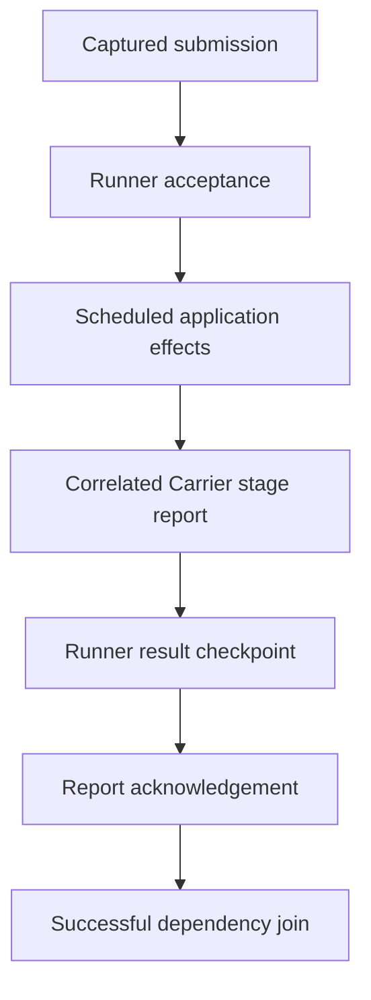

# Server workflow coordination

Runner owns durable jobs and scheduling. IR owns workflow semantics. Server
adapts workspace intent, scoped effects, and observations.

## Native chat report path

This is the successful native-chat path. Invalid reports and failed prerequisites
do not unlock dependents. Final human delivery requires its own confirmation.

## Adapter boundaries

| Entry | Job | Source |
| --- | --- | --- |
| Job transport | Validate public job requests and correlate Runner responses | [Jobs gateway](../../src/workflows/jobs.gateway.ts), [Runner adapter](../../src/workflows/runner-client.ts) |
| Workspace views/controls | Adapt retained jobs through Runner's Python client | [SuiteWorkflows](../../agent-bridge/application/workflows.py) |
| Workflow transport | Retain its gateway/bridge protocol | [Gateway](../../src/workflows/workflows.gateway.ts), [Rust bridge](../../workflow-bridge/src/main.rs) |

These adapters use the durable service; they do not create independent schedulers.

## Capture and recovery rules

| Boundary | Preserve |
| --- | --- |
| Accepted submission | Graph/plan, context, permissions, resources, and selection decisions |
| Effects | Host-selected bindings; documents cannot choose credentials or private endpoints |
| Lost acceptance response | Inspect Runner using the retained submission key; discovery does not submit unaccepted work |
| Restart | Reconcile supported native chat/turn identities; opaque-resource paths may remain uncertain |
| Cancellation | Target owned recorded work; completed effects are not rolled back |
| Controller turn ends | Accepted stages continue independently |

[Native workflow contract](../integrations/native-workflows.md) owns exact graph
versions, reports/limits, amendments, continuations, and capability prerequisites.

[Workflow-route tests](../../agent-bridge/tests/test_public_workflow_routes.py) ·
[Runner adapter tests](../../src/workflows/runner-client.spec.ts)
