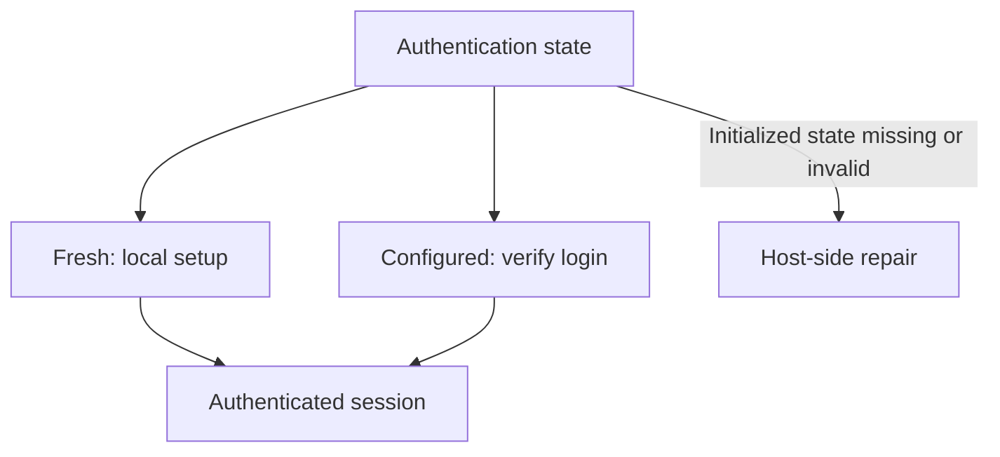

# Suite password authentication

One password grants the single-owner workspace's OS-user authority, including
terminal input, agents, workflows, chats, and Carrier.



## First startup

For local development, Node 24.15+, from `apps/server`:

```sh
npm ci
cp -n .env.example .env
npm run start:dev
```

| Boundary | Contract |
| --- | --- |
| Frontend | From `apps/web`, `npm run dev -- --port 5186`; open `http://127.0.0.1:5186` on host |
| Setup transaction | Password, initial session, pending `workspace_onboarding` record created together; full Suite already supplies managers/Runner/Carrier |
| Browser | HttpOnly cookie only; no password in localStorage/URLs; no access-key, setup-secret, initialization command, or web reset |
| Provider onboarding | Host OS/CPU/WSL/tools; Codex/OpenCode in the current Suite UI; managed install on compatible Linux/macOS |
| Selection | Installed compatible CLIs initially selected; detection refresh preserves manual selection; Agent Manager owns recipes |
| Progress | Names/selections/operation IDs only; `GET /api/auth/onboarding`; CSRF-protected `POST` with expected revision, stale save 409 |
| Resume | Set up later / Resume agent setup; reload, later login, and login terminal preserve progress; older configured installs are not forced through onboarding |
| Preview | Account-menu Onboarding simulates in memory; no probing, install, sign-in, profile or progress write |
| Initial setup admission | Loopback peer, Host, browser Origin, allowed Origin, no forwarded headers; deny configured proxy peers even on loopback |
| Vite / SSH | Vite validates original setup connection; remote host can use loopback SSH tunnel; normal HTTPS login works after local setup |
| Initialized state | Write `auth.db.initialized` before creation; preserve database+marker; missing/empty/corrupt/unsupported state requires host repair |
| Schema-one upgrade | Transactional; keep configured hash, credential version, sessions; unfinished setup can use local password setup |

## Configuration and network deployment

| Setting | Purpose |
| --- | --- |
| `AIXAND_AUTH_DATABASE` | Absolute authentication database path; defaults to `~/.aixand/suite/auth/auth.db` |
| `AIXAND_AUTH_DEV_HTTP=1` | Explicit HTTP exception for loopback peers, loopback hosts, and loopback browser origins only |
| `AIXAND_AUTH_LOOPBACK_HTTP=1` | Same strict local/SSH exception; takes precedence over the legacy development flag |
| `AIXAND_AUTH_COOKIE_NAMESPACE` | Optional instance cookie namespace; production derives one from its authentication database path |
| `AIXAND_TRUST_PROXY` | Comma-separated exact reverse proxy peer IP addresses; default is empty |
| `CORS_ORIGINS` | Exact browser Origin allowlist, including scheme and port |

| Enforcement | Values / rule |
| --- | --- |
| Production | [Production entry](production.md) uses `AIXAND_PRODUCTION_*`, port 8753; namespace derived from auth database path |
| Network | Same HTTPS frontend/API origin; exact proxy peers; preserve Origin/cookies/WebSocket upgrades; set trusted `X-Forwarded-Proto: https` |
| Development | Loopback/private daemons; disable development HTTP exception for network hosting; Vite public binding is not a production boundary |
| Forwarded headers | Untrusted peer cannot select secure status/client IP |
| HTTPS cookie | `__Host-aixand-session`, Secure, HttpOnly, SameSite=Strict, Path=/; loopback uses `aixand-dev-session` |
| Session lifetime | 12 hours maximum / one-hour inactivity; authenticated workspace commands count, pings/auth-status checks do not |
| Session cap | 32; excess login revokes oldest |
| WebSockets | All five gateways validate session/exact Origin before bridges; commands/sends rechecked, idle sockets checked every second |
| Logout / recovery | Close current-session sockets / revoke every session; durable jobs and shells can outlive browser disconnect |
| Password | 15–128 Unicode characters, spaces allowed, no trimming; bundled common-password rejection |
| Hash | Argon2id, 64 MiB, three passes, parallelism one, random salt; two concurrent hash operations |
| Throttling | Five failed attempts/IP/minute, increasing cooldown capped at 15 minutes; global 30 setup/login attempts/minute; expiring SQLite counters |
| Logs | Exclude passwords, cookies, CSRF tokens, request bodies |

## Recover through a host helper

Recovery requires terminal or SSH access as the host owner. Anyone who can execute
shell commands as the Suite OS user can also modify its authentication database.
The recovery link is instructions only; there is no web reset endpoint.

1. Stop `aixand-server` using its service manager or Ctrl-C.
2. Locate the configured authentication database. Preserve its exact path and
   back it up together with its `.initialized` marker; do not delete it or replace it with an empty file.
3. For installed Server, run `aixand-server password` on the host using the
   selected workspace configuration. In a source checkout, run `npm run auth:recover`
   from `apps/server` with the configured authentication database. Enter the new password twice
   through the hidden terminal prompt. Do not pass it as an argument or paste it
   into chat.
4. Restart the backend and sign in. The helper replaces the Argon2id hash,
   increments `credential_version`, and deletes all sessions and throttling
   counters in one transaction. Existing browser cookies cease to authorize access.

Use a dedicated private parent directory (`0700`); initialization refuses shared
existing directories without changing their permissions. The authentication database
is private (`0600`). Keep backups private too. Restore a valid backup if the credential record
or schema has been damaged; recovery refuses invalid records and missing databases.


## Manual SQL recovery

Stop the backend first. In the following commands, set `aixand_auth_db` to the
actual configured path if it differs from the default:

```sh
aixand_auth_db="$HOME/.aixand/suite/auth/auth.db"
umask 077
cp -pn -- "$aixand_auth_db" "$aixand_auth_db.before-recovery"
cp -pn -- "$aixand_auth_db.initialized" "$aixand_auth_db.initialized.before-recovery"
npm run auth:hash-password
sqlite3 "$aixand_auth_db"
```

The helper prompts for and confirms the password privately, then prints an encoded
Argon2id hash. Within the SQLite prompt, bind that complete hash, including all
`$` characters. Replace the example value below with the helper's actual output:

```sql
.parameter init
.parameter set @new_hash '$argon2id$v=19$m=65536,t=3,p=1$REPLACE_WITH_SALT$REPLACE_WITH_HASH'
BEGIN IMMEDIATE;
UPDATE workspace_auth
SET password_hash = @new_hash,
    credential_version = credential_version + 1
WHERE id = 1 AND state = 'configured';
SELECT changes();
```

`SELECT changes()` must return exactly `1`. If it does not, run `ROLLBACK;`, exit,
and repair or restore the database on the host. If it returns `1`, finish with:

```sql
DELETE FROM auth_sessions;
DELETE FROM auth_attempts;
COMMIT;
.quit
```

Restart the backend. Verify that the new password works, the previous password
fails, and previous browser cookies are rejected. Never clear the password, delete
the credential record, change its state to `setup_pending`, or insert a session
as a recovery shortcut. Those operations either leave access locked or undermine
the owner-verification boundary.


## Prompt for an AI agent

Use an agent that already has local or SSH access, independently of the locked
Suite chat:

> Recover the password for this Aixand Suite installation using terminal or SSH
> access to its host. Read apps/server/docs/operations/authentication.md and locate
> AIXAND_AUTH_DATABASE without exposing credentials. Stop the backend and back up
> its authentication database and .initialized marker. Run aixand-server password
> for installed Server, or npm run auth:recover from apps/server for a source
> checkout with the configured database, and let
> me enter the password privately in the hidden terminal prompt. If you cannot
> provide private interactive input, prepare the manual steps for me. Never ask me
> to paste the password into chat or pass it as a command-line argument. Verify
> that the password hash was replaced, the credential version increased, and all
> sessions were revoked. Restart the backend and verify old sessions are rejected.
> Preserve workspace data. Do not delete authentication records, reopen setup, or
> enable an authentication bypass.


## Storage and verification

The authentication database is independent of chat and Carrier data. Schema
version two contains `workspace_auth`, `auth_sessions`, and `auth_attempts`.
Session tokens are stored as SHA-256 digests; passwords are
stored as encoded Argon2id hashes. Session creation checks the credential version
again after password verification so concurrent recovery cannot revive access.

```sh
npm run lint
npm test
npm run test:e2e
npm run build
```

From `apps/web`, run `npm run test:auth` for real browser onboarding, login,
refresh, logout, remote setup rejection, recovery instructions, cross-tab revocation, and accessibility.
These checks use disposable databases and do not initialize a live installation.

The bundled `src/auth/common-passwords.txt` comes from
[SecLists 10k-most-common](https://github.com/danielmiessler/SecLists/blob/master/Passwords/Common-Credentials/10k-most-common.txt),
retrieved on 2026-10-12. Its MIT license is retained as `SecLists-LICENSE.txt`.
Refresh this file from the upstream list during dependency/security maintenance;
password checks make no external requests.
