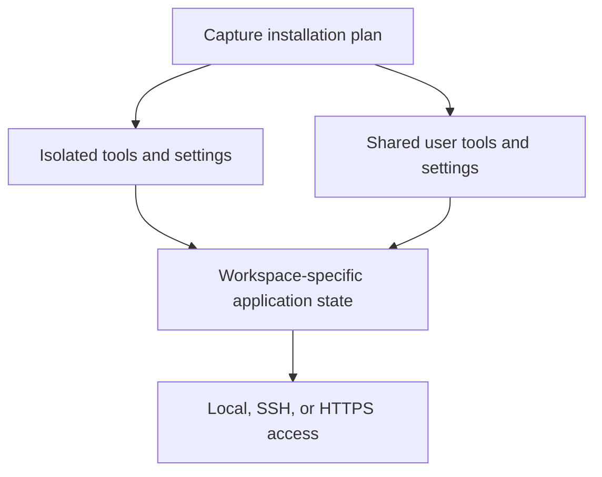

# Desktop and terminal-only Server installation

The native console installer carries Node/Python and the qualified product kit.
Provider software, SDKs, and speech models can need later explicit downloads.

| Role | Payload |
| --- | --- |
| Desktop | Native shell, complete interface, local backend |
| Server | Backend/runtime; no frontend, Tauri executable, or WebView requirement |
| Client | Interface/native connection shell, remote-only; no backend or localhost gateway |

Desktop/Server share independent product packages and receipts. First-party products
are 0.1.0-beta. See [Client](../../../web/docs/client.md).



Run from native PowerShell or macOS/Linux terminal:

```powershell
.\Aixand-Server-windows-x86_64-setup.exe
```

```sh
chmod +x ./Aixand-Server-linux-x86_64-setup
./Aixand-Server-linux-x86_64-setup
```

Choose Install/Update/Repair/Reset/Uninstall. Windows needs a new terminal for PATH;
macOS/Linux commands use `~/.local/bin`. Direct path:
`<application directory>/bin/aixand-server` (`aixand-server.exe` on Windows).
No source checkout/toolchain is required.

## Installation choices

| Choice / state | Contract |
| --- | --- |
| Isolated (recommended) | `<workspace>/software/products`; workspace settings/data, private commands; default for unattended fresh `--yes` |
| Shared | Normal user stores and selected UC connection; reuse compatible complete external tool commands, install missing products in independent product store |
| Workspace data | Auth/chats/Carrier/workflow service state remains workspace-specific in either mode |
| Shared manager root | `${XDG_DATA_HOME:-~/.local/share}/aixand/manager`; product dirs `agent`, `conversation`, `mcp`, `prompt`, `skill` |
| State/config | `agent/state`, `agent/home`, `conversation/state`; `agent/providers.toml`, `conversation/config.toml` |
| Override | `AIXAND_MANAGER_ROOT`; explicit product home/config takes precedence; empty/relative XDG data uses `~/.local/share`; record resolved paths |
| Settings | Isolated `fresh` or `copy`, Shared `reuse`; copy can include credentials/external paths but not accounts, live DBs, runtime connections; source unchanged |
| Compatibility | Reuse receipt-matched versions; recheck external tools before start; external UC must match bundled version or update/use Isolated |
| Saved plan | Schema 2 at `<workspace>/config/installation-plan.json`; preserve through restart/repair/update; reject unsupported/retired/missing populated-workspace plans without moving data |
| Existing workspace | Retain saved mode; setup does not infer ownership or switch modes |
| UI | Arrows/Enter, Space checkboxes, A all, Esc cancel; scroll short terminals; `NO_COLOR`; paths/ports/password text input; scripts explicit options |

```sh
aixand-server setup --installation-mode isolated --settings fresh
aixand-server setup --installation-mode shared --settings reuse
```

`--yes` alone never selects deletion. Shared UC sessions retain instance identity;
normal stop targets only this instance. Shared removal reviews affected processes.
Suite API/Python dependencies stay in the application runtime.

## Setup and operation

Setup reviews directories, products/terms, conflicts, hidden password entry, and
optional user-login startup. Provider installation/sign-in can happen later.

```sh
aixand-server setup
aixand-server configure
aixand-server start
aixand-server status
aixand-server logs server
aixand-server doctor
aixand-server stop
```

| Command / policy | Effect |
| --- | --- |
| `run` | Foreground; Ctrl+C stops this workspace |
| `start` | Background managed services, survives terminal/SSH loss |
| `startup enable/status/disable` | After user login only: macOS LaunchAgent, limited Windows logon task, Linux systemd user session; no root/SYSTEM or boot service |
| Providers | Agent Manager under captured workspace config; vendor login may need external browser |
| Missing standard preferences | Bundled Agent Manager defaults; custom config must exist; doctor prepares missing defaults and preserves preferences |
| Network | Loopback 8753 by default; origin changes require service restart |
| Authority | Single OS owner, not multi-user account isolation |

### Provider setup

Configure provider software and sign-in on the Server host:

```sh
aixand-server providers install
aixand-server providers codex login
```

Current Suite provider scope is Codex and OpenCode. Use
`aixand-server providers --help` and provider-specific help
for other supported login options. Sign-in alone does not establish model access;
verify it with a completed conversation from Client. See [profile sign-in](../../../../docs/onboarding/profiles-sign-in.md).

## Connecting Desktop

| Boundary | Contract |
| --- | --- |
| Full Desktop | Bundled interface via private loopback gateway; checks Host/Origin/access cookie, isolates connections, translates only Aixand session cookies |
| Remote connection | Preserve HTTPS certificate/auth/CSRF checks; remote content cannot launch native maintenance |
| Selected address | Server root, including SSH `http://127.0.0.1:8753/`; host owns projects/tools/accounts/work |
| Frontend-free Server | No browser UI at `/`; source web mode is separate; historical thin clients need web-serving backend |
| State | One active backend per workspace; separate instances need separate state/ports |
| UC connections | Instance-specific new names, reuse existing Suite records, preserve terminal-selected/permanent `default` profile |

## Connect to a separate Server

These instructions are for advanced users connecting Client or full Suite to a
separately hosted Server. Normal full Suite use with **This computer** manages
its local connection automatically. Isolated and Shared tool installation are
independent of this network configuration.

Run `aixand-server` commands on the Server host, in a terminal or through SSH.
The commands below work in POSIX shells and PowerShell. They assume the default
Server port, 8753, and an installed Server command on `PATH`.

### Connect through an SSH tunnel

For a fresh Server, complete setup interactively on the host. This creates the
workspace password without exposing it in a command-line argument:

```sh
aixand-server setup
aixand-server start
aixand-server status
```

With the default loopback configuration, no origin changes are needed for this
tunnel. On the client computer, replace `user@server-host` with your SSH login
and destination. An SSH client and access to that host are required.

```sh
ssh -N -o ExitOnForwardFailure=yes -L 127.0.0.1:8753:127.0.0.1:8753 user@server-host
```

Keep the SSH command running. In Client, save `http://127.0.0.1:8753/` as the
Server address. In full Suite, choose Server and enter the same address. Sign in
with the workspace password. A successful connection opens the host's workspace.
The frontend-free Server does not provide a browser interface at that address.

If local port 8753 is already occupied, choose another unused local port, such
as 18753, in the first port position of `-L`. Connect to
`http://127.0.0.1:18753/` and include `http://127.0.0.1:18753` in the Server's
configured origins using the configuration procedure below with
`--transport loopback`. Keep all required loopback origins in that list.

Close Client's workspace connection and press Ctrl+C in the SSH terminal to
close the tunnel. This does not stop Server or its running work. Client neither
creates the tunnel nor starts the remote services.

### Connect through an HTTPS reverse proxy

Complete `aixand-server setup` on the host before enabling remote access. This
creates the password locally. Initial HTTP password creation through a reverse
proxy is rejected; normal sign-in works through the configured HTTPS proxy.

You need a domain, a TLS certificate trusted by the client computer, and a
reverse proxy that can reach Server's loopback listener. These commands configure
Aixand; they do not install a proxy, configure DNS, or obtain a certificate.

Replace `https://suite.example.com` with your public origin, without a path or
trailing slash. The example assumes the proxy connects to Server from
`127.0.0.1`. Use the proxy's actual peer IP address if different.

Configuration changes require stopped services and disabled automatic startup.
Stopping the workspace interrupts its services; choose a suitable maintenance
time. First check whether automatic startup is enabled:

```sh
aixand-server startup status
```

If enabled, disable it before changing configuration:

```sh
aixand-server startup disable
```

Then stop the workspace, save its network settings, and start it again:

```sh
aixand-server stop
aixand-server configure --yes --transport https-proxy --origins https://suite.example.com --trust-proxy 127.0.0.1
aixand-server start
aixand-server doctor
```

`configure --yes` saves the supplied settings without interactive path and port
prompts. It preserves workspace data. If automatic startup was enabled before
the change, restore it with `aixand-server startup enable`.

Configure the reverse proxy to:

- Terminate HTTPS with the trusted certificate.
- Forward API and WebSocket traffic to `http://127.0.0.1:8753`.
- Preserve Host, Origin, and cookie headers, and forward WebSocket upgrades.
- Set `X-Forwarded-Proto: https` for requests received over HTTPS.

Trust only actual proxy peer addresses. Forwarded HTTPS headers from other peers
do not establish a secure connection. Server continues to bind loopback; do not
try to expose it by changing the production listener to `0.0.0.0`.

Open Client or Suite's Server connection window and enter
`https://suite.example.com/`. Sign in and open a conversation or terminal to
check both authenticated requests and live WebSocket traffic. Use
`aixand-server doctor` and `aixand-server logs server` on the host if it fails.
A healthy `/api/health` response alone does not verify authenticated access.

### Understand origins and authentication

An origin is the scheme, hostname, and port. It contains no path or trailing
slash. `https://suite.example.com`, `http://suite.example.com`, and
`https://suite.example.com:8443` are different origins. `localhost` and
`127.0.0.1` are also different hostnames.

Native Client sends the selected Server address's origin for HTTP and WebSocket
requests. Allow that origin, rather than a Tauri origin or the client computer's
LAN address. Multiple exact origins use a comma-separated value:

```sh
aixand-server configure --yes --transport https-proxy --origins "https://suite.example.com,https://suite.example.com:8443" --trust-proxy 127.0.0.1
```

Use the same disable-startup, stop, configure, start, and restore-startup sequence
above. `--origins` replaces the list; include every origin you intend to retain.
HTTPS proxy mode requires HTTPS origins. Loopback mode requires loopback origins.

Allowed origins do not grant access by themselves. Protected operations require
an authenticated session, and mutations also require a valid CSRF token.
WebSocket connections validate the session and exact origin. The workspace
password grants the authority of the Server's OS user; it is not a multi-user
account system. See [authentication](authentication.md) for session and recovery
details.

### Troubleshoot a remote connection

| Symptom | Check and corrective action |
| --- | --- |
| Connection refused or timeout | Run `aixand-server status` on the host. Check the SSH tunnel or proxy upstream address and port. |
| Client rejects an HTTP network address | Use HTTPS, or connect through SSH at an HTTP loopback address. |
| `Origin is not allowed` | Match the selected Server address's scheme, hostname, and port to the configured origin list. Restart services after configuration changes. |
| `HTTPS is required. Local connections need explicit loopback HTTP configuration.` | For HTTPS, check the actual proxy peer and its `X-Forwarded-Proto: https` header. For SSH, use loopback transport and an allowed loopback origin. |
| `Sign in required` | Sign in through the selected connection again; its session may have expired or been revoked. |
| `Invalid CSRF token` | Reload the workspace and sign in again if needed. Check that the proxy preserves cookies and uses the same selected origin. |
| Login succeeds but live updates fail | Check WebSocket upgrades, Origin forwarding, and cookies at the proxy. Inspect Server logs for authentication rejection. |
| `configure` refuses to save | Stop the workspace services and disable automatic startup before changing configuration. |

The owning checks are [production configuration](../../src/production.ts),
[transport and origin validation](../../src/auth/config.ts),
[authentication](../../src/auth/auth.service.ts),
[native Client transport](../../../desktop/src-tauri/transport/src/lib.rs), and
[saved Server configuration](../../../../scripts/runtime/server-installer.mjs).


## Repair, reset and removal

| Operation / flag | Effect |
| --- | --- |
| Application repair | Fresh qualified setup executable; `aixand-server repair` reinstalls/verifies product kit; updates/repair preserve workspace and accounts |
| Uninstall scope | Application, tools, both, or Everything managed by Aixand; Everything includes available managed software/settings/data; provider logins require their own choice |
| Other scopes | Ask keep/remove settings and data; final review lists removed/kept paths; reset keeps software |
| Components | Private tools, shared products, tool data, accounts, provider software, retained runtimes stay distinct; shared-store records need every product removed |
| Unsupported uninstaller | Report and keep; use original installer/package manager |
| Missing application | Setup executable can still remove supported tools/data; `--directory` selects app, `--home` selects workspace without app record; offer another path/Exit |
| Automation | `--remove-target application\|tools\|both\|everything`, `--purge`, `--yes`; Everything includes managed data without purge |
| Additional files | `--existing-files remove` explicitly permits removal; otherwise automation preserves them |
| Selection/output | `--purge` stays in chosen scope; `--select COMPONENT`, `--all`; `--json` result on stdout, review on stderr |
| Existing nonempty app dir | Without installation record, review backup to unique timestamped sibling / permanent remove / another path / cancel; removal needs confirmation |
| Unattended recovery | `install --existing-files backup\|remove --yes`; bare `--yes` never authorizes removal; verify payload, reject unsafe/redirected paths; retain backup outside install |
| Execution | Disable affected startup, stop owned services, check selected-path processes; separate shared-process review; report partial completion; keep personal projects outside managed stores |
| Windows final removal | Installed command exits before helper removes app files; external result log; helper waits, never kills to delete; other cleanup reported first |

Removal is not one cross-component transaction. Failed/blocked components remain
explicit. Review data and process ownership before applying the selected plan.

## Build and qualification

```sh
python3 scripts/package-linux.py --engine podman --package server --without-voice
python3 scripts/package-macos.py --output /absolute/build --package server --without-voice
```

```powershell
.\build-windows.ps1 -Package server -WithoutVoice
```

`--package desktop`, `client`, `server`, `both` (Desktop and Server), or
`all` (the default, all three installers) selects package roles. The installation
model is distributed. `--runtime-only` emits verified runtime archives without native
installers. Server-only builds skip frontend compilation and Tauri packaging.
Native installers embed the exact verified archive in the executable, allowing
native code signing to cover the payload. Publication and platform signing or
notarization require separate release configuration and qualification.

Qualification uses disposable homes, state directories, ports and receipts. It
checks headless startup, APIs/authentication, restart, independent products,
console extraction, corruption/escape refusal, and selective maintenance. A
successful cross-platform source check does not substitute for native runtime
and installer execution on that target.
