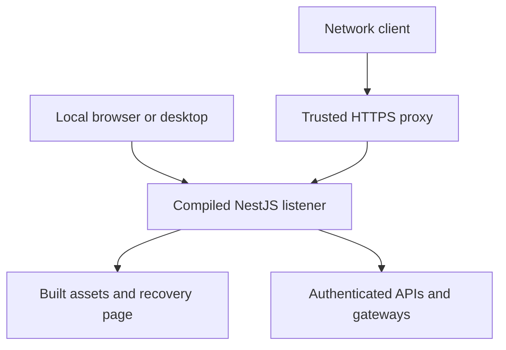

# Production web service and connected desktop client

The combined source web mode serves built assets, `/recovery.html`, downloads,
`/api/*`, and WebSockets on **127.0.0.1:8753**. This differs from the frontend-free
Server installer role. Vite is only for development.



## Build

From Suite root with development dependencies prepared:

```sh
node scripts/production.mjs build
```

Builds Web assets and Nest. Run `./dev.sh prepare` from the Suite root separately
to regenerate the Connect companion download; Web dev/build do not regenerate it.
Does not start/install Runner,
Carrier, managers, providers, Python environments, or MCP servers.

## Configure

Precedence: process environment → `.env.production` → `apps/server/.env`.
Development `PORT`, `HOST`, and origins cannot choose the production listener.
Copy `.env.production.example` only for explicit overrides.

| Setting | Default / purpose |
| --- | --- |
| `AIXAND_PRODUCTION_PORT` | `8753`; integer from 1 to 65535 |
| `AIXAND_PRODUCTION_HOST` | `127.0.0.1`; `::1` is also supported |
| `AIXAND_PRODUCTION_ORIGINS` | `http://127.0.0.1:8753,http://localhost:8753`; exact frontend origins |
| `AIXAND_PRODUCTION_WEB_DIST` | Sibling `apps/web/dist`; must contain both HTML entry points |
| `AIXAND_PRODUCTION_TRANSPORT` | `loopback` for local/SSH, or `https-proxy` |
| `AIXAND_PRODUCTION_TRUST_PROXY` | Exact proxy peer addresses; required in HTTPS proxy mode |

A different SSH forwarding port needs its exact browser origin. Production origins
replace the development list.

## Start and switch an existing installation

From Suite root; requires the existing Undercurrent daemon:

```sh
./dev.sh serve --production
```

| Situation | Behavior |
| --- | --- |
| Start | Detached managed Carrier/Runner/backend; reuse healthy services; no Vite or automatic rebuild |
| Readiness | Built frontend, recovery page, backend health at the combined address |
| Switch managed development | Preflight build/config/ownership/runtime; gracefully replace backend and Vite; reuse Carrier/Runner, preserve workspace data; brief disconnect |
| Other checkout / unmanaged backend | Report and leave alone; no second owner of the same databases/workers/sockets |
| Rebuild | Run build explicitly before restarting compiled code |
| Return to development | Stop managed backend, then `./dev.sh serve`; plain serve refuses active production replacement |
| Parallel testing | Separate complete runtime config and disposable state |
| Sessions | Preserve auth database; derived cookie namespace; sign in again; cookies are not port-isolated, browser preferences are origin-specific |

Preview without changing services:

```sh
./dev.sh serve --production --dry-run
```

Stop the managed Suite:

```sh
./dev.sh stop --production
```

Stop includes labelled agents/workers, preserves data, leaves Undercurrent running.
Low-level root `node scripts/production.mjs serve` or Server `npm run start:prod`
are foreground backend-only commands: stop the existing backend first; these do
not supervise Carrier/Runner.

Host liveness check:

```sh
curl http://127.0.0.1:8753/api/health
```

Open `http://127.0.0.1:8753/` and sign in. Health is Nest liveness, not provider
or complete runtime readiness.

## Windows over SSH

Client computer: native Windows PowerShell, or WSL for the Linux/WSLg application:

```powershell
ssh -N -o ExitOnForwardFailure=yes -L 127.0.0.1:8753:127.0.0.1:8753 user@server-host
```

Replace the example SSH identity/host with your own. Keep tunnel open and use
`http://127.0.0.1:8753/`. Projects/tools/work belong to the remote host. See
[desktop build](../../../web/docs/desktop.md); old port-5173 previews need rebuild.

## HTTPS network deployment

```dotenv
AIXAND_PRODUCTION_TRANSPORT=https-proxy
AIXAND_PRODUCTION_ORIGINS=https://aixand.example.com
AIXAND_PRODUCTION_TRUST_PROXY=127.0.0.1
```

| Proxy requirement | Rule |
| --- | --- |
| Values | Actual domain and proxy peer; upstream loopback port 8753 |
| Headers | Preserve Host, Origin, cookies, upgrades; trusted proxy sets `X-Forwarded-Proto: https` |
| Transport | Disable both loopback HTTP exceptions in proxy mode |
| First password | Local-only; complete through local/SSH setup first |
| Connection window | Accepts HTTPS network or HTTP loopback; creates no tunnels and starts no remote services |

Use the [installed-host runbook](installation.md) for packaged lifecycle behavior.
