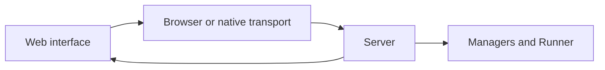
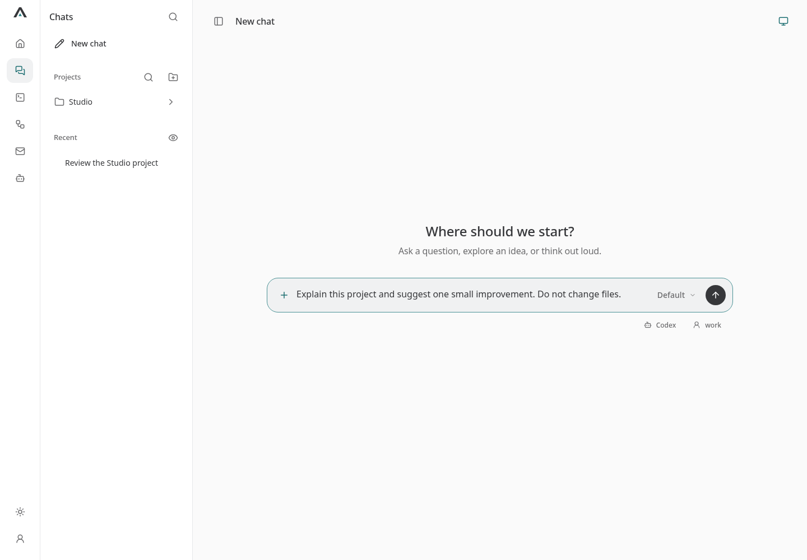

# Web component

Web presents workspace state and sends explicit actions to Server. Desktop supplies the native shell and selected-host transport; managers and Runner retain execution authority.

## State and boundaries

| Concern | Contract |
| --- | --- |
| Start here | Read architecture, then the lifecycle relevant to the feature. |
| Change a feature | Read its module page, implementation status and linked source/tests. |
| Ownership | Do not recreate authoritative transcripts, queues or execution lifecycles in React state. |

## Reading map

| Section | Pages |
| --- | --- |
| Architecture | [Composition](architecture/composition.md), [state](architecture/state.md), [transport](architecture/transport.md) |
| Lifecycles | [Authentication](lifecycles/authentication.md), [live state](lifecycles/live-state.md), [recovery](lifecycles/recovery.md) |
| Modules | [Workspace](modules/workspace.md), [conversations](modules/conversations.md), [supervision](modules/supervision.md), [providers](modules/providers.md), [resources](modules/resources.md), [builder](modules/workflow-builder.md), [runs](modules/workflow-runs.md), [terminals](modules/terminals.md), [Carrier](modules/carrier.md), [Connect](modules/connect.md), [Vox](modules/vox.md), [settings](modules/settings.md) |
| UI contracts | [Drafts](contracts/drafts.md), [content safety](contracts/content.md), [design and accessibility](contracts/design.md) |
| Development | [Verification](development/verification.md), [screenshots](development/screenshots.md), [implementation status](implementation-status.md) |

Existing precise references remain available: [chat commands](chat-commands.md), [native Client](client.md), [Desktop](desktop.md), [updates](updates.md), [editions](installation-editions.md), [release versions](release-versions.md).

## Interface snapshot

Real Web interface with isolated fixture data, 1440 × 1000, light theme.

## Source and verification

[src/App.tsx](../src/App.tsx), [src/auth/transport.ts](../src/auth/transport.ts).

