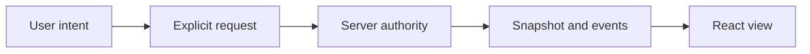

# State ownership

React holds selections, drafts and rendered projections. Server responses and manager events determine durable workspace state.

## State and boundaries

| Concern | Contract |
| --- | --- |
| Local | Theme, selection and unsaved edits are presentation state. |
| Remote | Chats, approvals, provider observations and executions come from their owning service. |
| Staleness | A resolved request can be obsolete after navigation; do not replace newer selections with late results. |
| Storage | Inspect each feature storage key and native connection isolation. The generic storage helper is not a global namespace policy. |

## Source and verification

[src/storage.ts](../../src/storage.ts), [src/agents/client.ts](../../src/agents/client.ts), [src/workspace/model.ts](../../src/workspace/model.ts).

Relevant checks: [chat-cache.spec.ts](../../tests/chat-cache.spec.ts), [chat-sync.spec.ts](../../tests/chat-sync.spec.ts). Fixture tests verify presentation and interaction; they do not establish live service availability.
