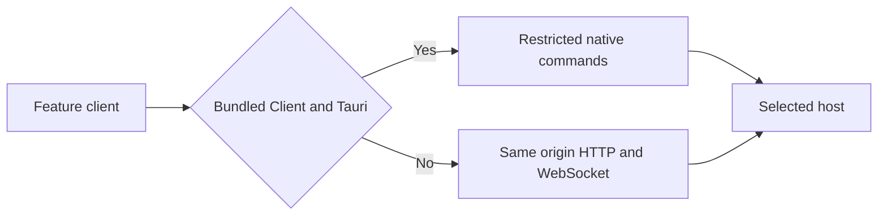

# Browser and native transport

workspaceFetch and workspaceSocket select the browser or bundled Client transport. The selected host remains the destination of workspace operations.

## State and boundaries

| Concern | Contract |
| --- | --- |
| Browser | Use the shared authenticated transport rather than constructing a bypass. |
| Native | client_request and client_socket commands carry restricted requests through the shell; native cookies stay native. |
| Cancellation | Abort/unmount stops delivery to consumers; do not infer remote work was cancelled. |
| Connection switch | Generation and close invalidation prevent old connection replies from updating a new workspace. |
| Backpressure | Native socket sends are serialized and bounded; handle failures instead of accumulating unbounded output. |

Native connection persistence and host trust belong to [Client](../client.md) and [Desktop](../desktop.md).

## Source and verification

[src/auth/transport.ts](../../src/auth/transport.ts), [src/auth/client.ts](../../src/auth/client.ts).

Relevant checks: [connection-recovery.spec.ts](../../tests/connection-recovery.spec.ts). Fixture tests verify presentation and interaction; they do not establish live service availability.
