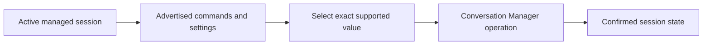

# Use managed chat commands

Conversation Manager owns Codex/OpenCode chat sessions in the local beta. The active session advertises its command catalog and settings; `/` opens the picker with reasons for disabled entries.

## Choose a setting

| Concern | Contract |
| --- | --- |
| Support | An advertised reference is not necessarily executable. Terminal-only references remain unsupported in managed chat. |
| Settings | Picker/model-panel values must be supported by the active session; changes can require idle state. |
| Confirmation | Use Conversation Manager confirmation rather than a cached draft catalog. A model list does not prove entitlement. |
| Execution | Provider-native commands use the retained session. Do not synthesize provider RPC names or start a replacement terminal when an operation is unavailable. |
| Retries | Preserve the exact selected value and operation identity. |

## Preserve intent and recovery

| Concern | Contract |
| --- | --- |
| Turn identity | Follow-ups, approvals, questions and cancellation retain conversation/turn identities. |
| Unknown outcome | Inspect unconfirmed work before retrying. |
| Reopen | Restore the exact native session where supported; do not resend previous messages or commands. See [application recovery](../../server/agent-bridge/application/README.md). |
| Resources | Libraries are independent of profiles. Explicitly select supported managed instructions/MCP tools for new chats. Native skill delivery and advanced workflows need separate qualification. |

Ownership: [command catalog UI](../src/chats/commands.ts), [Suite chat adapter](../../server/agent-bridge/application/chats.py), [agent integration](../../../docs/development/agent-integration.md) and [Conversation Manager integration](../../../docs/development/conversation-integration.md).
