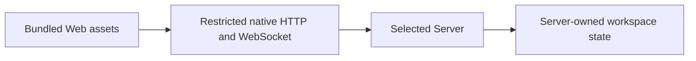

# Aixand Client

Client bundles the interface and native shell for remote Server workspaces. It can connect to a frontend-free Server and installs independently as `org.aixand.suite.client` alongside Desktop.

| Role | Payload | Workspace |
| --- | --- | --- |
| Desktop | Interface, shell, backend and product runtimes | This computer or Server |
| Client | Interface and shell | Server only |
| Server | Backend and product runtimes | Hosts the workspace |



## Connection and trust

| Concern | Contract |
| --- | --- |
| Payload | No localhost gateway/listener, agent processes, Node, Python or first-party installation kit. OS WebView/native TLS dependencies remain; Windows can install WebView2. |
| Addresses | HTTPS for network hosts; loopback HTTP supports an existing SSH tunnel. Client creates no tunnel and starts no remote service. |
| Server origin | Allow the Server root HTTPS origin using the [Server proxy configuration](../../server/docs/operations/authentication.md). |
| Transport | Tauri loads bundled assets; restricted native commands send requests to the selected host. Certificates use native trust; cross-host redirects are refused. |
| Sessions | Native code holds cookies and original expiry in per-user configuration. POSIX session files use 0600; passwords are not saved. |
| Authorization | Normal password, transport, Origin and CSRF checks apply. Workspace content has no launcher, cleanup, runtime or process-execution permissions. |

## Connection isolation and maintenance

| Concern | Contract |
| --- | --- |
| Connection window | Saved servers, optional names, automatic opening, connection health and reconnect. |
| Windows/Linux | Each saved connection/backend address has separate sessions and browser data directory. |
| macOS | Ephemeral workspace WebView isolates browser data without macOS 14 APIs. Saved connections/native sessions persist; browser preferences, drafts and caches do not survive workspace closure. |
| Switching | Close the old workspace and cancel its native traffic. Reject requests carrying the old connection generation. |
| Updates | Client updates in the connection window or a newer installer; retain saved connections/sessions. Daily checks and optional downloads never authorize installation/restart. |
| Reset | Client settings → Clear Client data clears local connections, sessions and browser data; Server is unchanged. |
| Removal | OS uninstall preserves per-user data unless cleared first. Workspace component updates belong to Server. |

## Building

From the Suite root:

```sh
python3 scripts/package-linux.py --package client --output /fresh/client-build
python3 scripts/package-macos.py --package client --output /fresh/client-build
```

```powershell
.\build-windows.ps1 -Package client -OutputDirectory C:\fresh\client-build
```

| Concern | Contract |
| --- | --- |
| Role selection | all (default) builds Desktop/Server/Client; both retains Desktop/Server meaning. Individual desktop/server choices remain. |
| Client-only | Skip backend compilation, product builds and runtime assembly. Build tools and build-time Node do not ship. --runtime-only applies only to runtime-bearing roles. |
| Artifacts | output/installers/client and checksums; installers.json records the role. Signing/public distribution use normal release configuration. |
| Feed inputs | AIXAND_CLIENT_UPDATE_CONFIG supplies public trust settings; AIXAND_CLIENT_SEQUENCE must be a positive safe integer. Optional AIXAND_CLIENT_VERSION must match the application version. |
| Identity | Linux wrapper forwards inputs. Packaging reads native identity into client.json.nativeUpdater; release preparation rejects version, sequence, trust or checksum mismatch. Checked-in feed remains disabled. |

## Verification

```sh
npm --prefix apps/web run test:client
npm --prefix apps/web run test:desktop
cargo test --manifest-path apps/desktop/src-tauri/transport/Cargo.toml
python3 -m unittest discover -s scripts/runtime -p test_client_package.py
```

| Concern | Contract |
| --- | --- |
| Linux packaged probe | scripts/runtime/verify-client.py drives WebKitWebDriver under Xvfb. client-auth-test-server.mjs uses real Server authentication with a disposable database and authenticated echo socket. |
| Covered boundaries | Login/cookie persistence, API/socket authentication, reconnect, isolation, stale requests, permissions, local reset and app-owned TCP listeners. |
| Qualification limit | Does not qualify every agent feature. Windows/macOS native builds and installations require their own platform checks. |

