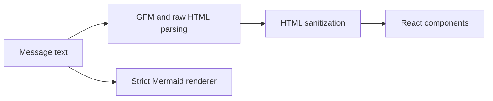

# Content rendering and safety

Conversation content is untrusted data. Markdown and Mermaid use explicit rendering boundaries before content reaches the interface.

## State and boundaries

| Concern | Contract |
| --- | --- |
| Markdown | rehypeRaw runs before rehypeSanitize; keep sanitization in the rendering path. |
| Mermaid | Strict security mode and secured configuration prevent message text from weakening renderer policy. |
| Links | Inspect custom content link handling before adding protocols or native open actions. |
| Errors | Invalid diagrams/content should produce bounded, readable failure states rather than break the conversation. |

## Source and verification

[src/chats/MessageContent.tsx](../../src/chats/MessageContent.tsx), [src/chats/MermaidDiagram.tsx](../../src/chats/MermaidDiagram.tsx), [src/components/ContentLink.tsx](../../src/components/ContentLink.tsx).

Relevant checks: [agents-content.spec.ts](../../tests/agents-content.spec.ts). Fixture tests verify presentation and interaction; they do not establish live service availability.
