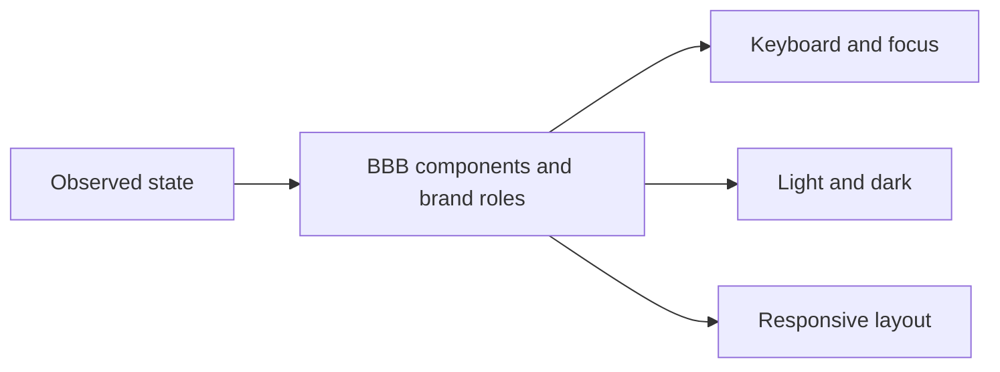

# Design and accessibility

Use BBB components and Suite brand roles to make observed state, next actions and recovery understandable across themes and viewports.

## State and boundaries

| Concern | Contract |
| --- | --- |
| Hierarchy | Show the object state and useful next action before optional diagnostics. |
| Focus | Dialogs, menus and route changes must preserve an understandable keyboard path. |
| Responsive | Check narrow layouts, long content and terminal geometry; screenshots are not an accessibility test. |
| Motion | Honor reduced-motion preferences. Verify both themes rather than relying on a light screenshot. |

## Source and verification

[src/App.tsx](../../src/App.tsx), [src/main.tsx](../../src/main.tsx).

Relevant checks: [agents-layout.spec.ts](../../tests/agents-layout.spec.ts), [chat-focus.spec.ts](../../tests/chat-focus.spec.ts), [terminal-layout.spec.ts](../../tests/terminal-layout.spec.ts). Fixture tests verify presentation and interaction; they do not establish live service availability.
