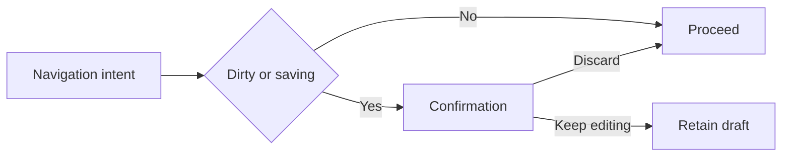

# Draft and navigation contracts

The shared editor guard protects dirty or saving resource edits across navigation and browser unload.

## State and boundaries

| Concern | Contract |
| --- | --- |
| Mechanism | requestResourceNavigation emits the cancelable aixand:resource-navigation event. |
| Browser exit | beforeunload protects dirty editor state where supported by the browser. |
| Save | Reset dirty state after observed completion; a failed save must retain editable content. |
| Scope | This is a shared resource-editor guard, not proof that every feature draft is persisted. |

## Source and verification

[src/resources/editor/drafts.tsx](../../src/resources/editor/drafts.tsx), [src/resources/editor/ResourceEditor.tsx](../../src/resources/editor/ResourceEditor.tsx).

Relevant checks: [prompts.spec.ts](../../tests/prompts.spec.ts), [managed.spec.ts](../../tests/managed.spec.ts). Fixture tests verify presentation and interaction; they do not establish live service availability.
