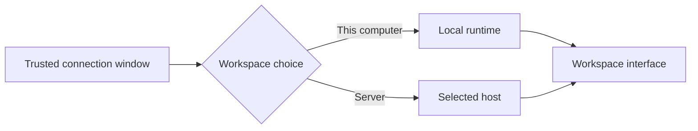

# Develop the desktop shell

Desktop wraps Web assets with Tauri. Native source and lockfile live in `apps/desktop`; [Web](../README.md) owns the interface. Development builds do not establish installer qualification or public availability.

## Choose a workspace



| Concern | Contract |
| --- | --- |
| Local | Loopback port 8753 by default. Choose Separate Suite installation (isolated, recommended) or Shared installation. |
| Storage | Isolated starts with fresh settings; Shared reuses selected normal user stores. Reopening preserves the saved plan. |
| Remote | Selected host owns authentication; shell creates no SSH tunnel or remote service. Read [authentication](../../server/docs/operations/authentication.md). |
| Onboarding | Tool installation and license acceptance happen inside workspace onboarding. |
| Maintenance | Connection-window Advanced controls service stop and reviewed maintenance. |
| Client | [Client](client.md) is remote-only with no local runtime; see [installation roles](installation-editions.md). |

## Run or build the shell

Install Node 24, Rust and target-OS Tauri prerequisites. Prepare Web/runtime inputs, then from `apps/desktop`:

```sh
npm ci
npm run desktop:dev
npm run desktop:build
```

| Concern | Contract |
| --- | --- |
| Commands | [package.json](../../desktop/package.json) defines shell commands. |
| Inputs | [Tauri configuration](../../desktop/src-tauri/tauri.conf.json) selects assets and runtime inputs. |
| Complete installer | Use root packaging tools. A shell build alone does not qualify a complete Desktop installation or backend readiness. |

## Export sources

From `apps/desktop`:

```sh
npm run desktop:export
```

The [export helper](../../desktop/scripts/export-desktop.py) defines archive contents. Build the archive on the target with its native prerequisites; Windows needs Microsoft C++ Build Tools. Linux cross-build output still needs native Windows tests.

Complete runtime packaging uses `scripts/package-linux.py`, `scripts/package-macos.py`, `scripts/package-windows.py` and `build-windows.ps1`. See [Server build and qualification](../../server/docs/operations/installation.md#build-and-qualification) for roles. Builds/exports do not publish installers.

## Preserve security and recovery

| Concern | Contract |
| --- | --- |
| Native permissions | Trusted connection window owns maintenance. Remote workspace content must not gain launcher, cleanup or process-execution access. |
| Transport | Retain session, exact Origin, CSRF and native certificate checks. |
| Consent | Review installation/removal plans. Account and workspace changes need consent separate from software installation. |
| Interruption | Retain operation IDs and receipts; inspect uncertain work before retrying. [Updates](updates.md) covers the disabled-by-default update foundation. |

