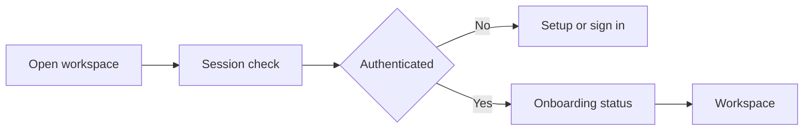

# Authentication and onboarding

Authentication and installation readiness gate the workspace. Onboarding presents observed setup progress before normal workspace navigation.

## State and boundaries

| Concern | Contract |
| --- | --- |
| Session | Keep session state, CSRF handling and expiry in auth clients/gates. |
| Installation | Installation status and provider readiness are separate from an authenticated browser session. |
| Capabilities | The top-level context gates voice/Vox; other feature clients have their own capability checks. |
| Failure | Show unavailable/retry state; an API failure is not an empty successful setup. |

## Source and verification

[src/auth/AuthGate.tsx](../../src/auth/AuthGate.tsx), [src/auth/OnboardingStartup.tsx](../../src/auth/OnboardingStartup.tsx), [src/capabilities.tsx](../../src/capabilities.tsx).

Relevant checks: [auth.spec.ts](../../tests/auth.spec.ts), [product-onboarding.spec.ts](../../tests/product-onboarding.spec.ts). Fixture tests verify presentation and interaction; they do not establish live service availability.
