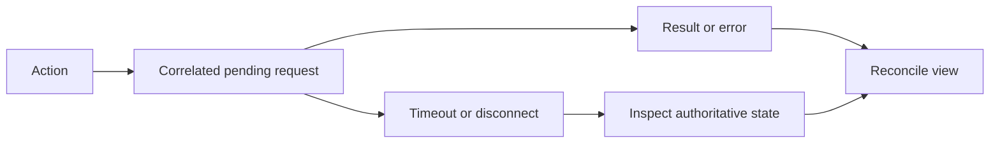

# Requests, events and mutations

Feature clients correlate requests and reconcile live events. A disconnected or timed-out submission can have an unknown remote outcome.

## State and boundaries

| Concern | Contract |
| --- | --- |
| Correlation | Use the owning client request IDs and pending map, not a second component protocol. |
| Events | Apply feature-specific revision, stream or run identity rules; no universal event ordering is assumed. |
| Retry | Preserve operation identity when supported. Re-read uncertain state before repeating a mutation. |
| Read versus action | Opening a report is read-only; acknowledgment, approval and execution are explicit actions. |

## Source and verification

[src/agents/client.ts](../../src/agents/client.ts), [src/workflows/client.ts](../../src/workflows/client.ts), [src/carrier/client.ts](../../src/carrier/client.ts), [src/terminals/connection.ts](../../src/terminals/connection.ts).

Relevant checks: [chat-sync.spec.ts](../../tests/chat-sync.spec.ts), [carrier.spec.ts](../../tests/carrier.spec.ts). Fixture tests verify presentation and interaction; they do not establish live service availability.
