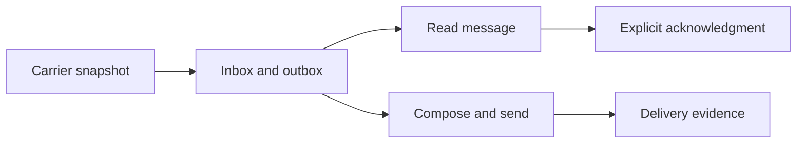

# Carrier inbox and delivery

Carrier projects messages, delegated work and delivery evidence into an inbox/outbox interface. Reading, delivery and acknowledgment are distinct events.

## State and boundaries

| Concern | Contract |
| --- | --- |
| Projection | Use Carrier client and model for counts, pagination and message identity. |
| Acknowledgment | Opening a message or report does not acknowledge it. |
| Delivery | Completed execution without a receipt must not claim successful delivery. |
| Navigation | Late reader responses must not reopen a dismissed item or replace a newer selection. |

## Source and verification

[src/carrier/client.ts](../../src/carrier/client.ts), [src/carrier/CarrierPage.tsx](../../src/carrier/CarrierPage.tsx), [src/carrier/CarrierMessageReader.tsx](../../src/carrier/CarrierMessageReader.tsx), [src/carrier/delegated.ts](../../src/carrier/delegated.ts).

Relevant checks: [carrier.spec.ts](../../tests/carrier.spec.ts), [carrier-delegated.spec.ts](../../tests/carrier-delegated.spec.ts). Fixture tests verify presentation and interaction; they do not establish live service availability.
