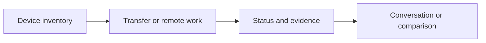

# Connect devices and remote work

Connect views present devices, transfers, remote conversations and project comparisons. UI contracts alone do not qualify the corresponding host integration.

## State and boundaries

| Concern | Contract |
| --- | --- |
| Devices | Pairing and inventory are distinct from a confirmed transfer. |
| Work | Show transfer, remote chat and project-run state from the owning service. |
| Authority | Do not infer local filesystem or conversation ownership from a remote card. |
| Current gap | Some retained remote-chat/project-run handlers are absent from the current Server tree; mark unavailable paths explicitly. |

## Source and verification

[src/connect/DevicesSettings.tsx](../../src/connect/DevicesSettings.tsx), [src/connect/TransferCard.tsx](../../src/connect/TransferCard.tsx), [src/connect/RemoteChatDialog.tsx](../../src/connect/RemoteChatDialog.tsx), [src/connect/ProjectComparisonCard.tsx](../../src/connect/ProjectComparisonCard.tsx).

Relevant checks: [connect.spec.ts](../../tests/connect.spec.ts), [remote-chat.spec.ts](../../tests/remote-chat.spec.ts), [project-run.spec.ts](../../tests/project-run.spec.ts). Fixture tests verify presentation and interaction; they do not establish live service availability.
