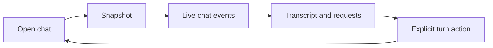
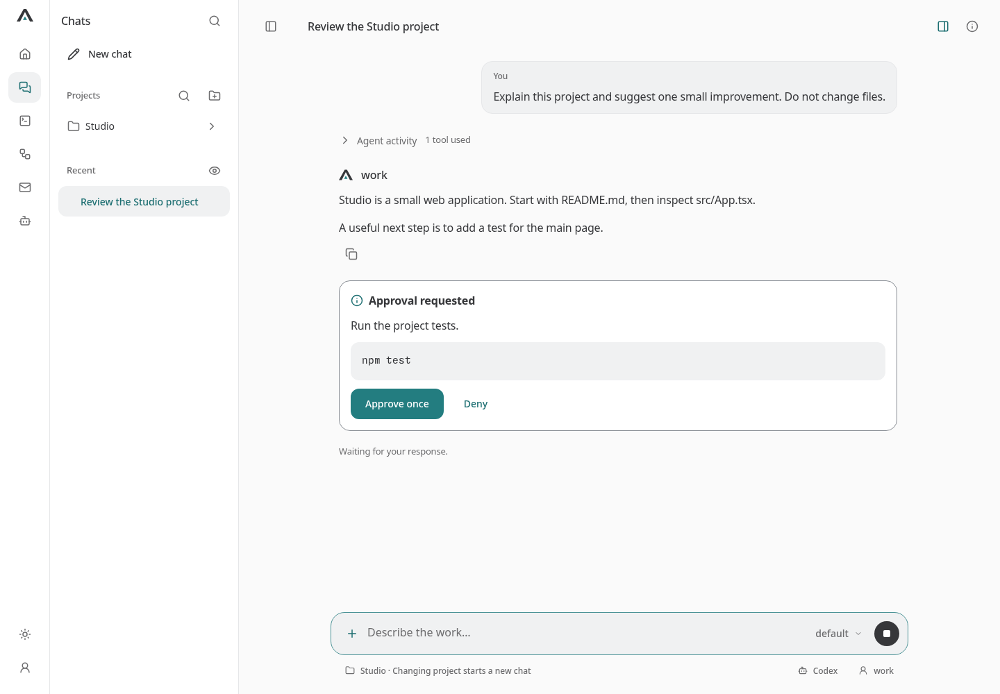
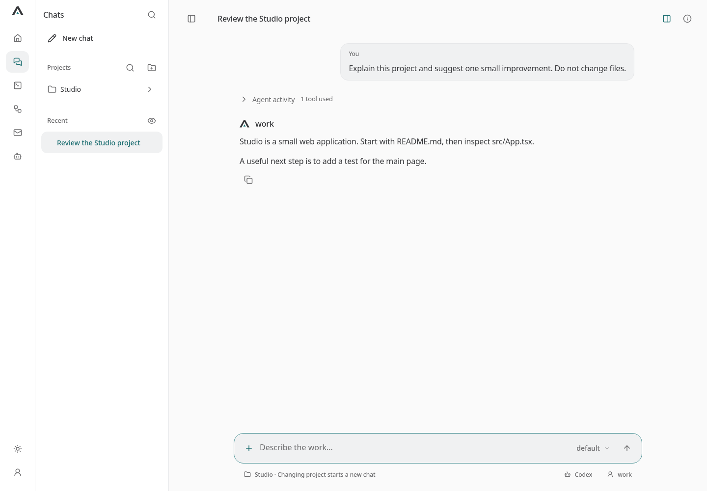

# Conversations and sessions

Conversation views render authoritative chat items, requests and turn state. Session readers expose related agent history without becoming a second conversation store.

## State and boundaries

| Concern | Contract |
| --- | --- |
| Transcript | Render item types and current turn state from the chat model. |
| Approvals | Show pending requests and require explicit answers; never infer consent from navigation. |
| Queue and steering | Expose only supported chat capabilities; preserve uncertain submission state. |
| Commands | Keep the exact slash-command and session-configuration contract in the existing reference. |

## Interface snapshot

Real Web interface with isolated fixture data, captured at 1440 × 1000 in the light theme. This shows interface structure, not backend readiness.

The completed transcript and pending-approval screenshots show different observed conversation states.

Exact configuration and command semantics: [chat command reference](../chat-commands.md).

## Source and verification

[src/chats/Conversation.tsx](../../src/chats/Conversation.tsx), [src/agents/client.ts](../../src/agents/client.ts), [src/sessions/SessionsPage.tsx](../../src/sessions/SessionsPage.tsx).

Relevant checks: [conversation.spec.ts](../../tests/conversation.spec.ts), [chat-followups.spec.ts](../../tests/chat-followups.spec.ts), [chat-commands.spec.ts](../../tests/chat-commands.spec.ts). Fixture tests verify presentation and interaction; they do not establish live service availability.
