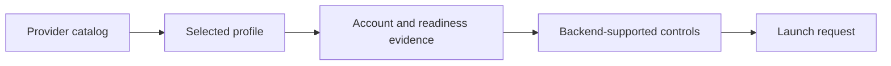
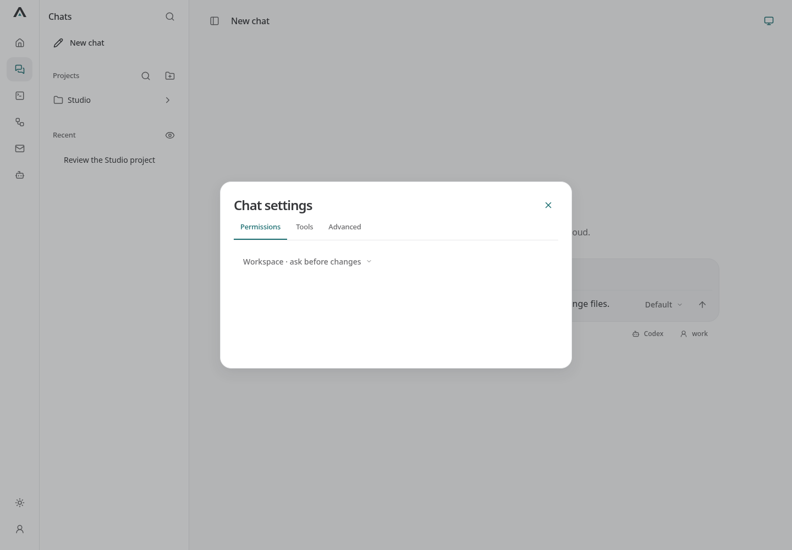

# Providers, profiles and readiness

Provider catalogs supply identities, controls and account observations. Web displays readiness evidence rather than treating a configured account as proof that a launch can run.

## State and boundaries

| Concern | Contract |
| --- | --- |
| Identity | Provider/profile/backend identities come from the catalog; avoid hardcoded provider lists. |
| Readiness | Terminal and chat readiness can differ. Show reason, verification and stale observations. |
| Resources | Profile resource revisions and launch selections have separate lifetimes. |
| Jobs | Installation/login jobs expose progress and blockers; a started job is not completion. |

## Interface snapshot

Real Web interface with isolated fixture data, captured at 1440 × 1000 in the light theme. This shows interface structure, not backend readiness.

## Source and verification

[src/agents/client.ts](../../src/agents/client.ts), [src/agents/ProfileSettings.tsx](../../src/agents/ProfileSettings.tsx).

Relevant checks: [profile-management.spec.ts](../../tests/profile-management.spec.ts), [account-status.spec.ts](../../tests/account-status.spec.ts), [agents-operations.spec.ts](../../tests/agents-operations.spec.ts). Fixture tests verify presentation and interaction; they do not establish live service availability.
